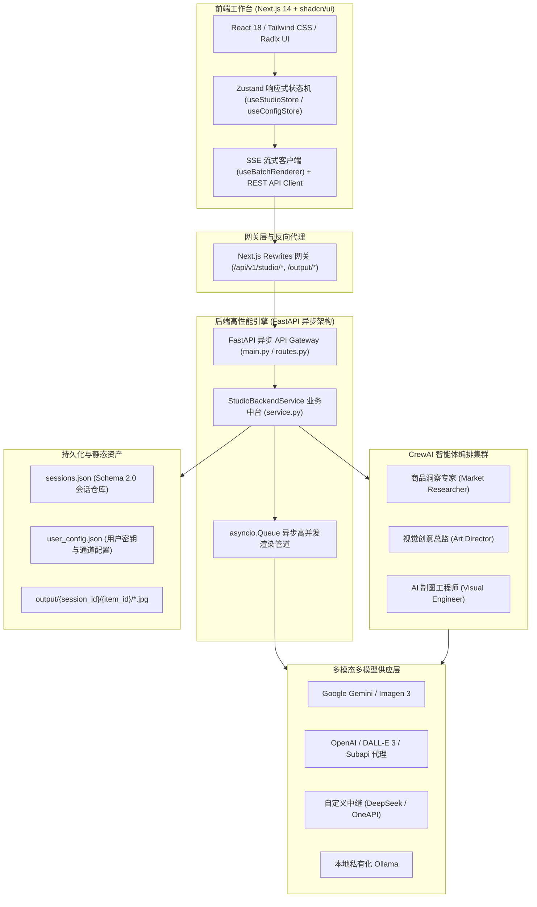
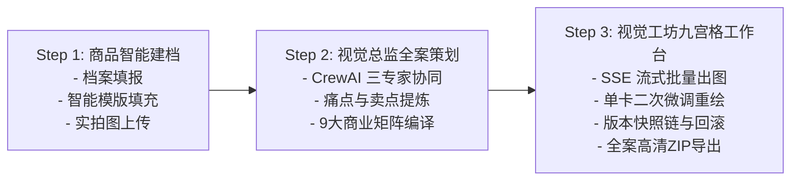
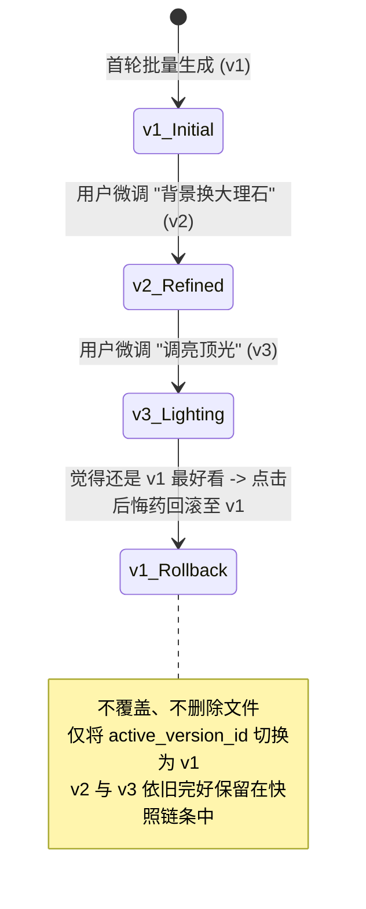
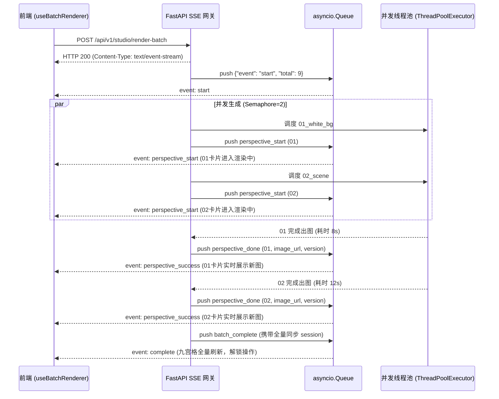
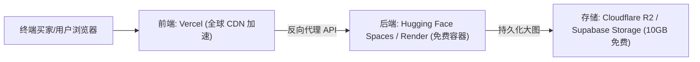

# 🛒 电商视觉工坊 (Ecommerce Studio) · 全栈功能交接与系统设计文档

> **文档版本**: v2.1.0 (Refactored)  
> **更新时间**: 2026-11-21  
> **适用受众**: 产品经理、前端/后端工程师、运维工程师、测试专家及项目交接人  
> **代码仓库分支**: `refactor/nextjs-fastapi-studio`

---

## 目录
1. [项目概况与商业定位](#1-项目概况与商业定位)
2. [总体系统架构与技术选型](#2-总体系统架构与技术选型)
3. [核心功能矩阵与三阶段流水线](#3-核心功能矩阵与三阶段流水线)
4. [核心关键技术实现与设计细节](#4-核心关键技术实现与设计细节)
   - 4.1 9大电商转化视角矩阵与心理学标签
   - 4.2 非破坏性多版本快照链条与“后悔药”原子回滚
   - 4.3 `asyncio.Queue` 事件驱动 SSE 流式并发渲染管道
   - 4.4 多模型与代理中继即时探测与热切换系统
5. [API 接口契约规范与全景清单](#5-api-接口契约规范与全景清单)
6. [数据存储与会话模型 (Schema 2.0)](#6-数据存储与会话模型-schema-20)
7. [运维与自动化启停体系](#7-运维与自动化启停体系)
8. [质量保障与自动化测试体系](#8-质量保障与自动化测试体系)
9. [免服务器 (Serverless) 免费部署指南](#9-免服务器-serverless-免费部署指南)
10. [常见问题定位与运维排障手册](#10-常见问题定位与运维排障手册)

---

## 1. 项目概况与商业定位

### 1.1 背景与定位
**电商视觉工坊 (Ecommerce Studio)** 是一套专为现代电商卖家、品牌主理人与视觉设计师打造的 **AI 商业视觉全案与高转化主图生成工作台**。

项目摆脱传统文生图工具“单图偶发性、缺乏商业转化逻辑、风格不统一、不可迭代回溯”的缺陷，创新性地将**国际 4A 广告策划流程**与**多智能体（Multi-Agent）协同架构**融合，以买家下单顾虑为靶心，自动输出契合真实商业场景的 **9 大视角主图矩阵**。

### 1.2 核心业务价值
- **零账号即开即用**：轻量化独立会话管理，免除繁重的用户中心与权限限制，开箱即用。
- **转化心理学靶向**：不仅生成好看的图片，更针对“抗拒点击破、信任背书、场景代入、材质精工”等 9 大转化维度做专业布光与构图指导。
- **安全可控可追溯**：单卡二次重绘生成新版本快照（v1 -> v2 -> v3），绝不破坏历史数据，并提供一键原子回滚（后悔药功能）。
- **专业工业级全案交付**：支持一键打包下载全部高清商用图（带版本号规范命名）与视觉总监 Markdown 策划案。

---

## 2. 总体系统架构与技术选型

系统采用现代化的 **前后端解耦架构 (Clean Architecture)**：



### 技术栈选型一览

| 分层 | 技术选型 | 版本/规范 | 选型优势 |
| :--- | :--- | :--- | :--- |
| **前端框架** | Next.js (App Router) | 14.2.35 | 现代化服务端组件与静态渲染、开箱即用的路由与反向代理能力 |
| **UI 组件库** | shadcn/ui + Radix UI + Lucide | 最新标准 | 极高质感、高可访问性、无缝沉浸式电商暗色/高级灰商务视觉风格 |
| **样式与动画**| Tailwind CSS + Tailwind Merge | 3.4+ | 实用类优先，极简易维护，Shimmer 骨架屏与微交互动画 |
| **前端状态机**| Zustand | 4.5+ | 极轻量、免除 Context 重复渲染地狱、多卡片状态独立精准驱动 |
| **后端框架** | FastAPI + Uvicorn | 0.115+ / 0.32+ | 原生异步高并发、自动 OpenAPI/Swagger 文档、强类型安全约束 |
| **数据校验** | Pydantic v2 | 2.9+ | 严格字段序列化与请求校验，阻断畸形入参 |
| **多智能体** | CrewAI | 0.83+ | 角色分工明确、职责解耦、提示词链条自组织协同 |
| **流式通信** | SSE (Server-Sent Events) | W3C EventSource | 单向轻量、自动重连、低延迟实时推送每个视角的生成进度与结果 |
| **并发引擎** | `asyncio.Semaphore` + `ThreadPoolExecutor` | Python 3.12 原生 | 线程池生图 + 异步协程事件调度，兼具 CPU 与网络 IO 效率 |

---

## 3. 核心功能矩阵与三阶段流水线

项目按电商主图产出链路划分为三大渐进式操作阶段：



### 3.1 Step 1：商品智能建档 (Product Dossier)
- **核心文件**: [Step1ProductInput.tsx](file:///home/coderwdd/workspace/explore/crewAI/ecommerce_studio_web/src/components/step1-input/Step1ProductInput.tsx)
- **功能特性**:
  - **多字段档案录入**：包含商品名称、商业品类、目标客群画像、买家痛点/竞品短板、工业材质工艺细节。
  - **快速预设导入**：提供“智能数显保温杯”、“降噪蓝牙耳机”等 4 种典型高转化商业预设模版，一键回填。
  - **实拍参考图上传**：支持拖拽上传本地参考主图，通过后端网关落地至本地资产目录，为视觉生成提供物理形变与色彩锚定参考。

### 3.2 Step 2：视觉总监全案策划 (Strategy & Prompt Matrix)
- **核心文件**: [Step2StrategyReview.tsx](file:///home/coderwdd/workspace/explore/crewAI/ecommerce_studio_web/src/components/step2-strategy/Step2StrategyReview.tsx)、[studio_crew.py](file:///home/coderwdd/workspace/explore/crewAI/ecommerce_studio/studio_crew.py)
- **功能特性**:
  - **三专家协同编排**：
    1. **商品洞察专家 (Market Researcher)**：解析商品真实价值主张与买家购买阻碍，提炼核心卖点 USP。
    2. **视觉创意总监 (Art Director)**：规划主色调调色板（HEX 颜色代码）、视觉光影风格与场景构想。
    3. **AI 制图工程师 (Visual Production Engineer)**：基于前序方案，精准编译符合商业静物摄影规范的专业英文/中文生图提示词。
  - **人工编辑介入**：用户可在生成前直接查看并润色 9 大镜头的提示词，确认后一键送入视觉工坊。

### 3.3 Step 3：视觉工坊九宫格工作台 (Studio Grid Workspace)
- **核心文件**: [StudioGrid.tsx](file:///home/coderwdd/workspace/explore/crewAI/ecommerce_studio_web/src/components/step3-studio/StudioGrid.tsx)、[StudioPerspectiveCard.tsx](file:///home/coderwdd/workspace/explore/crewAI/ecommerce_studio_web/src/components/step3-studio/StudioPerspectiveCard.tsx)
- **功能特性**:
  - **九宫格沉浸式视觉陈列**：标准化 3x3 响应式卡片网格，清晰展示 9 个商业视角的出图状态、进度与心理学标签。
  - **一键并发批量渲染**：支持自定义并发度（1-4）与图片比例（1:1, 3:4, 16:9），通过 SSE 实时更新单卡进度。
  - **单卡智能微调 (Refine Slot)**：支持用户输入自然语言反馈（如“背景换为大理石”、“增强金属反光”），后端首席顾问智能二次润色并定向重绘。
  - **版本快照链条 (v1, v2, v3...)**：展示所有历史出图版本缩略图，支持点击快速切换。
  - **“后悔药”原子回滚**：切换到任意历史版本，点击“回滚至此版本”瞬间切换激活态，绝不丢失任何出图历史。
  - **大图全屏预览与参数查看**：点击卡片可查看完整生图参数、版本时间戳、耗时，并支持全屏无损放大。
  - **全案打包导出**：一键导出包含全部商用大图的 ZIP 压缩包以及视觉总监交付方案 Markdown 文档。

---

## 4. 核心关键技术实现与设计细节

### 4.1 9大电商转化视角矩阵与心理学标签
在 [ecommerce_studio/api/service.py](file:///home/coderwdd/workspace/explore/crewAI/ecommerce_studio/api/service.py#L25-L140) 与 [constants.ts](file:///home/coderwdd/workspace/explore/crewAI/ecommerce_studio_web/src/lib/constants.ts#L20-L45) 中统一规范了 9 大权威商业视角的权威定义与消费心理学靶向：

| 标准 ID | 中文视角名称 | 心理学标签 | 商业分类 | 核心镜头与构图指导 |
| :--- | :--- | :--- | :--- | :--- |
| `01_white_bg` | 商业纯净白底首图 | CTR 点击收割机 | 主图检索 | 正视微俯30度，极简哑光白底展台，顶部均匀漫射，通透微倒影，极致高点击率主图 |
| `02_scene` | 真实生活使用场景图 | 沉浸代入感 | 场景种草 | 真实办公/家居自然光侧射，百叶窗斑驳光影，浅景深虚化，营造高阶生活方式 |
| `03_detail` | 核心卖点与工艺微距图 | 精工品质背书 | 卖点攻坚 | 近景45度定焦核心功能构件/微距金属拉丝/精密接缝，极浅景深，消除廉价感 |
| `04_structure` | 内部结构透视拆解图 | 硬核科技认同 | 技术拆解 | 悬浮立体透视图/精密机械分层爆炸图，半透明材质与幽蓝科技冷光，凸显高技术门槛 |
| `05_pain_killer` | 买家痛点场景攻坚图 | 顾虑粉碎机 | 信任攻坚 | 直击买家最大抗拒点（如密封防漏测试、持久保温水珠、防摔防刮），打消下单疑虑 |
| `06_size` | 实际尺寸与参照物比例图 | 尺码认知锚点 | 规格认知 | 与经典参照物（iPhone/日常通勤手袋）同框并列，消除用户对体积大小的预判失误 |
| `07_emotional` | 品牌质感与情绪共鸣图 | 溢价信任升华 | 品牌溢价 | 幽暗电影感布光，戏剧性冷暖撞色轮廓光，大光圈暗角，拉升产品调性与客单价 |
| `08_color` | 全系配色与陈列矩阵图 | 多色激发与家族感 | 矩阵陈列 | 现代几何台阶艺术展台，全系经典配色一字排开，统一侧光保证真实无色差 |
| `09_buyer_show` | 真实买家秀与社交种草图 | 真实口碑与生活种草 | 社交种草 | 自然手持第一人称视角，自然非影棚环境光，轻微生活化颗粒感，激发真实口碑种草 |

### 4.2 非破坏性多版本快照链条与“后悔药”原子回滚
系统严格遵循 **不可变版本快照设计原则 (Append-Only Snapshot Pattern)**：



- **数据持久化**: 每次生成新图，均在会话文件 `sessions.json` 的 `generated_images[i].versions` 数组中追加新版本对象，包含生成时间戳、当时提示词、触发原因、本地图片路径与静态访问 URL。
- **回滚实现**: 调用 `POST /api/v1/studio/rollback`，仅更新卡片的 `active_version_id` 指针，毫秒级即时生效，绝不物理删除任何文件，赋予用户无拘无束的创作容错空间。

### 4.3 `asyncio.Queue` 事件驱动 SSE 流式并发渲染管道
针对原有的长耗时请求容易超时卡死问题，后端 [service.py](file:///home/coderwdd/workspace/explore/crewAI/ecommerce_studio/api/service.py#L750-L860) 彻底重构为事件驱动流式管道：



- **即时响应保证**: 前端连接建立后的 10ms 内立即收到 `start` 事件，杜绝网关或浏览器因长时间等待首字节而断开连接。
- **逐卡流式上屏**: 某张图一旦生成完毕，立即通过 `perspective_done` 逐个点亮卡片，无需等待全部 9 张图完结。

### 4.4 多模型与代理中继即时探测与热切换系统
- **配置文件**: [user_config.json](file:///home/coderwdd/workspace/explore/crewAI/ecommerce_studio/user_config.json)、[config_manager.py](file:///home/coderwdd/workspace/explore/crewAI/ecommerce_studio/config_manager.py)
- **核心能力**:
  1. **支持四大主流通道**:
     - **Gemini**: 官方 Google GenAI SDK（文本模型 `gemini-2.0-flash`，生图模型 `imagen-3.0-generate-002`）。
     - **OpenAI (含第三方 Subapi 代理)**: 标准兼容接口，支持 `gpt-4o` / `gpt-6-sol` 文本模型与 `dall-e-3` / `gpt-image-2` 生图模型，支持自定义 `base_url`。
     - **自定义代理 (Custom OpenAI)**: 适配 DeepSeek, Moonshot, SiliconFlow, OneAPI 等代理中继平台。
     - **本地私有化 (Ollama)**: 支持本地运行视觉模型与推理，免除公网 API 依赖。
  2. **双重自适应出图降级**: 优先请求 `response_format="b64_json"`；若中继代理报错不支持，则自动降级为标准 `url` 模式并异步拉取下载落盘，兼容市面 99% 的第三方代理服务商。
  3. **无副作用即时探测 (`/config/test`)**: 在设置对话框中输入配置后，点击“测试连接”会发起仅含 1 个 token 的极简连通性嗅探，返回精准往返延迟（Latency ms）与端点健康诊断，不浪费商用生图额度。

---

## 5. API 接口契约规范与全景清单

后端对外暴露完整的 RESTful API 规范，文档地址直达 `http://localhost:8000/docs`。

| HTTP 方法 | 接口路径 | 核心入参 (Payload) | 返回关键结构 | 功能说明 |
| :--- | :--- | :--- | :--- | :--- |
| `GET` | `/api/v1/studio/health` | 无 | `{status: "ok", active_provider: "openai"}` | 网关健康心跳与生效模型检测 |
| `GET` | `/api/v1/studio/sessions` | 无 | `List[SessionSummary]` | 获取全量历史视觉策划会话列表 |
| `POST` | `/api/v1/studio/sessions` | `{name, product_info}` | `StudioSession` (完整会话模型) | 创建新的视觉策划全案会话 |
| `GET` | `/api/v1/studio/sessions/{id}` | `session_id` | `StudioSession` | 获取指定会话完整详情与9卡状态 |
| `DELETE`| `/api/v1/studio/sessions/{id}` | `session_id` | `{success: true}` | 删除废弃会话及其关联物理资产 |
| `POST` | `/api/v1/studio/sessions/{id}/assets/upload`| `file: UploadFile` | `{filename, url, asset_url}` | 上传商品参考实拍图 |
| `POST` | `/api/v1/studio/plan` | `{product_info, auto_execute}` | `StudioSession` (含策略与9视角) | 触发三智能体策划全案分析 |
| `POST` | `/api/v1/studio/refine-slot` | `{session_id, perspective_id, prompt_zh, instruction, aspect_ratio}` | `{success, perspective_id, version, session}` | **单卡定向微调出图与版本追加** |
| `POST` | `/api/v1/studio/render-batch` | `{session_id, concurrency, aspect_ratio, perspective_ids}` | `text/event-stream` (SSE 流) | **九宫格高并发批量渲染流式管道** |
| `POST` | `/api/v1/studio/rollback` | `{session_id, perspective_id, version_id}` | `{success, active_version}` | **后悔药：原子回滚至任意历史版本**|
| `POST` | `/api/v1/studio/copilot/chat` | `{session_id, message}` | `{role: "assistant", content, suggested_actions}`| 首席视觉创意总监实时对话咨询 |
| `GET` | `/api/v1/studio/export/zip` | `session_id` | `application/zip` 二进制流 | 一键打包全套高清商用出图快照 |
| `GET` | `/api/v1/studio/export/markdown`| `session_id` | `text/markdown` 文本流 | 导出总监策划全案商业交付报告 |
| `GET` | `/api/v1/studio/config` | 无 | `MultiProviderConfig` (密钥全脱敏) | 获取当前多通道模型与代理配置 |
| `PUT` | `/api/v1/studio/config` | `UpdateConfigRequest` | `{success: true, active_provider}`| 保存或切换当前激活模型与 API Key |
| `POST` | `/api/v1/studio/config/test` | `{provider, base_url, api_key}` | `TestConnectionResponse` (含延迟与诊断) | 即时无副作用连通性与模型探测 |

---

## 6. 数据存储与会话模型 (Schema 2.0)

所有业务会话统一存储在 [ecommerce_studio/sessions.json](file:///home/coderwdd/workspace/explore/crewAI/ecommerce_studio/sessions.json) 中，单会话严格对应规范模型：

```json
{
  "schema_version": "2.0",
  "session_id": "sess_1795231820_init",
  "id": "sess_1795231820_init",
  "name": "智能数显保温杯商业视觉全案",
  "created_at": 1795231827,
  "updated_at": 1795233603,
  "product_info": {
    "name": "智能数显真空气密随行保温杯",
    "category": "316L医用不锈钢 / 哑光磨砂黑 / 触控数显杯盖",
    "target_audience": "25-38岁都市白领、商务通勤人士",
    "pain_points": "市面竞品保温短、容易漏水、杯口烫嘴、易掉漆",
    "material_features": "316L不锈钢内胆，曜石黑喷砂烤漆，LED数显屏"
  },
  "strategy_summary": {
    "tone": "商业极简、顶级精工与生活格调",
    "usp": "针对痛点构建差异化视觉证言，提升转化率",
    "color_palette": ["#09090B", "#71717A", "#0EA5E9", "#10B981"]
  },
  "perspectives": [
    {
      "id": "01_white_bg",
      "alt_id": "main_white_bg",
      "name": "商业纯净白底首图",
      "tag": "CTR点击收割机",
      "category": "主图检索",
      "prompt_zh": "高端商业广告静物摄影，正视微俯30度全景...",
      "active_version_id": "v3",
      "image_url": "/output/sess_1795231820_init/01_white_bg/01_white_bg_1795233034_5f61ba.jpg",
      "render_status": "success",
      "render_progress": 100,
      "versions": [
        {
          "version_id": "v1",
          "version_num": 1,
          "image_url": "/output/sess_1795231820_init/01_white_bg/v1.jpg",
          "prompt_zh": "初始出图提示词...",
          "timestamp": 1795232000,
          "created_at_fmt": "2026-11-21 11:33:20",
          "note": "全套商业图首轮并发渲染"
        },
        {
          "version_id": "v2",
          "version_num": 2,
          "image_url": "/output/sess_1795231820_init/01_white_bg/v2.jpg",
          "prompt_zh": "加亮顶光...",
          "timestamp": 1795232268,
          "created_at_fmt": "2026-11-21 11:37:48",
          "note": "AI微调重绘：加强金属边缘高光"
        }
      ]
    }
  ]
}
```

---

## 7. 运维与自动化启停体系

项目在根目录配备了开箱即用的自动化运维脚本，具备环境自检、端口冲突排查、优雅退出与后台守护能力：

### 7.1 启动服务 (`./start.sh`)
- **执行方式**:
  ```bash
  # 方式 1: 前台交互模式（按 Ctrl+C 优雅停止全部服务）
  ./start.sh

  # 方式 2: 后台守护模式（服务常驻后台，脚本退出）
  ./start.sh --daemon

  # 方式 3: 强制释放占用端口并启动（推荐遇端口占用时使用）
  ./start.sh --force
  ```
- **核心机制**:
  1. **环境与依赖自动侦测**: 检查 Python (3.10+)、Node.js (18+)、npm 及相关依赖；
  2. **智能端口治理**: 自动探测 8000 (FastAPI) 与 3000 (Next.js) 端口，若被陈旧进程占用，提供交互式或静默清理；
  3. **健康检测轮询**: 启动前后端后持续轮询 `/api/v1/studio/health` 与 `http://localhost:3000`，确认前后端均就绪后才打印就绪看板。

### 7.2 停止服务 (`./stop.sh`)
- **执行方式**:
  ```bash
  ./stop.sh
  ```
- **核心机制**:
  读取 `logs/backend.pid` 与 `logs/frontend.pid`，并结合 `fuser/lsof` 双重排查占用 8000 与 3000 端口的所有子孙进程树，优先发送 `SIGTERM` 优雅关闭，5 秒未退出则升级为 `SIGKILL` 强行释放，确保绝不残留僵尸进程。

---

## 8. 质量保障与自动化测试体系

后端基于 Python 原生 `unittest` 框架构建了三层递进测试套件，全面覆盖底层核心类、FastAPI 契约以及全量业务集成场景：

```bash
# 执行全量自动化测试（共 44 项测试）
python3 -m unittest ecommerce_studio/test_core_backend.py \
                    ecommerce_studio/test_fastapi_backend.py \
                    ecommerce_studio/test_fastapi_endpoints_comprehensive.py
```

### 测试套件覆盖范围

| 测试套件文件 | 用例数 | 覆盖核心逻辑 |
| :--- | :--- | :--- |
| [test_core_backend.py](file:///home/coderwdd/workspace/explore/crewAI/ecommerce_studio/test_core_backend.py) | 12 | 多配置加载脱敏、会话创建更新删除、多版本快照追加与原子回滚、图片尺寸映射计算 |
| [test_fastapi_backend.py](file:///home/coderwdd/workspace/explore/crewAI/ecommerce_studio/test_fastapi_backend.py) | 8 | FastAPI 网关健康心跳、会话 CRUD REST 路由、提示词局部更新、配置读取与写入 |
| [test_fastapi_endpoints_comprehensive.py](file:///home/coderwdd/workspace/explore/crewAI/ecommerce_studio/test_fastapi_endpoints_comprehensive.py) | 24 | 全量接口端到端集成、智能体全案策划触发、单卡微调与版本链条、SSE 批量生成事件流校验、顾问对话、ZIP 打包下载与 Markdown 报告流式导出 |

> **最新执行指标**: `Ran 44 tests in ~2.0s, OK (0 Failures, 0 Errors)`。
> **前端编译指标**: `cd ecommerce_studio_web && npm run build` -> `Compiled successfully (0 TypeScript/Lint Errors)`。

---

## 9. 免服务器 (Serverless) 免费部署指南

若您没有专属云服务器，推荐采用以下经过实测的**零成本免服务器部署方案**：



### 推荐组合方案：Vercel (前端) + Hugging Face Spaces (后端)

#### 1. 前端托管 (Vercel) - 完全免费
1. 将代码推送到 GitHub；
2. 登录 [Vercel](https://vercel.com)，点击 **New Project** 并关联您的仓库；
3. **Root Directory** 选择 `ecommerce_studio_web`；
4. **Environment Variables** 配置：
   - `FASTAPI_BACKEND_URL`: 填入您的后端公网地址（如 `https://your-app.hf.space`）。
5. 点击 **Deploy**，约 1 分钟即可获得全球 CDN 加速的 `https://your-studio.vercel.app` 免费域名。

#### 2. 后端容器托管 (Hugging Face Spaces 或 Render) - 完全免费
- **平台优势**: Hugging Face Spaces 免费提供 2 vCPU + 16GB 内存容器，支持 Docker 原生部署，无冷启动休眠超时限制。
- **操作步骤**:
  1. 在 Hugging Face 创建一个 **New Space**，SDK 选择 **Docker**；
  2. 使用工程根目录自带的 `Dockerfile`；
  3. 在 Space Settings 的 **Variables and secrets** 中配置你的 API Key（如 `OPENAI_API_KEY`、`GEMINI_API_KEY` 等）；
  4. 部署完成后即可得到免费独立的 HTTPS API 端点。

#### 3. 静态图片外部托管 (Cloudflare R2) - 10GB 免费
- 在免服务器环境下容器磁盘可能是临时只读的，可在 `tools/image_tool.py` 中将生成的图片直接通过 S3 SDK 上传至 Cloudflare R2（每月提供 10GB 免费存储与零流出流量费），并返回 CDN URL。

---

## 10. 常见问题定位与运维排障手册

### Q1: 生图时一直显示“生成中”且没有图片出来？
- **排查步骤**:
  1. 打开右上角“模型与环境配置”；
  2. 检查当前 **激活服务商 (Active Provider)** 是否与您配置了 Key 的通道一致（例如配置了 OpenAI 代理，确保当前处于 OpenAI 标签并点击了“保存配置”）；
  3. 点击“测试连接”，确认中继端点往返延迟正常；
  4. 若使用 OpenAI 第三方中继代理，请确认代理平台是否已开通 `dall-e-3` 或对应生图模型权限，且余额充足。

### Q2: 遇到 `500 Internal Server Error (socket hang up / ECONNRESET)`？
- **根本原因排查与架构修复**:
  1. **Next.js 开发代理超时限制 (30s)**: Next.js dev 模式默认 `rewrites` 使用 `http-proxy`，硬编码了 `proxyTimeout: 30000` (30秒)。商业多模型生图（Imagen 3 / DALL-E 3）叠加 AI 提示词二次润色总耗时常在 15~35 秒之间，极易触发代理断开抛出 `socket hang up / ECONNRESET`。
     - **修复**: 在 `ecommerce_studio_web/src/app/api/v1/studio/[...path]/route.ts` 实现了全功能 App Router Route Handler，配置 `export const maxDuration = 300;`，解除 30 秒硬超时限制，并增加连接异常友好的 502 JSON 诊断，杜绝 500 崩溃页面。
  2. **FastAPI 主事件循环阻塞**: 原 `routes.py` 的 `render_perspective_version` 声明为 `async def` 但同步执行耗时阻塞生图，锁死整个事件循环导致 TCP keep-alive 握手超时。
     - **修复**: 重构使用 `await asyncio.to_thread(...)` 将生图与润色异步卸载至独立工作线程池，主协程事件循环持续保持健康心跳与低延迟。
  3. **服务异常退出**: 若服务未以守护模式运行被终端误杀，直接执行 `./start.sh --daemon` 或 `./start.sh --force` 重启即可。

### Q3: 端口 8000 或 3000 被占用无法启动？
- **解决**: 执行 `./start.sh --force`。脚本会自动识别并优雅终止占用进程树，完成端口释放后自动就绪。

---

## 11. 交接人与工程维护建议
- **代码规范**: 遵循 PEP8 与 TypeScript 严格类型检查；杜绝在 `LLMMessage` 或复杂对象上直接调用 `str()` 引起 Python repr 泄露。
- **分支管理**: 当前现代化重构所有落地代码均沉淀在 `refactor/nextjs-fastapi-studio` 分支，可随时合并至 `main`。
- **技术支持与扩展**: 后续如需引入账号多租户体系，仅需在 FastAPI 中扩展 JWT 依赖注入中间件并在 `SessionManager` 中按 `user_id` 区分存储分区，现存前端组件与状态流完全无需重构。
