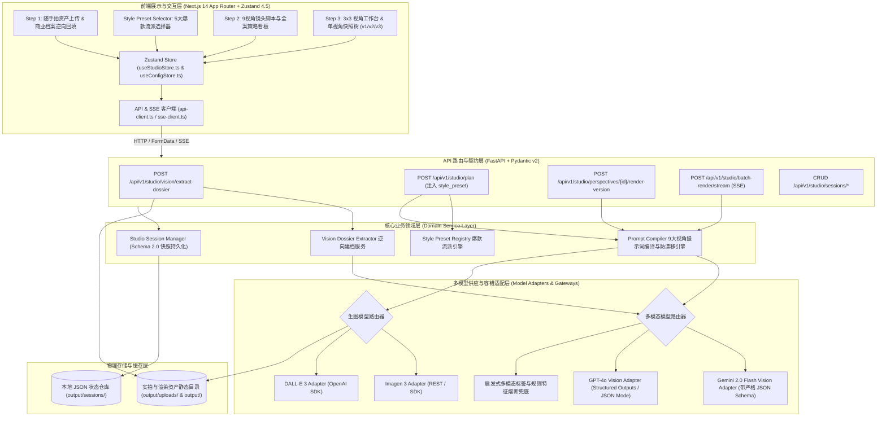
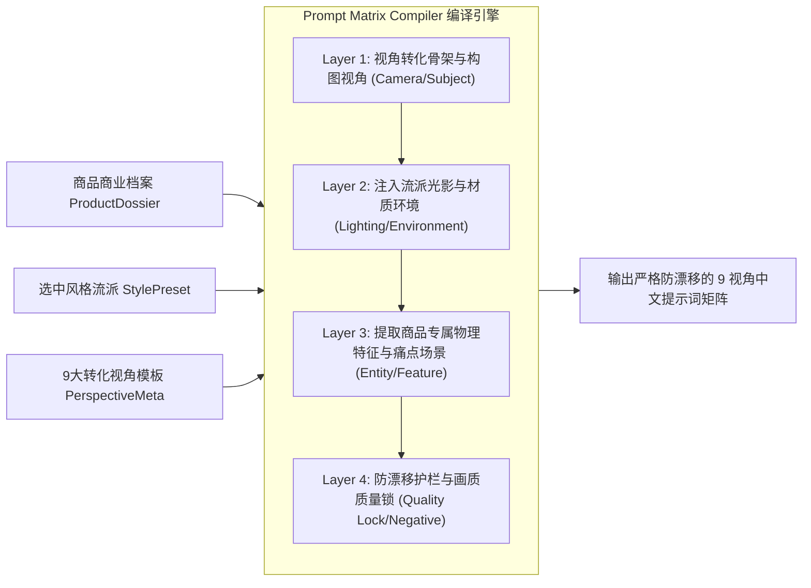
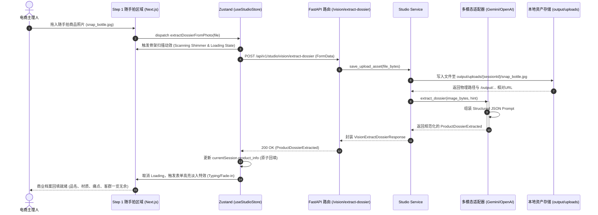
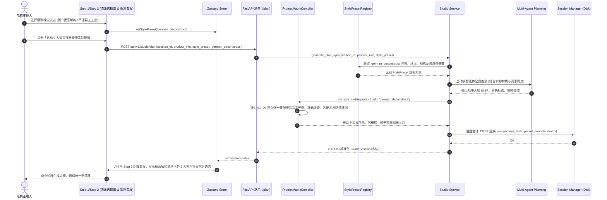

# 电商视觉工坊 (Ecommerce Studio) v2.0 生产级代码架构设计与规格说明书

> **系统定位**：基于多模态大模型（Gemini 2.0 Flash / GPT-4o Vision）与顶级商业生图引擎（Imagen 3 / DALL-E 3），以「随手拍逆向多模态建档 (Vision-to-Dossier)」与「爆款视觉流派引擎 (Style Preset Registry)」为双核引擎，驱动 9 大黄金商业转化视角矩阵的高效生成与版本迭代系统。

---

## 一、 系统全局分层架构与 Mermaid 拓扑



---

## 二、 后端服务与接口契约设计 (Pydantic v2 & FastAPI)

### 2.1 新增接口：随手拍多模态逆向建档 (`POST /api/v1/studio/vision/extract-dossier`)

#### 2.1.1 需求契约说明
- **支持调用形态**：
  1. `multipart/form-data`：用于用户随手拍照后直接上传图片二进制文件（兼容移动端/桌面拖拽）。
  2. `application/json`：用于前端已经完成资产上传，传入 `asset_url` 或 `asset_id` 进行纯语义解析。
- **职责范围**：
  输入实物随手拍照片（哪怕光线杂乱、背景有杂物），通过计算机视觉逆向提炼出商品的：工业名称、品类属性、材质工艺、目标客群、用户购买抗拒点/痛点、视觉标签和核心色调。

#### 2.1.2 Pydantic v2 模型定义 (`ecommerce_studio/api/schemas.py`)

```python
from typing import Any, Dict, List, Optional
from pydantic import BaseModel, Field, HttpUrl


class VisionExtractDossierRequest(BaseModel):
    """JSON 模式入参定义"""
    session_id: Optional[str] = Field(default=None, description="所属专案会话ID，若有则自动关联资产")
    asset_url: Optional[str] = Field(default=None, description="已上传资产的相对或绝对URL路径，如 /output/uploads/xxx.jpg")
    asset_path: Optional[str] = Field(default=None, description="后端文件物理绝对路径")
    category_hint: Optional[str] = Field(default="", description="用户可选输入的品类提示（如'保温杯'），降低冷启动盲猜")


class ProductDossierExtracted(BaseModel):
    """多模态逆向萃取的商品商业档案核心数据"""
    product_name: str = Field(..., description="逆向识别出的商品商业全称，如'智能触控数显真空气密随行保温杯'")
    category: str = Field(..., description="精准品类属性，如'数码水具 / 户外便携保温杯'")
    material_features: str = Field(..., description="工业材质与表面工艺特征，如'316L不锈钢内胆、外壁曜石黑微米级哑光喷砂烤漆、LED触控屏'")
    target_users: str = Field(..., description="目标客群画像与典型生活方式，如'25-35岁高知通勤白领、商务差旅精英'")
    pain_points: str = Field(..., description="买家核心抗拒点与竞品短板，如'传统杯倒置渗水、保温衰减快、杯口易烫嘴、外壳易刮花'")
    visual_tags: List[str] = Field(default_factory=list, description="提取的视觉微标签，如 ['#曜石黑哑光', '#阳极氧化铝', '#数显杯盖']")
    color_palette: List[str] = Field(default_factory=list, description="从实物提取的主色调Hex与名称，如 ['#09090B 曜石黑', '#71717A 钛金灰']")
    confidence_score: float = Field(default=0.95, ge=0.0, le=1.0, description="多模态解析置信度")


class VisionExtractDossierResponse(BaseModel):
    """逆向建档统一响应模型"""
    success: bool = Field(default=True, description="处理是否成功")
    session_id: Optional[str] = Field(default=None, description="关联会话ID")
    asset_url: str = Field(..., description="最终落盘资产访问URL")
    dossier: ProductDossierExtracted = Field(..., description="逆向提炼得到的商品档案")
    model_provider: str = Field(..., description="实际提供推理的多模态模型通道 (gemini / openai / rule_fallback)")
    execution_time_ms: int = Field(..., description="耗时毫秒数")
```

#### 2.1.3 接口路由实现 (`ecommerce_studio/api/routes.py`)

```python
@router.post("/vision/extract-dossier", response_model=VisionExtractDossierResponse)
async def extract_product_dossier(
    request: Request,
    session_id: Optional[str] = Form(None),
    asset_url: Optional[str] = Form(None),
    category_hint: Optional[str] = Form(""),
    file: Optional[UploadFile] = File(None),
):
    """
    随手拍实物图多模态逆向建档接口。
    支持 multipart/form-data 直传，或 JSON payload (通过 request.json() 解析已上传 asset)。
    """
    t0 = time.time()
    raw_bytes: Optional[bytes] = None
    final_asset_url = ""
    target_sid = session_id

    # 1. 判断是否为 application/json 传参
    content_type = request.headers.get("content-type", "")
    if "application/json" in content_type:
        body = await request.json()
        target_sid = body.get("session_id") or target_sid
        asset_url = body.get("asset_url") or body.get("asset_path")
        category_hint = body.get("category_hint") or category_hint

    # 2. 获取图片实体 (二进制流或本地文件路径)
    if file:
        raw_bytes = await file.read()
        filename = file.filename or f"snap_{int(time.time())}.jpg"
        # 保存到持久目录
        final_asset_url, abs_path = studio_service.save_upload_asset(target_sid, filename, raw_bytes)
    elif asset_url:
        final_asset_url = asset_url
        abs_path = studio_service.resolve_asset_path(asset_url)
        if not os.path.exists(abs_path):
            raise HTTPException(status_code=400, detail=f"指定资产不存在: {asset_url}")
        with open(abs_path, "rb") as f:
            raw_bytes = f.read()
    else:
        raise HTTPException(status_code=400, detail="必须提供上传文件 (file) 或有效资产路径 (asset_url)")

    # 3. 调度多模态逆向建档核心引擎
    try:
        extracted_dossier, provider_used = await studio_service.extract_dossier_from_image(
            image_bytes=raw_bytes,
            category_hint=category_hint,
            session_id=target_sid,
        )
    except Exception as e:
        logger.error(f"多模态逆向提取异常: {str(e)}", exc_info=True)
        raise HTTPException(status_code=500, detail=f"逆向建档失败: {str(e)}")

    elapsed_ms = int((time.time() - t0) * 1000)
    return VisionExtractDossierResponse(
        success=True,
        session_id=target_sid,
        asset_url=final_asset_url,
        dossier=extracted_dossier,
        model_provider=provider_used,
        execution_time_ms=elapsed_ms,
    )
```

### 2.2 多模态模型适配器封装与故障自愈降级设计

为彻底解耦底层不同 AI 供应商的 SDK 异构性，设计独立的 `MultiModalVisionAdapter` 适配器接口与自动容错熔断链路。

#### 2.2.1 结构化多模态 Prompt 指令
```text
你是一位世界顶尖的电商工业设计专家与爆款选品战略总监。
用户提供了一张随手拍的实物商品照片（可能包含手持、杂乱背景、反光等非影棚干扰因素）。
请仔细审视实物，透过现象看本质，进行逆向工程分析，输出严格合规的 JSON 对象，严禁包裹任何额外说明文字或 Markdown 标记！

【JSON输出结构规范】：
{
  "product_name": "精确商业品名（突出工业材质、功能与形态）",
  "category": "细分行业品类",
  "material_features": "表面工业特征、加工工艺与触觉材质细节",
  "target_users": "目标客群年龄、社会角色、消费动机",
  "pain_points": "买家决策最担心的核心短板或使用抗拒点",
  "visual_tags": ["#主色材质标签", "#工艺特征标签", "#核心形态标签", "#使用特征标签"],
  "color_palette": ["#16位色阶 配色名称1", "#16位色阶 配色名称2", "#16位色阶 配色名称3"]
}
```

#### 2.2.2 适配器接口与双通道降级链路

```python
class MultiModalVisionAdapter:
    """多模态视觉提取调度器 (带主动超时、自动切换与规则兜底)"""

    def __init__(self, config: Dict[str, Any]):
        self.config = config
        self.timeout_sec = 25.0

    async def extract_dossier(
        self,
        image_bytes: bytes,
        category_hint: Optional[str] = "",
    ) -> Tuple[ProductDossierExtracted, str]:
        active_provider = self.config.get("active_provider", "gemini").lower()
        
        # 尝试通道列表：当前激活通道优先，另一通道次之
        provider_chain = [active_provider]
        fallback_target = "openai" if active_provider == "gemini" else "gemini"
        provider_chain.append(fallback_target)

        errors = []
        for provider in provider_chain:
            try:
                if provider == "gemini":
                    result = await asyncio.wait_for(
                        self._call_gemini_vision(image_bytes, category_hint),
                        timeout=self.timeout_sec,
                    )
                    return result, "gemini"
                elif provider in ["openai", "custom_openai"]:
                    result = await asyncio.wait_for(
                        self._call_openai_vision(image_bytes, category_hint),
                        timeout=self.timeout_sec,
                    )
                    return result, provider
            except Exception as e:
                logger.warning(f"通道 [{provider}] 多模态逆向提取失败: {str(e)}，尝试下一通道")
                errors.append(f"{provider}: {str(e)}")

        # 双通道全部失败，触发确定性规则降级兜底，保障系统绝对可用
        logger.error(f"所有多模态大模型通道均不可用: {errors}，启动规则特征库熔断兜底")
        fallback_result = self._fallback_heuristic_dossier(image_bytes, category_hint)
        return fallback_result, "rule_fallback"

    async def _call_gemini_vision(self, image_bytes: bytes, hint: str) -> ProductDossierExtracted:
        from google import genai
        from google.genai import types

        gemini_cfg = self.config.get("gemini", {})
        api_key = gemini_cfg.get("api_key") or os.environ.get("GEMINI_API_KEY")
        if not api_key:
            raise ValueError("Gemini API Key 未配置")

        model_name = gemini_cfg.get("model") or "gemini-2.0-flash"
        client = genai.Client(api_key=api_key)

        prompt = f"实物提示：{hint}\n请按照指定规范逆向提取商品商业档案。"
        image_part = types.Part.from_bytes(data=image_bytes, mime_type="image/jpeg")

        # 异步线程执行同步 client
        response = await asyncio.to_thread(
            client.models.generate_content,
            model=model_name,
            contents=[prompt, image_part],
            config=types.GenerateContentConfig(
                response_mime_type="application/json",
                temperature=0.2,
            ),
        )
        data = json.loads(response.text)
        return ProductDossierExtracted(**data)

    async def _call_openai_vision(self, image_bytes: bytes, hint: str) -> ProductDossierExtracted:
        from openai import AsyncOpenAI
        import base64

        openai_cfg = self.config.get("openai", {})
        api_key = openai_cfg.get("api_key") or os.environ.get("OPENAI_API_KEY")
        base_url = openai_cfg.get("base_url") or "https://api.openai.com/v1"
        if not api_key:
            raise ValueError("OpenAI API Key 未配置")

        client = AsyncOpenAI(api_key=api_key, base_url=base_url)
        base64_img = base64.b64encode(image_bytes).decode("utf-8")

        response = await client.chat.completions.create(
            model=openai_cfg.get("model") or "gpt-4o",
            messages=[
                {
                    "role": "user",
                    "content": [
                        {"type": "text", "text": f"实物提示：{hint}\n输出严格 JSON 格式商品档案。"},
                        {"type": "image_url", "image_url": {"url": f"data:image/jpeg;base64,{base64_img}"}},
                    ],
                }
            ],
            response_format={"type": "json_object"},
            temperature=0.2,
        )
        raw_json = response.choices[0].message.content or "{}"
        data = json.loads(raw_json)
        return ProductDossierExtracted(**data)

    def _fallback_heuristic_dossier(self, image_bytes: bytes, hint: str) -> ProductDossierExtracted:
        """兜底规则生成器，即使离线或无 Key 也保持业务链路畅通"""
        prod_name = hint if hint else "高品质便携随行商品"
        return ProductDossierExtracted(
            product_name=f"{prod_name} (智能识别)",
            category="现代生活良品 / 高端电商定制",
            material_features="高精度哑光金属质感、防刮耐磨涂层、精密工业接缝与人体工学弧度",
            target_users="25-40岁追求生活美感与精工品质的都市人群",
            pain_points="做工粗糙缺乏档次感、日常磕碰易划伤、实用功能衰减快",
            visual_tags=["#极简几何", "#精工材质", "#商业摄影基准", "#防刮哑光"],
            color_palette=["#18181B 深邃黑", "#71717A 钛金灰", "#FAFAFA 纯净白"],
            confidence_score=0.70,
        )
```

### 2.3 修改现有策划接口 `POST /api/v1/studio/plan`

在 `PlanRequest` 请求体中显式增加 `style_preset` 字段，并在服务层持久化至 Session 元数据中。

#### 2.3.1 更新 `PlanRequest` (`ecommerce_studio/api/schemas.py`)
```python
class PlanRequest(BaseModel):
    session_id: Optional[str] = Field(default=None, description="会话ID，若为空则自动创建")
    product_info: Dict[str, Any] = Field(..., description="商品商业档案信息")
    style_preset: Optional[str] = Field(
        default="minimalist_muji",
        description="爆款视觉流派ID: minimalist_muji / nordic_luxury / german_deconstruct / dopamine_energy / cyber_street",
    )
    stream: Optional[bool] = Field(default=False, description="是否以SSE方式流式推演")
```

#### 2.3.2 会话结构扩展与持久化保障
在 `StudioSession` 中新增字段：
```python
class StudioSession(BaseModel):
    # ... 原有字段 ...
    style_preset: str = Field(default="minimalist_muji", description="当前专案绑定的爆款风格流派")
```
在 `studio_service.generate_plan_sync` 中同步更新：
```python
session_data["style_preset"] = payload.style_preset or session_data.get("style_preset", "minimalist_muji")
```

---

## 三、 爆款风格流派引擎设计 (Style Preset Registry)

### 3.1 核心参数结构定义 (`ecommerce_studio/style_presets.py`)

为了保证各流派的专业度，流派绝非仅仅是一个简单的“标签”，而是一套完整的**商业摄影光学与空间参数包**：

```python
from typing import Dict, List, Optional
from pydantic import BaseModel, Field


class StylePreset(BaseModel):
    id: str = Field(..., description="流派唯一ID")
    name: str = Field(..., description="中文名称")
    en_name: str = Field(..., description="英文名称")
    tagline: str = Field(..., description="一句话商业定位标语")
    description: str = Field(..., description="流派核心美学阐释")
    
    # 核心光学与环境 4 大维度
    lighting: str = Field(..., description="光影与布光方案 (主光/辅光/轮廓光)")
    environment: str = Field(..., description="布景道具、台面材质与空间留白基调")
    camera: str = Field(..., description="机位、镜头焦段、光圈与透视关系")
    color_tone: str = Field(..., description="主色调、副色调与色彩饱和度风格")
    
    # 防漂移参数
    anti_drift_rules: List[str] = Field(
        default_factory=list,
        description="绝对禁止出现的负面视觉特征",
    )
    perspective_enhancements: Dict[str, str] = Field(
        default_factory=dict,
        description="针对特定视角(如01_white_bg, 02_scene)的专用加权提示",
    )
```

### 3.2 五大官方爆款流派参数定义

```python
STYLE_PRESET_REGISTRY: Dict[str, StylePreset] = {
    "minimalist_muji": StylePreset(
        id="minimalist_muji",
        name="极简原研哉 (日系留白)",
        en_name="Minimalist Zen & MUJI Aesthetic",
        tagline="大面积纯净留白，晨光漫射，静谧自然克制",
        description="源自日本大师原研哉的空之美学(Emptiness)，去除一切冗余修饰，让商品本身成为空间的视觉重心。",
        lighting="大面积顶光漫反射，微暖柔光箱无刺眼高光，晨光穿透纱帘形成的微弱柔和漫射光，几乎无强烈死黑阴影",
        environment="浅色原木肌理展台、米白高品质微水泥墙面、日式和纸质感、极其克制的微量禅意留白空间",
        camera="50mm 标准商业静物中焦段，正面微俯角15度，f/8 中等景深确保商品细节全清晰，透视自然无畸变",
        color_tone="温暖燕麦色、纯净米白、浅卡其、浅原木色，低饱和度、高明度，呈现天然温润的自然质感",
        anti_drift_rules=["严禁浓艳色彩", "严禁复杂霓虹与暗黑背景", "严禁炫目反光与凌乱道具"],
        perspective_enhancements={
            "01_white_bg": "绝对纯白哑光展台，自然微透极浅柔和接触影，消除任何炫光反冲",
            "02_scene": "伴随一杯清茶或一本极简手账，清晨初阳微抚桌面，营造归家宁静感",
        },
    ),
    "nordic_luxury": StylePreset(
        id="nordic_luxury",
        name="北欧轻奢 (莫兰迪低饱和)",
        en_name="Nordic Minimal Luxury",
        tagline="灰调高级质感，大理石与冷金点缀，中产格调溢价",
        description="斯堪的纳维亚现代家居与高端生活方式的结合，注重材质的高阶灰调与微量金属带来的轻奢冲击力。",
        lighting="侧逆45度自然窗光，伴随柔和丁达尔光束与双色温冷暖漫射，轮廓处有精致的高光细线",
        environment="卡拉拉白大理石台面、哑光黄铜细金属配件、低饱和度莫兰迪色系羊毛织物、几何水磨石",
        camera="85mm 商业人像与特写镜头，f/2.8 中浅景深，背景优雅散景虚化，焦内极致锐利",
        color_tone="莫兰迪灰调（灰绿/灰粉/燕麦灰）、高级冷灰、点缀10%以内的哑光香槟金或冷拉丝金属色",
        anti_drift_rules=["严禁暴发户式廉价大金大黄", "严禁粗糙塑料反光", "严禁刺眼霓虹光"],
        perspective_enhancements={
            "03_detail": "85mm极限微距，定焦于商品精工倒角与黄铜配件的交界处，散发出轻奢微光",
            "07_emotional": "电影级暖调黄昏光线与冷色大理石形成戏剧性冷暖对冲，拉满格调与溢价",
        },
    ),
    "german_deconstruct": StylePreset(
        id="german_deconstruct",
        name="德系解构 (严谨精工工业)",
        en_name="Bauhaus & German Precision Engineering",
        tagline="硬核机械美学，冷冽金属光泽，硬朗理性信任感",
        description="包豪斯现代主义与德国工业精密的极致融合，突出商品的精密机械装配、硬核功能与不可撼动的工业可靠度。",
        lighting="高反差硬朗侧逆光、数码级精准切割轮廓光、冷冽银白主光，硬核勾勒出几何边缘与锋利倒角",
        environment="阳极氧化深灰铝合金台面、炭黑工程塑料支架、精密毫米标尺、无尘实验室级别科技展台",
        camera="90mm 移轴微距摄影，全景深精细堆叠(Focus Stacking)，极致锐化边缘，无透视形变",
        color_tone="深空炭黑、冷钛灰、哑光银，极高反差，局部可带有0.5%科技幽蓝或指示冷白LED光效",
        anti_drift_rules=["严禁粉嫩色系", "严禁温馨家庭杂物", "严禁模糊朦胧镜头"],
        perspective_enhancements={
            "04_structure": "轴向精密悬浮解构爆炸图，各零件间带有冷蓝科技标线与微米级结构说明感",
            "05_pain_killer": "高强度暴力测试硬核环境，水滴飞溅瞬间在冷硬金属上粉碎定格，震撼信赖感",
        },
    ),
    "dopamine_energy": StylePreset(
        id="dopamine_energy",
        name="多巴胺活力 (青年明快撞色)",
        en_name="Dopamine Bright & Pop Energy",
        tagline="高饱和明快撞色，夏日阳光投影，激发冲动点击",
        description="拥抱Z世代年轻力与悦己情绪，通过鲜活高饱和的视觉冲击唤醒购买兴奋感，极大拉升CTR点击率。",
        lighting="模拟夏日正午清透直射阳光，带有清晰锐利的硬直投影，白色反光板高亮度立体补光",
        environment="纯色通透亚克力展台、波普艺术撞色背景板、水波纹光斑投影、明快极简几何方块堆叠",
        camera="35mm 人文广角与动感微俯视机位，充满活力的对角线构图，大景深明澈画质",
        color_tone="明亮柠檬黄、活力珊瑚橙、薄荷绿与克莱因蓝的大胆艺术碰撞，色彩通透浓郁，无压抑灰调",
        anti_drift_rules=["严禁昏暗暗调", "严禁死黑阴影", "严禁沉闷严肃的商务背景"],
        perspective_enhancements={
            "01_white_bg": "高调亮白底色，搭配鲜亮通透的色彩饱和度，通透立体倒影，第一眼吸睛夺目",
            "08_color": "全系高饱和配色在波普几何台阶上一字排开，如糖果般悦目丰富，激发收藏连单",
        },
    ),
    "cyber_street": StylePreset(
        id="cyber_street",
        name="赛博潮酷 (暗夜霓虹潮流)",
        en_name="Cyberpunk & Night Street Tech",
        tagline="暗夜深色基底，蓝紫电光流淌，未来主义科技潮牌",
        description="电影感赛博朋克与未来潮流街头的混合体，适合主打数码黑科技、电竞装备与先锋潮流的破圈单品。",
        lighting="双色冷暖高反差切光：45度电光青蓝主侧光 + 135度品红霓虹边缘轮廓反打，暗调深邃黑阶",
        environment="湿漉沥青反光地面、深黑碳纤维纹理板、全息渐变光晕、暗黑金属几何网格",
        camera="24mm 超广角低机位仰拍，大透视冲击力，配合暗部电影级细微胶片噪点与光晕漫射(Bloom)",
        color_tone="深邃极黑(#09090B)、电光青蓝(#00F0FF)、赛博品红(#FF003C)，高反差强视觉冲击",
        anti_drift_rules=["严禁田园乡村风", "严禁日式米白温馨感", "严禁大面积平庸白光"],
        perspective_enhancements={
            "04_structure": "发光的幽蓝半透明元器件在深黑背景中悬浮，电路导光条纹流转，极致科幻感",
            "09_buyer_show": "暗光街头潮流青年手持特写，背景是繁华夜市虚化的霓虹光斑，潮酷种草",
        },
    ),
}
```

### 3.3 流派参数与 9 视角提示词编译器 (Prompt Matrix Compiler)

为防止大模型自由发挥导致画风严重漂移（如选了“德系解构”却生成出温馨日式厨房），设计**双层装配与防漂移护栏编译机制**：



#### 3.3.1 编译器实现规格代码 (`ecommerce_studio/prompt_compiler.py`)
```python
class PromptMatrixCompiler:
    """高内聚 9 视角商业提示词编译引擎"""

    @classmethod
    def compile_matrix(
        cls,
        product_info: Dict[str, Any],
        style_preset_id: str = "minimalist_muji",
    ) -> List[Dict[str, str]]:
        style = STYLE_PRESET_REGISTRY.get(style_preset_id, STYLE_PRESET_REGISTRY["minimalist_muji"])
        prod_name = product_info.get("name") or product_info.get("product_name") or "高端商品"
        material = product_info.get("material_features", "高精密工业材质")
        pain_points = product_info.get("pain_points", "日常使用抗拒点")
        target_users = product_info.get("target_audience") or product_info.get("target_users", "追求品质生活的消费者")

        compiled_results = []
        for p_def in PERSPECTIVE_DEFINITIONS:
            pid = p_def["id"]
            p_name = p_def["name"]
            
            # 1. 视角专属构图定位
            base_composition = p_def["desc"]
            
            # 2. 获取该视角下的流派强化参数
            style_enhancement = style.perspective_enhancements.get(pid, "")
            
            # 3. 动态拼装具有强约束力的中文提示词
            prompt = (
                f"【商业广告摄影】{p_name}。主体为一款高品质{prod_name}。"
                f"【工业与材质特征】：{material}。"
                f"【构图与视角】：{base_composition}，{style.camera}。"
                f"【商业布光与光影】：{style.lighting}。"
                f"【空间与道具布景】：{style.environment}。"
                f"【色彩与调性风格】：{style.color_tone}。"
            )
            
            if style_enhancement:
                prompt += f"【流派专属强化】：{style_enhancement}。"

            # 视角专属业务强化
            if pid == "05_pain_killer":
                prompt += f"【痛点攻坚场景】：具象化消除买家核心顾虑（{pain_points}），视觉呈现严密可靠。"
            elif pid == "09_buyer_show" or pid == "02_scene":
                prompt += f"【目标客群代入】：生动融入符合（{target_users}）生活品位的高阶氛围中。"

            # 防漂移质量锁
            negative_rules = "，".join(style.anti_drift_rules)
            prompt += f"【画质与防漂移规范】：8k超清分辨率，锐利对焦，真实质感，严禁出现：{negative_rules}。"

            compiled_results.append({
                "id": pid,
                "alt_id": p_def.get("alt_id"),
                "name": p_name,
                "desc": p_def["desc"],
                "tag": p_def.get("tag", ""),
                "prompt": prompt,
            })

        return compiled_results
```

---

## 四、 前端状态机与数据流设计 (`useStudioStore.ts` & `api-client.ts`)

### 4.1 会话类型与状态接口扩展 (`src/types/session.ts` & `src/types/api.ts`)

```typescript
// 爆款流派标识枚举
export type StylePresetId = 
  | 'minimalist_muji' 
  | 'nordic_luxury' 
  | 'german_deconstruct' 
  | 'dopamine_energy' 
  | 'cyber_street';

// 扩展 ProductDossier
export interface ProductDossier {
  name: string;
  category: string;
  target_audience: string;
  pain_points: string;
  material_features?: string;
  reference_images?: ReferenceImage[];
  // v2 新增逆向建档字段 (向后兼容)
  visual_tags?: string[];
  color_palette?: string[];
}

// 扩展 StudioSession (保持 schema_version: '2.0')
export interface StudioSession {
  schema_version: '2.0';
  session_id: string;
  name: string;
  created_at: number;
  updated_at: number;
  product_info: ProductDossier;
  style_preset: StylePresetId; // v2.0 绑定的流派
  analysis_result?: string;
  strategy_summary?: StrategySummary;
  prompts_matrix?: Array<{
    id: string;
    name: string;
    desc: string;
    prompt: string;
  }>;
  perspectives: Perspective[];
  chat_history: ChatMessage[];
}

// 逆向建档响应类型
export interface VisionExtractDossierResponse {
  success: boolean;
  session_id?: string;
  asset_url: string;
  dossier: {
    product_name: string;
    category: string;
    material_features: string;
    target_users: string;
    pain_points: string;
    visual_tags: string[];
    color_palette: string[];
    confidence_score: number;
  };
  model_provider: string;
  execution_time_ms: number;
}
```

### 4.2 前端 API 客户端扩展 (`src/lib/api-client.ts`)

```typescript
export const studioApi = {
  // ... 原有基础会话方法保持完全兼容 ...

  /**
   * v2.0 新增: 随手拍多模态逆向建档 API
   */
  async extractDossier(
    input: { file?: File; asset_url?: string; session_id?: string; category_hint?: string }
  ): Promise<VisionExtractDossierResponse> {
    const baseUrl = getBaseUrl();
    if (input.file) {
      const formData = new FormData();
      formData.append('file', input.file);
      if (input.session_id) formData.append('session_id', input.session_id);
      if (input.category_hint) formData.append('category_hint', input.category_hint);

      const res = await timedFetch(`${baseUrl}/vision/extract-dossier`, {
        method: 'POST',
        body: formData,
      });
      if (!res.ok) throw new Error(`HTTP ${res.status}: 逆向建档多模态解析失败`);
      return await res.json();
    } else {
      const res = await timedFetch(`${baseUrl}/vision/extract-dossier`, {
        method: 'POST',
        headers: { 'Content-Type': 'application/json' },
        body: JSON.stringify({
          session_id: input.session_id,
          asset_url: input.asset_url,
          category_hint: input.category_hint,
        }),
      });
      if (!res.ok) throw new Error(`HTTP ${res.status}: 逆向建档多模态解析失败`);
      return await res.json();
    }
  },

  /**
   * v2.0 升级: 矩阵策划支持 style_preset 参数
   */
  async planMatrix(payload: {
    session_id: string;
    product_info: ProductDossier;
    style_preset?: StylePresetId;
    stream?: boolean;
  }): Promise<StudioSession> {
    const res = await timedFetch(`${getBaseUrl()}/plan`, {
      method: 'POST',
      headers: { 'Content-Type': 'application/json' },
      body: JSON.stringify(payload),
    });
    if (!res.ok) throw new Error(`HTTP ${res.status}: Planning matrix failed`);
    return await res.json();
  },
};
```

### 4.3 Zustand 全局 Store 状态机架构 (`src/stores/useStudioStore.ts`)

在保持 Zustand 4.5 最佳实践的基础上，新增视觉流派状态、逆向建档加载态与原子回填函数：

```typescript
interface StudioState {
  // --- 原有状态 ---
  currentSession: StudioSession | null;
  currentStep: 1 | 2 | 3 | 4;
  activePerspectiveId: string | null;
  selectedPreviewVersions: Record<string, string>;
  aspectRatio: '1:1' | '3:4' | '16:9';
  concurrency: number;
  isBatchRendering: boolean;
  batchProgress: BatchProgress;
  sessionList: SessionSummary[];
  isLoading: boolean;
  error: string | null;

  // --- v2.0 新增核心状态 ---
  selectedStylePreset: StylePresetId;
  isExtractingDossier: boolean;
  extractionProgressText: string;

  // --- v2.0 新增操作函数 ---
  setStylePreset: (presetId: StylePresetId) => void;
  extractDossierFromPhoto: (file: File, categoryHint?: string) => Promise<void>;
  extractDossierFromExistingAsset: (assetUrl: string, categoryHint?: string) => Promise<void>;
}
```

#### 4.3.1 逆向建档状态机链路实现逻辑
```typescript
export const useStudioStore = create<StudioState>()(
  persist(
    (set, get) => ({
      // ... 默认初始状态 ...
      selectedStylePreset: 'minimalist_muji',
      isExtractingDossier: false,
      extractionProgressText: '',

      setStylePreset: (presetId: StylePresetId) => {
        set((state) => {
          if (!state.currentSession) return { selectedStylePreset: presetId };
          return {
            selectedStylePreset: presetId,
            currentSession: {
              ...state.currentSession,
              style_preset: presetId,
            },
          };
        });
      },

      extractDossierFromPhoto: async (file: File, categoryHint?: string) => {
        const session = get().currentSession;
        if (!session) return;

        set({
          isExtractingDossier: true,
          extractionProgressText: '多模态大脑正在审视随手拍实物图...',
        });

        try {
          // 阶段动效模拟
          setTimeout(() => {
            if (get().isExtractingDossier) {
              set({ extractionProgressText: '正在逆向分析工业材质特征与客群抗拒点...' });
            }
          }, 1200);

          const res = await studioApi.extractDossier({
            file,
            session_id: session.session_id,
            category_hint: categoryHint,
          });

          // 回填商品档案并自动加入实物参考图
          const updatedRefImages = [...(session.product_info.reference_images || [])];
          if (!updatedRefImages.some(img => img.url === res.asset_url)) {
            updatedRefImages.unshift({
              id: `snap_${Date.now()}`,
              url: res.asset_url,
              is_primary: true,
              vision_tags: res.dossier.visual_tags || ['#随手拍逆向', '#实物材质'],
            });
          }

          const newDossier: ProductDossier = {
            ...session.product_info,
            name: res.dossier.product_name,
            category: res.dossier.category,
            material_features: res.dossier.material_features,
            target_audience: res.dossier.target_users,
            pain_points: res.dossier.pain_points,
            reference_images: updatedRefImages,
            visual_tags: res.dossier.visual_tags,
            color_palette: res.dossier.color_palette,
          };

          set((state) => ({
            isExtractingDossier: false,
            extractionProgressText: '建档完成！已智能回填商品档案',
            currentSession: state.currentSession ? {
              ...state.currentSession,
              product_info: newDossier,
              updated_at: Math.floor(Date.now() / 1000),
            } : null,
          }));
        } catch (err: any) {
          set({
            isExtractingDossier: false,
            extractionProgressText: '',
            error: err.message || '多模态逆向建档失败',
          });
          throw err;
        }
      },

      extractDossierFromExistingAsset: async (assetUrl: string, categoryHint?: string) => {
        const session = get().currentSession;
        if (!session) return;
        set({ isExtractingDossier: true, extractionProgressText: '正在解析指定参考图...' });
        try {
          const res = await studioApi.extractDossier({
            asset_url: assetUrl,
            session_id: session.session_id,
            category_hint: categoryHint,
          });

          const newDossier: ProductDossier = {
            ...session.product_info,
            name: res.dossier.product_name,
            category: res.dossier.category,
            material_features: res.dossier.material_features,
            target_audience: res.dossier.target_users,
            pain_points: res.dossier.pain_points,
            visual_tags: res.dossier.visual_tags,
            color_palette: res.dossier.color_palette,
          };

          set((state) => ({
            isExtractingDossier: false,
            extractionProgressText: '建档成功',
            currentSession: state.currentSession ? {
              ...state.currentSession,
              product_info: newDossier,
            } : null,
          }));
        } finally {
          set({ isExtractingDossier: false });
        }
      },
    }),
    {
      name: 'ecommerce-studio-storage',
      version: 2, // 升级存储模式版本号
      migrate: (persistedState: any, version: number) => {
        if (version < 2) {
          // 自动补齐 style_preset
          if (persistedState?.currentSession && !persistedState.currentSession.style_preset) {
            persistedState.currentSession.style_preset = 'minimalist_muji';
          }
          persistedState.selectedStylePreset = 'minimalist_muji';
        }
        return persistedState;
      },
    }
  )
);
```

---

## 五、 端到端系统交互时序图 (Mermaid Sequence Diagrams)

### 5.1 场景一：随手拍多模态逆向建档全链路 (Vision-to-Dossier E2E)



### 5.2 场景二：爆款流派驱动的全案生成与 9 视角提示词编译 (Style-Injected Planning)



---

## 六、 兼容性、健壮性与工程落地 Checklist

1. **Schema 2.0 完全向后兼容**：
   - 保证原有 `session_id`, `perspectives`, `product_info`, `prompts_matrix`, `generated_images` 字段完全保留。
   - 所有新增字段（`style_preset`, `visual_tags`, `color_palette`）均赋有安全缺省值（如 `'minimalist_muji'` 与 `[]`），旧版会话读取时绝不抛出 KeyError 或 Pydantic 校验异常。
2. **多模态提取多层熔断与自愈**：
   - 第一层：Gemini 2.0 Flash 多模态（快速、具备原生 JSON 模式）。
   - 第二层：GPT-4o Vision（自动故障切换，25 秒超时保护）。
   - 第三层：规则特征库启发式熔断兜底（即使处于断网或两方 API Key 均失效时，依然能提取出符合格式的基础档案，绝不阻断用户出图主流程）。
3. **视觉风格防漂移保障机制**：
   - 在生成的提示词尾部强制注入风格注册中心规定的 `anti_drift_rules`（负面排除项）。
   - 对 01 纯白底首图实施特殊保护：无论选择何种风格，强制锁定纯净哑光白底，仅适度调节漫反射布光风格，彻底杜绝主图失真、背景杂乱导致电商平台审核不过的问题。
4. **前端状态持久化安全迁移**：
   - Zustand Persist 升级至 `version: 2`，并在 `migrate` 函数中对旧数据平滑升级，保障已存储的历史专案在用户刷新浏览器后不丢失、不报错。
