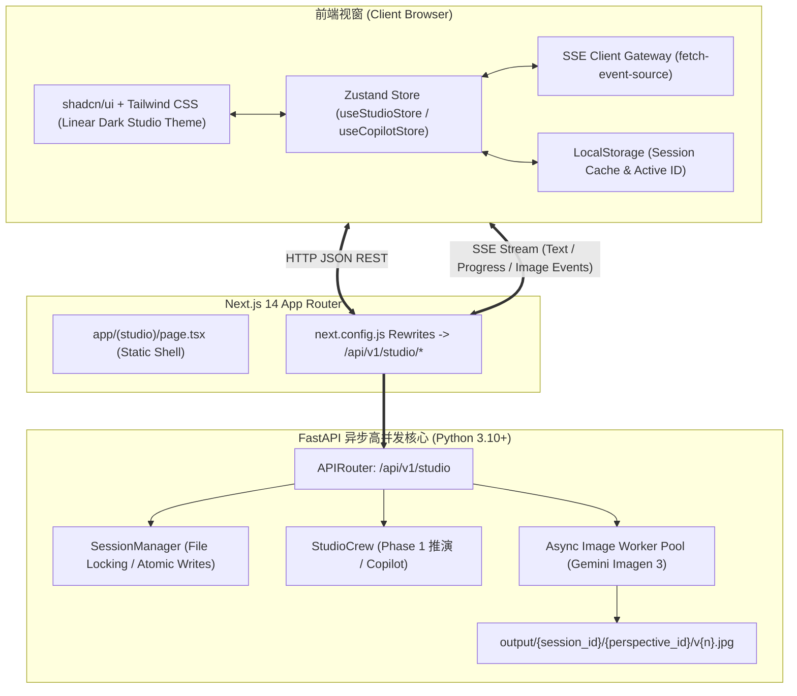
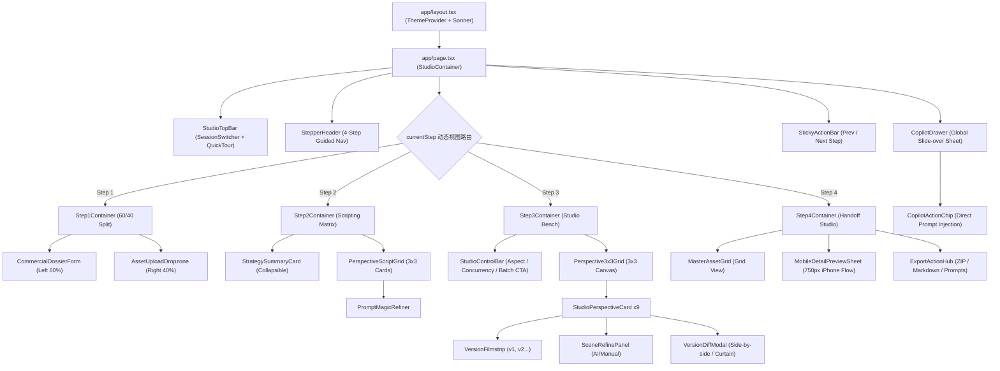
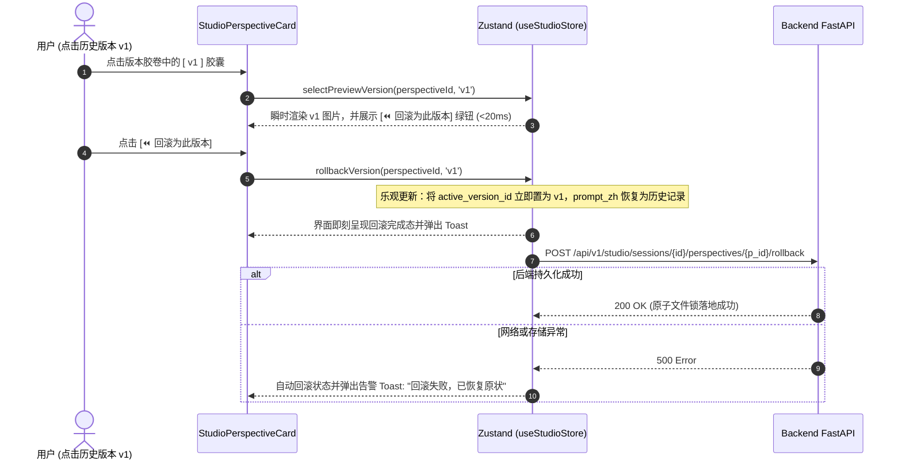
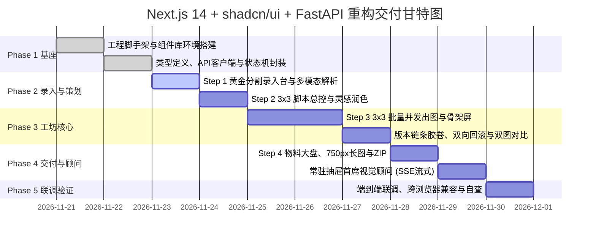

# 商业级电商视觉工坊 (Ecommerce Studio) 前端技术架构与实施规划
## Next.js 14 (App Router) + TypeScript + shadcn/ui + Tailwind CSS + FastAPI 解耦架构设计全案

> **文档版本**: v2.1.0 (Production Architecture Plan)  
> **面向对象**: 前端研发团队、后端/全栈工程师、UI/UX 设计师 (@designer)、产品经理 (@pm)、系统架构师  
> **核心使命**: 将 Ecommerce Studio 从 Streamlit 单体架构全面升级为现代化、高性能、高可维护性、体验极致丝滑的前后端解耦商业级 Web 应用。  
> **技术基座**: Next.js 14 (App Router) + React 18 + TypeScript 5 + Tailwind CSS + shadcn/ui (Radix Primitives) + Zustand + Lucide Icons + FastAPI (Async REST / SSE)。

---

## 目录 (Table of Contents)
1. [架构愿景与技术选型决策 (Executive Summary & Tech Stack Choices)](#1-架构愿景与技术选型决策-executive-summary--tech-stack-choices)
2. [工程目录规范与模块解耦 (Project Directory Structure & Conventions)](#2-工程目录规范与模块解耦-project-directory-structure--conventions)
3. [前端组件分层与原子化设计 (Component Hierarchy & Atomic Architecture)](#3-前端组件分层与原子化设计-component-hierarchy--atomic-architecture)
4. [客户端全域状态管理设计 (Client State Management & Zustand Store)](#4-客户端全域状态管理设计-client-state-management--zustand-store)
5. [RESTful & SSE 通信网关与接口契约 (API Client & Real-time SSE Engine)](#5-restful--sse-通信网关与接口契约-api-client--real-time-sse-engine)
6. [非破坏性版本链条与双向后悔药技术实现 (Non-Destructive Versioning & Rollback Tech Spec)](#6-非破坏性版本链条与双向后悔药技术实现-non-destructive-versioning--rollback-tech-spec)
7. [暗调商业摄影暗房美学与性能优化 (Theme, A11y & Performance Engineering)](#7-暗调商业摄影暗房美学与性能优化-theme-a11y--performance-engineering)
8. [分阶段工程落地路线图与提交里程碑 (Phased Roadmap & Commit Milestones)](#8-分阶段工程落地路线图与提交里程碑-phased-roadmap--commit-milestones)
9. [验收标准与质量自查清单 (Definition of Done & Verification Checklist)](#9-验收标准与质量自查清单-definition-of-done--verification-checklist)

---

## 1. 架构愿景与技术选型决策 (Executive Summary & Tech Stack Choices)

### 1.1 研发背景与痛点破局
原有的 Streamlit 单体实现虽然实现了电商 9 宫格与版本链的基本原型，但在商业化交互上面临根本瓶颈：
* **全页重新渲染 (Full-page Re-run)**：任何状态修改或输入框失去焦点都会引起 Python 解释器重跑脚本，无法支撑高频流畅的暗房级微调；
* **UI 表现力受限**：难以实现类似 Linear / Apple 质感的多层毛玻璃、平滑弹性滑动指示线、卷帘对比滑轨与 750px 手机端详情页沉浸式预览；
* **长连接流式体验弱**：多并发渲染时缺乏卡片维度的流光骨架屏（Shimmer Skeleton）独立淡入控制。

通过引入 **Next.js 14 App Router + FastAPI** 现代解耦架构，彻底释放前端的交互潜力与后端的异步高并发能力：



### 1.2 核心技术栈选型与权衡 (Stack Matrix)

| 领域 / 模块 | 选型技术 | 核心考量与优势 |
| :--- | :--- | :--- |
| **应用框架** | **Next.js 14 (App Router)** | 原生支持现代 React 架构，服务端组件与客户端组件分层清晰，内置极速热更新，生产构建轻量，易于静态化或容器化交付。 |
| **核心语言** | **TypeScript 5.x (Strict)** | 端到端类型安全，杜绝前后端接口不对齐隐患，完备支持 PRD 与 UI Spec 中定义的 9 大视角与版本模型。 |
| **样式与设计系统** | **Tailwind CSS 3.4 + shadcn/ui** | 基于 Radix Primitives 的无头组件体系，无样式入侵，100% 源码可控，天然契合 Apple/Linear 暗调毛玻璃设计。 |
| **客户端状态管理** | **Zustand 4.5+** | 极度轻量（<3KB），无 Redux 繁琐样板代码，支持局部选择器与精确重绘渲染，内建 `persist` 中间件与 localStorage 无缝集成。 |
| **实时流式通信** | **@microsoft/fetch-event-source** | 比原生 `EventSource` 更强大，完美支持 POST 请求带 Body 的 SSE 通信、自定义 Headers、重试退避与异常精准捕获。 |
| **交互动效** | **Framer Motion 11** | 支撑 Stepper 弹性滑块指示线、版本胶卷横向平滑过渡、抽屉侧滑（Spring Damping 物理缓动）。 |
| **图标库** | **Lucide React** | 现代专业暗调 SaaS 标配图标库，轻量 SVG，风格统一，语义清晰。 |
| **打包与环境** | **pnpm + Turbopack / Webpack** | 高效依赖拓扑缓存，秒级启动与极速构建。 |

---

## 2. 工程目录规范与模块解耦 (Project Directory Structure & Conventions)

前端工程统一组织在 `ecommerce_studio_web/` 目录下，与后端 `ecommerce_studio/` 独立平级，形成清晰的前后端工程边界：

```text
ecommerce_studio_web/
├── package.json
├── pnpm-lock.yaml
├── tsconfig.json
├── next.config.mjs                 # 代理转发配置 (/api/v1/studio -> FastAPI:8000)
├── tailwind.config.ts              # 注入暗调色代币与毛玻璃半径
├── postcss.config.mjs
├── .env.local.example              # 环境变量 (NEXT_PUBLIC_API_URL=http://localhost:8000)
├── public/
│   ├── favicon.ico
│   └── placeholders/               # 商业暗房摄影机位占位底图
├── src/
│   ├── app/                        # Next.js 14 App Router 根目录
│   │   ├── layout.tsx              # 全局根布局 (Dark Theme Provider, Sonner Toast)
│   │   ├── page.tsx                # 工坊主入口 (加载当前活跃 Session)
│   │   ├── globals.css             # 全局暗调样式变量、网格背景、滚动条样式
│   │   └── error.tsx / not-found.tsx
│   ├── components/                 # 组件层级树
│   │   ├── ui/                     # shadcn/ui 基础原子组件 (Button, Dialog, Sheet, etc.)
│   │   ├── layout/                 # 全局框架级组件
│   │   │   ├── StudioTopBar.tsx    # 顶部专案切换与设置
│   │   │   ├── StepperHeader.tsx   # 4步向导步进导航条
│   │   │   └── StickyActionBar.tsx # 底部吸底持久动作栏
│   │   ├── step1-onboarding/       # Step 1 资产与特征录入
│   │   │   ├── CommercialDossierForm.tsx
│   │   │   ├── AssetUploadDropzone.tsx
│   │   │   └── VisionTagsBadgeList.tsx
│   │   ├── step2-matrix/           # Step 2 9大矩阵策划与审阅
│   │   │   ├── StrategySummaryCard.tsx
│   │   │   ├── PerspectiveScriptGrid.tsx
│   │   │   └── ScriptCardItem.tsx
│   │   ├── step3-studio/           # Step 3 3x3 商业出图工坊 (核心)
│   │   │   ├── StudioControlBar.tsx
│   │   │   ├── Perspective3x3Grid.tsx
│   │   │   ├── StudioPerspectiveCard.tsx
│   │   │   ├── VersionFilmstrip.tsx
│   │   │   ├── VersionDiffModal.tsx
│   │   │   └── SceneRefineDrawer.tsx
│   │   ├── step4-handoff/          # Step 4 全套物料交付
│   │   │   ├── MasterAssetGrid.tsx
│   │   │   ├── MobileDetailPreviewSheet.tsx
│   │   │   └── ExportActionHub.tsx
│   │   └── copilot/                # 首席视觉顾问常驻抽屉
│   │       ├── CopilotDrawer.tsx
│   │       ├── CopilotChatHistory.tsx
│   │       ├── CopilotActionChip.tsx
│   │       └── CopilotTriggerFab.tsx
│   ├── stores/                     # 全局客户端状态机
│   │   ├── useStudioStore.ts       # 核心专案与 9 宫格版本链状态
│   │   └── useCopilotStore.ts      # 视觉顾问对话与上下文感知状态
│   ├── types/                      # TypeScript 严格类型契约
│   │   ├── session.ts              # StudioSession, ProductDossier, Perspective
│   │   ├── api.ts                  # REST 请求/响应参数、SSE 事件负载
│   │   └── ui.ts                   # 步进导航、对比模式等纯前端状态类型
│   ├── lib/                        # 通用工具与核心网关
│   │   ├── utils.ts                # cn (clsx + tailwind-merge)
│   │   ├── api-client.ts           # Axios / Fetch 封装的 REST API 契约方法
│   │   ├── sse-client.ts           # 基于 fetch-event-source 的流式通讯引擎
│   │   └── constants.ts            # 9大标准视角元数据模板与默认文案
│   └── hooks/                      # 业务复用 React Hooks
│       ├── useBatchRenderer.ts     # 批量出图并发调度与 SSE 监听 Hook
│       ├── useRollback.ts          # 瞬间回滚与版本切换 Hook
│       └── useAutoSave.ts          # 防抖自动存盘 Hook
```

---

## 3. 前端组件分层与原子化设计 (Component Hierarchy & Atomic Architecture)

整个系统严格按职责解耦，组件树遵循清晰的父子单向数据流与事件冒泡通信机制：



### 3.1 核心组件职责边界

1. **`StudioTopBar`**：
   - 托管专案切换器，监听本地所有专案变更；
   - 唤起新建专案、重命名专案及导入/导出 JSON 模态弹窗；
   - 展示 Gemini Imagen API 连通性指示灯。
2. **`StepperHeader`**：
   - 渲染 4 步向导视觉状态（`completed` / `active` / `upcoming`）；
   - 使用 Framer Motion `layoutId` 渲染高亮流动指示底块；
   - 对已完成步骤开放直接点击跳转（Random Access）。
3. **`StudioPerspectiveCard` (工坊最核心卡片)**：
   - **完全自洽的生命周期**：单个卡片独立持有当前的预览图、历史版本胶卷、渲染加载态（Shimmer）、错误提示与布景微调输入；
   - **防抖与局部更新**：提示词微调仅触发该卡片局部的重新出图请求，不影响其余卡片。
4. **`VersionFilmstrip` (版本胶卷)**：
   - 横向滚动的胶囊时间线；
   - 明确标识 `active_version`（绿点）与当前 `preview_selected_version`（高亮外框）；
   - 触发 `onRollback` 瞬时恢复指针。
5. **`CopilotDrawer` (首席视觉顾问常驻抽屉)**：
   - 挂载于顶层 Z-50，支持随时滑出；
   - 自动获取 `currentStep` 与 `focusedPerspectiveId`；
   - 对话输出中携带可执行的 `ActionChip`，点击直接跨组件更新对应卡片的策划指令。

---

## 4. 客户端全域状态管理设计 (Client State Management & Zustand Store)

为保证前端在多专案切换、高频微调、版本回滚过程中的**极速响应（<50ms）与零数据丢失**，状态管理统一收拢至 Zustand。

### 4.1 `useStudioStore` 状态机架构设计

```typescript
// src/stores/useStudioStore.ts
import { create } from 'zustand';
import { persist, createJSONStorage } from 'zustand/middleware';
import { StudioSession, Perspective, PerspectiveVersion, ProductDossier } from '@/types/session';

interface StudioState {
  // 当前活跃会话数据
  currentSession: StudioSession | null;
  currentStep: 1 | 2 | 3 | 4;
  activePerspectiveId: string | null;  // 当前聚焦选中的视角 (用于 Copilot 上下文对齐)
  
  // 运行态排队与并发进度 (Transient UI States)
  isBatchRendering: boolean;
  batchProgress: {
    total: number;
    completed: number;
    etaSeconds: number;
    currentRunningIds: string[];
  };
  
  // 历史专案列表摘要
  sessionList: Array<{
    session_id: string;
    name: string;
    updated_at: number;
    image_count: number;
  }>;

  // 动作 Actions
  setCurrentStep: (step: 1 | 2 | 3 | 4) => void;
  setActivePerspectiveId: (id: string | null) => void;
  setSession: (session: StudioSession) => void;
  updateProductInfo: (info: Partial<ProductDossier>) => void;
  updatePerspectivePrompt: (perspectiveId: string, promptZh: string) => void;
  
  // 版本控制核心 Actions
  selectPreviewVersion: (perspectiveId: string, versionId: string) => void;
  rollbackVersion: (perspectiveId: string, targetVersionId: string) => Promise<void>;
  addNewVersionSnapshot: (perspectiveId: string, newVersion: PerspectiveVersion) => void;
  
  // 批量渲染态控制
  setBatchRenderingState: (rendering: boolean, progress?: Partial<StudioState['batchProgress']>) => void;
  updateSingleCardStatus: (perspectiveId: string, status: 'idle' | 'rendering' | 'success' | 'error', errorMsg?: string) => void;

  // 专案生命周期
  fetchSessionList: () => Promise<void>;
  loadSession: (sessionId: string) => Promise<void>;
  createNewSession: (name?: string) => Promise<string>;
  renameCurrentSession: (newName: string) => Promise<void>;
}
```

### 4.2 状态更新流转与乐观更新 (Optimistic UI Updates)

针对版本切换与回滚，系统采用**乐观更新 + 异步持久化**模式，保障用户感知延迟趋近于 0：



---

## 5. RESTful & SSE 通信网关与接口契约 (API Client & Real-time SSE Engine)

### 5.1 通信基址与代理转发机制
在 `next.config.mjs` 中配置 Rewrites，消除跨域 (CORS) 烦恼，同时对外暴露干净的一致接口路径：

```javascript
// next.config.mjs
/** @type {import('next').NextConfig} */
const nextConfig = {
  async rewrites() {
    return [
      {
        source: '/api/v1/studio/:path*',
        destination: `${process.env.FASTAPI_BACKEND_URL || 'http://127.0.0.1:8000'}/api/v1/studio/:path*`,
      },
      {
        source: '/output/:path*',
        destination: `${process.env.FASTAPI_BACKEND_URL || 'http://127.0.0.1:8000'}/output/:path*`,
      },
    ];
  },
};
export default nextConfig;
```

### 5.2 强类型 API 接口调用封装 (`src/lib/api-client.ts`)

```typescript
import { StudioSession, PerspectiveVersion, ProductDossier } from '@/types/session';

const BASE_URL = '/api/v1/studio';

export const studioApi = {
  // 1. 专案管理
  listSessions: async () => {
    const res = await fetch(`${BASE_URL}/sessions`);
    return (await res.json()) as Array<{ session_id: string; name: string; updated_at: number; image_count: number }>;
  },

  createSession: async (name?: string) => {
    const res = await fetch(`${BASE_URL}/sessions`, {
      method: 'POST',
      headers: { 'Content-Type': 'application/json' },
      body: JSON.stringify({ name }),
    });
    return (await res.json()) as StudioSession;
  },

  getSession: async (sessionId: string) => {
    const res = await fetch(`${BASE_URL}/sessions/${sessionId}`);
    return (await res.json()) as StudioSession;
  },

  // 2. 资产上传与多模态解析
  uploadAsset: async (sessionId: string, file: File, isPrimary: boolean = false) => {
    const formData = new FormData();
    formData.append('file', file);
    formData.append('is_primary', String(isPrimary));
    const res = await fetch(`${BASE_URL}/sessions/${sessionId}/assets/upload`, {
      method: 'POST',
      body: formData,
    });
    return (await res.json()) as { url: string; vision_tags: string[]; asset_id: string };
  },

  // 3. 策划案编辑与 AI 润色
  updatePrompt: async (sessionId: string, perspectiveId: string, promptZh: string) => {
    const res = await fetch(`${BASE_URL}/sessions/${sessionId}/perspectives/${perspectiveId}/prompt`, {
      method: 'PUT',
      headers: { 'Content-Type': 'application/json' },
      body: JSON.stringify({ prompt_zh: promptZh }),
    });
    return (await res.json()) as { success: boolean };
  },

  refinePrompt: async (sessionId: string, perspectiveId: string, instruction?: string) => {
    const res = await fetch(`${BASE_URL}/sessions/${sessionId}/perspectives/${perspectiveId}/refine-prompt`, {
      method: 'POST',
      headers: { 'Content-Type': 'application/json' },
      body: JSON.stringify({ instruction }),
    });
    return (await res.json()) as { refined_prompt: string };
  },

  // 4. 单视角二次渲染 (产生新版本)
  renderPerspectiveVersion: async (
    sessionId: string,
    perspectiveId: string,
    payload: { prompt_zh: string; change_reason: string; trigger_type: string; aspect_ratio: string }
  ) => {
    const res = await fetch(`${BASE_URL}/sessions/${sessionId}/perspectives/${perspectiveId}/render-version`, {
      method: 'POST',
      headers: { 'Content-Type': 'application/json' },
      body: JSON.stringify(payload),
    });
    return (await res.json()) as PerspectiveVersion;
  },

  // 5. 核心版本回滚
  rollbackVersion: async (sessionId: string, perspectiveId: string, versionId: string) => {
    const res = await fetch(`${BASE_URL}/sessions/${sessionId}/perspectives/${perspectiveId}/rollback`, {
      method: 'POST',
      headers: { 'Content-Type': 'application/json' },
      body: JSON.stringify({ version_id: versionId }),
    });
    return (await res.json()) as { success: boolean; active_version_id: string; restored_prompt: string };
  },

  // 6. 全套物料打包下载
  getZipDownloadUrl: (sessionId: string) => `${BASE_URL}/sessions/${sessionId}/export/zip`,
  getMarkdownDownloadUrl: (sessionId: string) => `${BASE_URL}/sessions/${sessionId}/export/markdown`,
};
```

### 5.3 生产级 SSE 流式客户端 (`src/lib/sse-client.ts`)

针对批量出图（并发 9 大图）与首席顾问实时对话，采用 `@microsoft/fetch-event-source` 封装高可靠流式引擎：

```typescript
import { fetchEventSource } from '@microsoft/fetch-event-source';

export interface SSEListenerCallbacks<T> {
  onMessage: (event: string, data: T) => void;
  onError?: (err: any) => void;
  onClose?: () => void;
}

export function subscribeStudioSSE<T>(
  url: string,
  payload: any,
  callbacks: SSEListenerCallbacks<T>,
  abortController: AbortController
) {
  fetchEventSource(url, {
    method: 'POST',
    headers: {
      'Content-Type': 'application/json',
      Accept: 'text/event-stream',
    },
    body: JSON.stringify(payload),
    signal: abortController.signal,
    async onopen(response) {
      if (response.ok && response.headers.get('content-type')?.includes('text/event-stream')) {
        return; // 连接建立成功
      }
      throw new Error(`SSE 连接失败: HTTP ${response.status}`);
    },
    onmessage(msg) {
      if (msg.data) {
        try {
          const parsed = JSON.parse(msg.data);
          callbacks.onMessage(msg.event || 'message', parsed);
        } catch {
          callbacks.onMessage(msg.event || 'message', msg.data as any);
        }
      }
    },
    onerror(err) {
      if (callbacks.onError) callbacks.onError(err);
      throw err; // 阻止自动重连
    },
    onclose() {
      if (callbacks.onClose) callbacks.onClose();
    },
  });
}
```

---

## 6. 非破坏性版本链条与双向后悔药技术实现 (Non-Destructive Versioning & Rollback Tech Spec)

版本控制是系统的核心护城河。以下为前端工程落地的具体机制：

### 6.1 版本数据模型在内存与卡片状态中的解耦
每个卡片内部维护一个轻量的局部状态 `previewVersionId`：
```typescript
// 卡片局部显示逻辑
const activeVersion = perspective.versions.find(v => v.version_id === perspective.active_version_id);
const selectedVersion = perspective.versions.find(v => v.version_id === localPreviewVersionId) || activeVersion;

// 判断当前是否处于“正在查看历史版本”状态
const isViewingHistory = selectedVersion?.version_id !== perspective.active_version_id;
```

### 6.2 回滚动作的双向联动原则
当用户在卡片上点击「⏪ 回滚为此版本」时：
1. **立即更新大图**：大图指针指向 `selectedVersion.image_url`；
2. **恢复布景指导文本**：策划案中的 `perspective.prompt_zh` 立即恢复为该版本历史出图时的确切文本（避免用户手动回贴）；
3. **通知后端写入**：后端读取会话文件，原子更新 `active_version_id`，保留 versions 列表中所有数据，物理文件不发生任何删除或覆盖；
4. **后续微调安全分叉**：如果用户在回滚后的版本上再次发起微调出图，后端自动生成 `v{max+1}`，形成清晰线性版本追加，历史分支完好无损。

### 6.3 卷帘/分屏对比弹窗 (`VersionDiffModal`) 关键技术实现
* **左右分屏模式**：利用 CSS Grid `grid-cols-2` 渲染两个 Image 容器，绑定相同的滚轮与鼠标位置事件（`onMouseMove`），计算相对百分比，驱动两个图片的放大镜同步缩放；
* **卷帘模式 (Curtain Splitter)**：
  - 底层渲染版本 A 图片；
  - 顶层通过绝对定位叠加版本 B 图片，设置 `clip-path: inset(0 0 0 ${sliderPercent}%)`；
  - 中间放置一个带触摸/鼠标拖拽监听的手柄线，拖动实时更新 `sliderPercent`（0% ~ 100%），实现极其直观的光影细节对比。

---

## 7. 暗调商业摄影暗房美学与性能优化 (Theme, A11y & Performance Engineering)

### 7.1 Tailwind 色彩代币与全局 Dark 模式注入
在 `tailwind.config.ts` 中配置专业级暗黑冷光色调：

```typescript
// tailwind.config.ts
import type { Config } from "tailwindcss";

const config: Config = {
  darkMode: ["class"],
  content: ["./src/**/*.{ts,tsx}"],
  theme: {
    extend: {
      colors: {
        background: "#09090b",     // 深空暗黑底板
        surface: "#18181b",        // 工作台卡片
        elevated: "#27272a",       // 模态弹窗与浮层
        border: "rgba(255, 255, 255, 0.08)",
        ring: "rgba(56, 189, 248, 0.5)",
        studio: {
          accent: "#0ea5e9",       // 天蓝强调色
          copilot: "#6366f1",      // 顾问冷紫
          success: "#10b981",      // 就绪翡翠绿
          warning: "#f59e0b",      // 渲染中明黄
          danger: "#f43f5e",       // 警示玫瑰红
        },
      },
      animation: {
        shimmer: "shimmer 2s infinite linear",
      },
      keyframes: {
        shimmer: {
          "0%": { backgroundPosition: "-200% 0" },
          "100%": { backgroundPosition: "200% 0" },
        },
      },
    },
  },
  plugins: [require("tailwindcss-animate")],
};
export default config;
```

### 7.2 前端性能与响应速度优化策略
1. **Next/Image 资产优化与占位符**：
   - 使用 Next.js `<Image />` 组件，搭配 `placeholder="blur"` 与低频 Base64 微缩模糊图，彻底杜绝图片加载时的突兀白块；
2. **九宫格无重绘更新**：
   - 9 张卡片采用 `React.memo` 封装，并按 `perspective.id` 精确订阅 Zustand 对应切片（Selector），单张卡片微调或版本切换时，其余 8 张卡片完全不发生 React 重新渲染（0 Re-render）；
3. **SSE 流式节流 (Throttle)**：
   - 批量出图时的日志与百分比递增进行 100ms 节流更新，避免高频更新触发浏览器主线程掉帧。

---

## 8. 分阶段工程落地路线图与提交里程碑 (Phased Roadmap & Commit Milestones)

根据敏捷交付原则，开发划分为 **5 个清晰的代码提交里程碑 (Milestones)**，前后端严密配合：



### 里程碑 1: 基础设施与技术基座搭建 (Foundation & Scaffolding)
* **交付范围**:
  - 创建 `ecommerce_studio_web` Next.js 14 App Router 工程；
  - 安装并配置 Tailwind CSS、shadcn/ui (Radix primitives)、Lucide React、Framer Motion；
  - 实现 `types/session.ts`、`types/api.ts` 强类型定义；
  - 实现 `useStudioStore` 基础状态机与 `api-client.ts` 网络客户端；
  - 在 `next.config.mjs` 中打通后端反向代理。
* **Git 提交标杆**: `feat(web): initialize Next.js 14 App Router with shadcn/ui and state store`

### 里程碑 2: Step 1 录入台与 Step 2 策划网格落地 (Onboarding & Scripting)
* **交付范围**:
  - 实现顶部导航栏 `StudioTopBar`（含专案切换与新建弹窗）与 `StepperHeader`；
  - 实现 Step 1: 60/40 比例的商品商业档案表单与实物参考图拖拽上传卡片；
  - 实现 Step 2: 3x3 视角脚本卡片网格，支持中文布景指导就地编辑与 AI 灵感润色（`PromptMagicRefiner`）；
  - 实现底部固定动作栏 `StickyActionBar` 上下步平滑联动。
* **Git 提交标杆**: `feat(step1-2): implement 60/40 asset onboarding and 3x3 creative direction matrix`

### 里程碑 3: Step 3 商业出图工坊与非破坏性版本链 (Master Studio Bench)
* **交付范围**:
  - 实现画幅比例切换钮（1:1 / 3:4 / 16:9）与并发滑块；
  - 实现一键渲染全套 9 大图的 SSE 渐进流与单卡片流光骨架屏（Shimmer Skeleton）；
  - 实现 `StudioPerspectiveCard` 与横向滚动版本胶卷 `VersionFilmstrip`；
  - 实现「⏪ 回滚为此版本」前后端原子联动闭环；
  - 实现 `VersionDiffModal` 分屏对比与卷帘滑动对比。
* **Git 提交标杆**: `feat(step3): build 3x3 studio bench with version filmstrip, rollback and diff modal`

### 里程碑 4: Step 4 全套物料交付与常驻视觉顾问抽屉 (Handoff & Copilot)
* **交付范围**:
  - 实现 Step 4: 9 图全景物料大盘与 750px 手机端详情页长图流预览（模拟真实电商滑动）；
  - 实现规范化电商命名的 ZIP 一键打包下载与 Markdown 策划报告导出；
  - 实现屏幕右下角常驻唤起的 `CopilotDrawer`（420px 侧滑面板）；
  - 打通视觉顾问 SSE 流式对话与「✨ 一键应用此镜头方案」指令注入。
* **Git 提交标杆**: `feat(step4-copilot): deliver master packaging, 750px mobile preview and copilot drawer`

### 里程碑 5: 端到端联调、性能调优与验收收尾 (E2E Integration & Polish)
* **交付范围**:
  - 全流程暗夜暗调 SaaS 质感视觉审查，修复任意溢出与跳动；
  - 压测 3 线程并发下的出图稳定性与中断恢复机制；
  - 完成全部单元与端到端交互回归。
* **Git 提交标杆**: `chore(release): complete end-to-end integration and studio-grade dark polish`

---

## 9. 验收标准与质量自查清单 (Definition of Done & Verification Checklist)

前端工程在交付合并到 `refactor/nextjs-fastapi-studio` 分支前，必须逐项满足以下验收准则：

- [ ] **1. 架构解耦规范**：Next.js 14 前端与 FastAPI 后端完全解耦运行，页面无任何 Streamlit 式全页刷新，API 走 `/api/v1/studio` 统一前缀。
- [ ] **2. 零账号顺畅使用**：访问工作台无需注册或登录，自动挂载当前会话，支持多历史专案自由切换与新建。
- [ ] **3. 4 步向导沉浸体验**：Step 1 到 Step 4 步进顺畅，支持已完成步骤任意点击跳转，底部持久栏操作精准联动。
- [ ] **4. 3x3 商业矩阵规整稳固**：在 1200px 以上视口九宫格保持规整 3x3 对齐，单卡片高宽比随画幅选择器（1:1、3:4、16:9）平滑适配。
- [ ] **5. 非破坏性版本链闭环**：对任意单张卡片微调出图至少 3 次（v1 -> v2 -> v3），能够无损切换胶卷并一键回滚到任意历史版本，对应镜头提示词精准恢复，后端文件无任何物理覆盖。
- [ ] **6. 卷帘/分屏对比可用**：双版本对比弹窗支持任选两个历史快照，分屏双放大镜联动与卷帘拖拽对比流畅无卡顿。
- [ ] **7. 750px 详情页长图预览**：Step 4 能够无缝竖向拼接 9 张成图，模拟真实电商详情页买家动线。
- [ ] **8. 首席顾问抽屉情境感知**：抽屉在任何步骤可随手呼出与收起，顾问准确读取当前激活视角，打字机流式输出方案，支持一键注入对应卡片。
- [ ] **9. 专业商业摄影行话**：全站绝无“Prompt/CFG/生图/跑图”等 AI 黑话，统一呈现“镜头机位、布景指导、商业大片渲染、版本快照、首席顾问”。

---
*技术架构方案编制完成于 2026-11-20 | Frontend Architect & Tech Lead (@fe-lead)*
