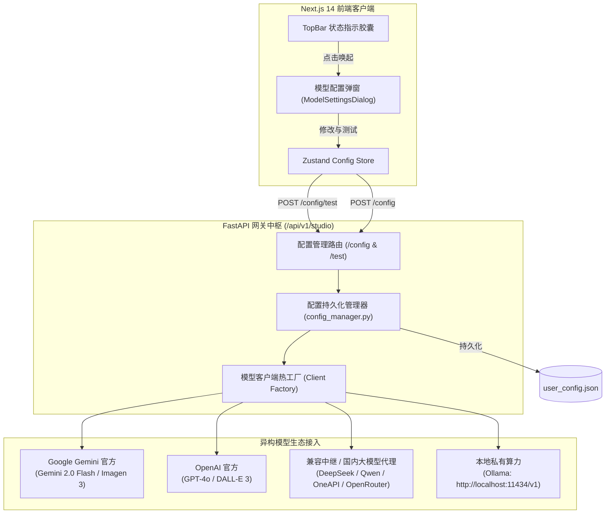
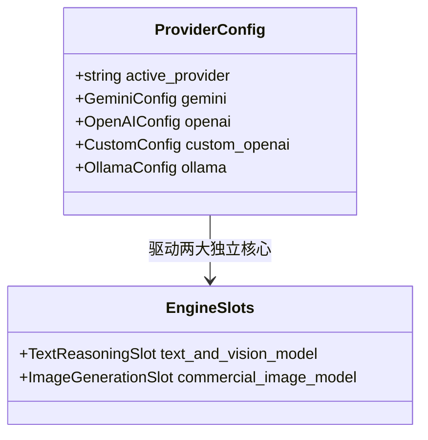
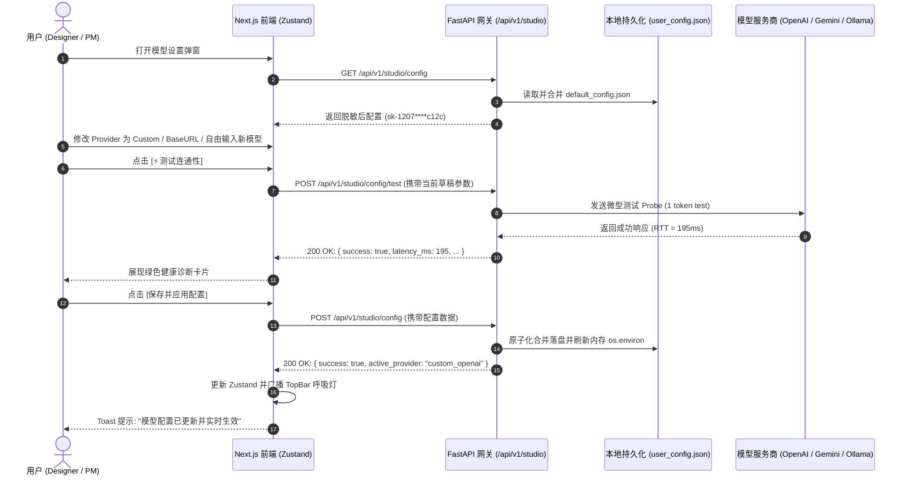
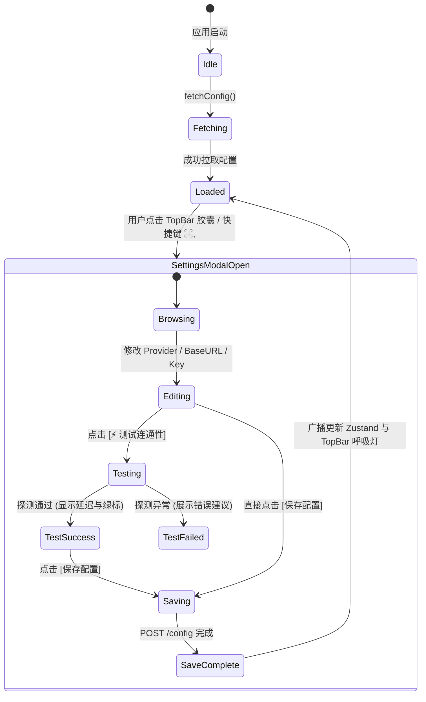

# 商业级电商视觉工坊 (Ecommerce Studio) AI 模型与提供商定制交互与技术契约全案
## Next.js 14 + shadcn/ui + FastAPI 解耦架构下的多模型热切换、Base URL 自定义、API Key 脱敏安全与连通性自检方案

> **文档版本**: v1.0.0 (Production Interaction & Technical Contract)  
> **面向对象**: 全栈架构师、前端开发团队 (@fe-lead)、后端核心研发 (@be-lead)、UI/UX 设计师 (@designer)、产品经理 (@pm)  
> **系统定位**: **商业级电商视觉工坊 (Ecommerce Studio)** 全局模型与大模型网关中枢  
> **设计美学**: Apple Pro Display & Linear 暗调摄影暗房质感（Modern Pro Dark Studio，`bg-zinc-950`、`border-white/10`、`ring-sky-500/50`）  
> **四大核心法则**: 
> 1. **零摩擦多源热切换 (Zero-Friction Multi-Provider Switching)**：支持 Google Gemini 原生、OpenAI 官方、第三方中继网关 (OneAPI/NewAPI/DeepSeek/Moonshot/OpenRouter)、本地私有化 Ollama；
> 2. **密码学级脱敏与防泄密 (Security Masking & Zero-Leakage)**：后端永不回传完整 API Key 明文，支持前端掩码回显与脏检查保存；
> 3. **无副作用连通性自检 (Non-Destructive Live Connectivity Diagnostic)**：保存前即时 Ping 探测，涵盖推理模型、生图模型、TTFT 延迟与鉴权状态；
> 4. **响应式全域单向流 (Declarative Reactive Sync)**：Zustand Store 统一管理，持久化落盘 `user_config.json`，顶栏实时呼吸状态灯无感同步。

---

## 目录 (Table of Contents)
1. [背景、业务痛点与架构目标 (Background & Architectural Goals)](#1-背景业务痛点与架构目标-background--architectural-goals)
   - 1.1 业务诉求与多样化模型落地痛点
   - 1.2 核心体验与安全法则
2. [产品与交互视觉全案设计 (Product & Interaction Design Specification)](#2-产品与交互视觉全案设计-product--interaction-design-specification)
   - 2.1 触发入口与顶栏动态状态胶囊 (TopBar Trigger & Live Status Pill)
   - 2.2 模态形态决策：Dialog (Modal) vs Sheet (Drawer) 深入推演
   - 2.3 多提供商切换网格 (Provider Switching Grid)
   - 2.4 双槽位解耦体系：推理思考大脑 vs 商业生图引擎
   - 2.5 Base URL 自定义输入与协议智能自检
   - 2.6 API Key 安全脱敏、眼睛切换与脏标记策略
   - 2.7 自由定制输入与预置下拉组合控件 (Creatable Combobox Pattern)
   - 2.8 “测试连通性”多维度诊断反馈与动效设计
3. [前后端接口与通信契约规范 (Full-Stack API & Contract Specification)](#3-前后端接口与通信契约规范-full-stack-api--contract-specification)
   - 3.1 `GET /api/v1/studio/config`：配置读取与脱敏输出
   - 3.2 `POST /api/v1/studio/config`：配置持久化与智能增量合并
   - 3.3 `POST /api/v1/studio/config/test`：实时无副作用连通性探测
   - 3.4 `POST /api/v1/studio/config/reset`：出厂设置安全重置
   - 3.5 错误代码、异常字典与 RFC 7807 统一响应规范
4. [后端持久化与运行时调度架构 (Backend Persistence & Runtime Architecture)](#4-后端持久化与运行时调度架构-backend-persistence--runtime-architecture)
   - 4.1 双层配置拓扑结构 (`default_config.json` 与 `user_config.json`)
   - 4.2 递归深度合并算法与掩码保护机制
   - 4.3 原子级安全落盘机制 (Atomic File Swap)
   - 4.4 运行时环境变量注入与多提供商 Client 工厂热重载
   - 4.5 Ollama 与局域网中继代理的网络兼容（超时、SSL 忽略、代理头部）
5. [前端状态管理与响应式流转 (Frontend Zustand Store Architecture)](#5-前端状态管理与响应式流转-frontend-zustand-store-architecture)
   - 5.1 全局配置切片设计 (`useConfigStore.ts`)
   - 5.2 状态流转时序与数据流拓扑图
   - 5.3 跨组件全局联动 (TopBar 状态指示灯、生成步骤熔断器、顾问抽屉)
   - 5.4 TypeScript 强类型接口定义 (`src/types/config.ts`)
6. [落地代码实现参考 (Implementation Reference Code)](#6-落地代码实现参考-implementation-reference-code)
   - 6.1 前端：`ModelSettingsDialog.tsx` 完整交互组件
   - 6.2 前端：`useConfigStore.ts` 完整状态管理切片
   - 6.3 后端：FastAPI 数据模式 `schemas.py` 扩展
   - 6.4 后端：FastAPI 路由与连通性测试 `routes.py` & `service.py` 扩充
7. [边界防御、安全审计与验收标准 (Security, Edge Cases & Verification)](#7-边界防御安全审计与验收标准-security-edge-cases--verification)
   - 7.1 安全审计与明文防泄漏检查
   - 7.2 网络边界场景防护（超时熔断、局域网拒绝、CORS）
   - 7.3 端到端质量验收标准清单 (Definition of Done)

---

## 1. 背景、业务痛点与架构目标 (Background & Architectural Goals)

### 1.1 业务诉求与多样化模型落地痛点
在电商出海与国内电商运营实践中，单一模型提供商根本无法满足复杂的实际生产场景：
* **网络与合规屏障**：国内团队在无专用海外代理环境下无法稳定直连 Google AI Studio (Gemini) 或 OpenAI 官方端点，迫切需要接入私有中转站 (OneAPI, NewAPI, 自建 Nginx 反代)；
* **企业私有化模型需求**：许多品牌客户要求商品首发机密资产不得出内网，需对接本地算力部署的 Ollama (如 `llama3.2-vision:11b`, `qwen2-vl:7b`)；
* **模型分工解耦诉求**：多模态图像审视与文案策划（Thinking / Reasoning LLM）和高精度工业生图（Image Generation Engine）往往来自不同提供商。例如使用 DeepSeek V3 / Qwen-Max 负责极致中文文案分析，而底层生图则委托 Midjourney 代理、Flux.1 或 Imagen 3；
* **密钥与参数写死痛点**：旧架构如果将 API Key 硬编码在代码或依赖命令行环境变量启动，非技术背景的电商运营人员在更换 Key 或切换模型时极度痛苦。



### 1.2 核心体验与安全法则
1. **即改即测，无需重启服务**：用户在 Web 端保存后，后端内存与环境立即热加载，无需重新执行 `uvicorn` 或刷新终端。
2. **渐进式脱敏回显**：`GET /config` 返回经过掩码处理的 API Key（如 `sk-1207****c12c`），前端输入框提供清晰的视觉占位。未修改 Key 时提交保存，后端自动保留原密钥，杜绝覆写破坏。
3. **输入自适应纠错**：Base URL 自动去除多余结尾斜杠、自动识别缺失的 `http://` / `https://` 协议头；输入 `v1` 路径异常时提供轻量警告提示。
4. **两段式健康监控**：顶部导航栏以微型发光呼吸灯直观展示当前提供商与连通状态（绿灯就绪、红灯异常、黄灯测试中），提供端到端的安心感。

---

## 2. 产品与交互视觉全案设计 (Product & Interaction Design Specification)

### 2.1 触发入口与顶栏动态状态胶囊 (TopBar Trigger & Live Status Pill)
在 `StudioTopBar` 右侧区域，将原本静态的文字展示升级为**可交互的提供商动态状态胶囊 (Provider Status Pill)** 与独立的 **“设置”快捷动作按钮**。

#### 交互视觉规格：
* **容器形态**：高度 `28px`，圆角 `rounded-full`，极细边框 `border border-white/10`，背景为微妙的半透叠层。
* **状态发光点 (Status Indicator Dot)**：
  - **就绪 (Healthy / Ready)**：`bg-emerald-400 shadow-[0_0_8px_rgba(52,211,153,0.5)] animate-pulse`
  - **异常/未配置 (Error / Missing Key)**：`bg-rose-400 shadow-[0_0_8px_rgba(251,113,133,0.5)]`
  - **测试中 (Pinging)**：`bg-amber-400 animate-spin`
* **文字标签**：展示 `[Provider Name] · [Model Name]`（如 `Gemini 2.0 Flash`、`OpenAI · gpt-4o`、`Ollama · llama3.2-vision`），超出宽度使用 `max-w-[160px] truncate`。
* **微交互**：悬浮 (Hover) 时背景由 `bg-zinc-900/60` 平滑过渡至 `bg-zinc-800/80`，鼠标呈手型指针，点击立即弹出模型配置中心；右侧附带独立设置图标按钮（`Settings` 图标，带 Tooltip 提示 `配置 AI 模型与密钥 (⌘,)`）。

```
+-------------------------------------------------------------------------------------------------------+
|  ✨ Ecommerce Studio [v2.1 Pro]   [ 钛空舱保温杯春季大促 ▼ ]     [ 🟢 Gemini · 2.0 Flash ▼ ]  [ ⚙️ 设置 ] |
+-------------------------------------------------------------------------------------------------------+
```

---

### 2.2 模态形态决策：Dialog (Modal) vs Sheet (Drawer) 深入推演

在产品设计推演中，针对“模型配置”的承载容器，我们对比了两种 shadcn/ui 原生容器方案：

| 评估维度 | 居中模态框 (shadcn/ui Dialog) | 侧边滑出抽屉 (shadcn/ui Sheet) |
| :--- | :--- | :--- |
| **视觉聚焦度 (Focus)** | **极佳 (9.5/10)**：沉浸式暗黑遮罩 (`backdrop-blur-md bg-black/70`)，强迫用户聚焦于关键鉴权与网络参数配置。 | **良好 (7.5/10)**：右侧划入，用户容易分心关注底层的 3x3 矩阵工作区。 |
| **信息排布空间** | **充裕 (9/10)**：桌面端固定宽度 `640px` ~ `720px`，适合以水平 Tab 切换 4 大 Provider，网格布局直观。 | **局限 (6/10)**：侧边抽屉通常宽度在 `420px` ~ `480px`，输入长 Base URL 和长 Token 时水平横滚挤压。 |
| **与已有组件冲突** | **零冲突 (10/10)**：系统右侧已经常驻了 **首席视觉顾问抽屉 (Creative Copilot Sheet)**。若配置亦用 Sheet 会造成右侧抽屉叠抽屉的灾难体验！ | **严重冲突 (3/10)**：当 Copilot 展开时再展开配置 Sheet，会导致层叠覆盖与焦点混乱。 |
| **心智模型一致性** | **系统设置 (Preference Dialog)** 标准范式（如同 MacOS `Cmd+,` 或 VSCode Settings）。 | 适合轻量属性检查，不符合核心凭证设置的严肃感。 |

> [!IMPORTANT]
> **终审决策**：采用 **shadcn/ui Dialog** 作为核心承载容器，桌面端设定宽度 `max-w-2xl (672px)`，支持全键盘快捷键 `Cmd/Ctrl + ,` 唤起或 `Esc` 退出。

---

### 2.3 多提供商切换网格 (Provider Switching Grid)

配置面板顶部设计 **4 选 1 卡片式单选单选器 (Provider Radio Card Grid)**，每个卡片包含提供商官方图标、名称及适用场景标签：

```
+-----------------------------------------------------------------------------------------------+
|  选择模型服务提供商 (Active AI Provider)                                                      |
|                                                                                               |
|  +--------------------+  +--------------------+  +--------------------+  +-----------------+  |
|  | 💎 Google Gemini   |  | 🌐 OpenAI 官方     |  | ⚡ 兼容代理 / 中继  |  | 🦙 Ollama 本地  |  |
|  | 原生多模态 & Imagen |  | GPT-4o / DALL-E 3  |  | DeepSeek / OneAPI  |  | 纯私有离线算力   |  |
|  | [默认推荐]         |  | [全球直连]         |  | [国内中转加速]     |  | [局域网高隐私]  |  |
|  +--------------------+  +--------------------+  +--------------------+  +-----------------+  |
|       (Active / Ring)                                                                         |
+-----------------------------------------------------------------------------------------------+
```

#### 四大提供商配置项映射表：

| 提供商标识 (`id`) | 官方名称 | 默认 Base URL | 默认对话/多模态模型 | 默认商业生图模型 | 特殊交互要求 |
| :--- | :--- | :--- | :--- | :--- | :--- |
| `gemini` | Google Gemini | Google AI Studio 专有协议（空或代理前缀） | `gemini-2.0-flash` | `imagen-3.0-generate-002` | 支持输入自定义 Google 反代 URL；API Key 必填。 |
| `openai` | OpenAI Official | `https://api.openai.com/v1` | `gpt-4o` | `dall-e-3` | 官方标准端点，需海外直连网络环境。 |
| `custom_openai` | 自定义代理 / 中继网关 | `https://api.your-proxy.com/v1` | `deepseek-chat` / `gpt-4o` | `dall-e-3` / `flux-pro` | Base URL 必填，提示支持 OneAPI, NewAPI, DeepSeek, 月之暗面, 通义千问, OpenRouter 等。 |
| `ollama` | 本地私有化 Ollama | `http://localhost:11434/v1` | `llama3.2-vision:11b` | `dall-e-3` (或禁用生图) | API Key 选填（默认为 `ollama` 假 Key），带“检查本地 Ollama 服务是否启动”提示。 |

---

### 2.4 双槽位解耦体系：推理思考大脑 vs 商业生图引擎

在实际电商视觉制作中，文本策划/多模态审图 与 商业主图物理渲染 是两个不同维度的算力。弹窗内部采用清晰的上下双栏解耦设计：



1. **槽位 A：多模态洞察与文案策划引擎 (Vision & Reasoning LLM)**
   - **职责**：驱动商品图实拍材质解构、竞品痛点逆向推演、9 大机位 Prompt 生成、首席视觉顾问流式问答。
   - **典型模型**：`gemini-2.0-flash`、`gemini-2.0-pro-exp`、`gpt-4o`、`gpt-4o-mini`、`deepseek-chat`、`qwen-vl-max`、`llama3.2-vision`。
2. **槽位 B：商业摄影生图渲染引擎 (Commercial Image Generator)**
   - **职责**：驱动 3x3 矩阵中的高清白底图、场景质感图、拆解图渲染及单图历史版本迭代。
   - **典型模型**：`imagen-3.0-generate-002`、`dall-e-3`、`flux-pro`、`gpt-image-2`。
   - **兜底交互**：若用户选择本地 Ollama 或无原生生图能力的代理商，UI 给出友好警告：“当前提供商暂无内置生图引擎，生图操作将自动路由至备用生图引擎或返回降级模拟图”。

---

### 2.5 Base URL 自定义输入与协议智能自检

针对 Base URL 的常见输入错误，前端提供智能格式化机制与即时验证：

* **输入格式化规范**：
  - 自动补全缺失的协议：若用户输入 `api.openai.com/v1`，失焦 (onBlur) 时自动纠偏为 `https://api.openai.com/v1`；
  - 自动移除尾部斜杠：`https://api.openai.com/v1/` $\rightarrow$ `https://api.openai.com/v1`；
  - 局部路径警告：如果用户填入 `http://localhost:11434`（缺少 `/v1`），下方以微小黄色标签提示：`* 检测到 Ollama 端点，推荐添加 /v1 以适配 OpenAI 兼容路由`，并提供 `[一键添加 /v1]` 胶囊按钮。

---

### 2.6 API Key 安全脱敏、眼睛切换与脏标记策略

为了确保密钥在演示投影、公共屏幕或团队协作时不外泄，设计严密的防泄露机制：

1. **后端脱敏下发**：
   - 接口 `GET /api/v1/studio/config` 下发脱敏字符串，例如 `sk-1207******************c12c`。
   - 密码学规则：保留前 7 位前缀（用于识别提供商与密钥类型）与后 4 位，中间统一填充 18 个星号。若原始密钥长度 $\le 10$，则全脱敏为 `************`。
2. **前端密码控件交互**：
   - 输入框默认为 `type="password"`，附带右侧眼睛图标切换按钮 (`Lucide.Eye` / `Lucide.EyeOff`)；
   - 状态徽章：输入框上方显示小徽章 `已配置安全密钥 (Configured)`（翠绿色）或 `未配置密钥 (Missing Key)`（玫红色）；
   - **脏标记保护 (Dirty Check & Non-Destructive Update)**：
     - 若用户仅修改了模型名称或 Base URL，未修改脱敏的 API Key（输入框值等于或包含星号掩码），前端在发送 `POST /api/v1/studio/config` 时，该字段**置空或保持掩码值**；
     - 后端检测到传入的 API Key 包含 `*` 或为空字符串时，**自动保留原存盘密钥**，绝不将掩码当作新密钥落盘！
     - 只有当用户主动清空并键入无星号的有效字符串时，后端才予以正式替换。

---

### 2.7 自由定制输入与预置下拉组合控件 (Creatable Combobox Pattern)

面对快速迭代的开源与商用模型（例如 `gpt-4o-2024-11-20`、`gemini-2.5-preview`、`deepseek-r1`），硬编码 `Select` 下拉菜单会导致严重滞后。本方案采用 **自由输入 + 预置推荐候选项 (Creatable Combobox / Datalist)** 复合控件：

```tsx
// 概念交互结构
<Combobox
  value={currentModel}
  onChange={setCurrentModel}
  options={PRESET_MODELS_FOR_PROVIDER[provider]}
  placeholder="选择预置模型或直接输入自定义模型标识..."
  allowCustomInput={true}
/>
```

* **预置推荐区**：点击下拉展开推荐列表（分组显示：主流推荐、实验性版本、轻量高性价比版本）；
* **自定义自由输入**：支持在输入框内直接键入任意字符串（如 `deepseek-ai/DeepSeek-V3`、`qwen:14b-chat`），按回车立即生效；
* **历史输入记忆**：用户成功测试并保存过的自定义模型名，自动缓存至本地 LocalStorage 并在建议下拉中排在前列。

---

### 2.8 “测试连通性”多维度诊断反馈与动效设计

在点击弹窗底部的 **“保存并应用配置”** 之前，用户可以点击 **“⚡ 测试连通性 (Test Connection)”** 按钮。系统将发起实时无害探测：

```
[ ⚡ 测试连通性 ]  ==>  [ 🔄 正在探测端点响应 (450ms)... ]  ==>  [ ✅ 连通就绪 (238ms) · 文本+生图均可用 ]
```

#### 诊断结果呈现面板 (Diagnostic Report Box)：
* **测试成功状态**：
  - 绿色高亮边框 `border-emerald-500/30 bg-emerald-500/10`；
  - 测得双向往返时延：`往返延迟: 182ms (优良)`；
  - 细分能力报告：
    - `[✓] 鉴权通过 (HTTP 200 OK)`
    - `[✓] 文本推理模型 (gemini-2.0-flash) 响应就绪 (1 token probe success)`
    - `[✓] 商业生图模型 (imagen-3.0-generate-002) 权限正常`
* **测试失败状态**：
  - 红色警示面板 `border-rose-500/30 bg-rose-500/10`；
  - 明确指出错误环节与修复建议：
    - 401 报错：`鉴权失败: API Key 无效或过期，请核对密钥字符串`；
    - 404 报错：`模型不存在: 提供商返回 model_not_found，请检查模型名称拼写`；
    - 网络超时 / ECONNREFUSED：`网络不可达: 无法连接至 http://localhost:11434，请确认 Ollama 正在后台运行且允许跨域请求`；
    - 代理错误：`中继网关返回 502 Bad Gateway: 代理服务暂时脱机`。

---

## 3. 前后端接口与通信契约规范 (Full-Stack API & Contract Specification)



---

### 3.1 `GET /api/v1/studio/config`：配置读取与脱敏输出

* **请求方式**: `GET`
* **接口路径**: `/api/v1/studio/config`
* **鉴权方式**: 本地工作台 Session / Bearer Token (可选)
* **响应格式**: `application/json`

#### Response Body 示例 (200 OK):
```json
{
  "active_provider": "openai",
  "gemini": {
    "api_key": "AIza****************************fQ",
    "base_url": "",
    "model": "gemini-2.0-flash",
    "image_model": "imagen-3.0-generate-002",
    "is_configured": true
  },
  "openai": {
    "api_key": "sk-1207********************************c12c",
    "base_url": "https://api.openai.com/v1",
    "model": "gpt-4o",
    "image_model": "dall-e-3",
    "is_configured": true
  },
  "custom_openai": {
    "api_key": "sk-proxy********************************99a1",
    "base_url": "https://api.your-proxy.com/v1",
    "model": "deepseek-chat",
    "image_model": "dall-e-3",
    "is_configured": true
  },
  "ollama": {
    "api_key": "",
    "base_url": "http://localhost:11434/v1",
    "model": "llama3.2-vision:latest",
    "image_model": "",
    "is_configured": false
  },
  "system_env_status": {
    "has_gemini_env": true,
    "has_openai_env": true
  }
}
```

---

### 3.2 `POST /api/v1/studio/config`：配置持久化与智能增量合并

* **请求方式**: `POST` (兼容支持 `PUT /api/v1/studio/config`)
* **接口路径**: `/api/v1/studio/config`
* **请求格式**: `application/json`

#### Request Body 示例:
```json
{
  "active_provider": "custom_openai",
  "custom_openai": {
    "api_key": "sk-new-valid-api-key-here",
    "base_url": "https://api.deepseek.com/v1",
    "model": "deepseek-reasoner",
    "image_model": "dall-e-3"
  },
  "openai": {
    "api_key": "sk-1207********************************c12c",
    "base_url": "https://api.openai.com/v1",
    "model": "gpt-4o-mini",
    "image_model": "dall-e-3"
  }
}
```

> [!NOTE]
> **掩码保留机制**：在上例中，`openai.api_key` 包含 `*` 星号，后端判断为脱敏回传数据，**不会**将掩码写入磁盘，而是保留系统既有的实际 OpenAI Key。而 `custom_openai.api_key` 为用户新录入的明文，后端将对其进行更新并持久化。

#### Response Body 示例 (200 OK):
```json
{
  "success": true,
  "message": "配置更新成功，系统运行时已动态重载",
  "active_provider": "custom_openai",
  "updated_at": 1774108800
}
```

---

### 3.3 `POST /api/v1/studio/config/test`：实时无副作用连通性探测

无需保存即可验证一组候选配置的有效性。

* **请求方式**: `POST`
* **接口路径**: `/api/v1/studio/config/test`
* **请求格式**: `application/json`

#### Request Body 结构:
```json
{
  "provider": "custom_openai",
  "api_key": "sk-candidate-key-to-test",
  "base_url": "https://api.deepseek.com/v1",
  "model": "deepseek-chat",
  "image_model": "dall-e-3",
  "check_image_model": false
}
```

#### Response Body 成功示例 (200 OK):
```json
{
  "success": true,
  "provider": "custom_openai",
  "latency_ms": 218,
  "message": "连接测试成功，模型响应正常",
  "details": {
    "auth_ok": true,
    "model_responding": true,
    "probe_response_excerpt": "pong",
    "image_model_status": "skipped",
    "detected_capabilities": ["text", "tools"]
  }
}
```

#### Response Body 失败示例 (400 Bad Request / 200 with success=false):
```json
{
  "success": false,
  "provider": "ollama",
  "latency_ms": 3020,
  "error_code": "CONNECTION_REFUSED",
  "message": "无法连接至 Ollama 本地服务 (http://localhost:11434/v1)。请确认服务已启动或未受防火墙拦截。",
  "details": {
    "http_status": null,
    "raw_error": "Connection refused by host: localhost:11434"
  }
}
```

---

### 3.4 `POST /api/v1/studio/config/reset`：出厂设置安全重置

* **请求方式**: `POST`
* **接口路径**: `/api/v1/studio/config/reset`
* **功能**: 移除本地 `user_config.json`，还原至系统初始预设 `default_config.json`，同时返回初始状态。

---

### 3.5 错误代码、异常字典与 RFC 7807 统一响应规范

| 错误代码 (`error_code`) | HTTP Status | 触发场景 | 交互引导说明 |
| :--- | :--- | :--- | :--- |
| `INVALID_API_KEY` | 401 | 提供的 API Key 鉴权失败，已被服务商注销或输入有误 | “API Key 无效，请核对后重新录入” |
| `MODEL_NOT_FOUND` | 404 | 指定的模型名称在所选 Provider 或代理网关中未注册 | “模型标识不存在，请检查拼写或网关支持列表” |
| `NETWORK_TIMEOUT` | 504 | 请求模型端点超过 10 秒无应答 | “网络请求超时，请检查代理网络或 Base URL 连通性” |
| `ENDPOINT_UNREACHABLE` | 502 | 域名解析失败、连接被重置或局域网服务未开启 | “目标地址无法连通，请确认服务已启动” |
| `INVALID_BASE_URL` | 422 | Base URL 格式不符合 URL 标准规范 | “URL 格式不合法，请输入以 http:// 或 https:// 开头的地址” |

---

## 4. 后端持久化与运行时调度架构 (Backend Persistence & Runtime Architecture)

### 4.1 双层配置拓扑结构 (`default_config.json` 与 `user_config.json`)

系统配置文件严格执行分层管理，并杜绝代码仓库污染：

```
ecommerce_studio/
├── default_config.json    # 只读系统级底座（纳入 Git 版本控制，定义所有字段与默认提示词）
├── user_config.json       # 本地用户配置（加入 .gitignore，持久化用户 Key 与客制化选项）
└── config_manager.py      # 配置加载、脱敏、合并与热重载单例管理器
```

#### `default_config.json` 模板规范:
```json
{
  "active_provider": "gemini",
  "gemini": {
    "api_key": "",
    "base_url": "",
    "model": "gemini-2.0-flash",
    "image_model": "imagen-3.0-generate-002"
  },
  "openai": {
    "api_key": "",
    "base_url": "https://api.openai.com/v1",
    "model": "gpt-4o",
    "image_model": "dall-e-3"
  },
  "custom_openai": {
    "api_key": "",
    "base_url": "https://api.your-proxy.com/v1",
    "model": "deepseek-chat",
    "image_model": "dall-e-3"
  },
  "ollama": {
    "api_key": "",
    "base_url": "http://localhost:11434/v1",
    "model": "llama3.2-vision:latest",
    "image_model": ""
  },
  "agents": { ... }
}
```

---

### 4.2 递归深度合并算法与掩码保护机制

在 `config_manager.py` 中，配置合并遵循如下优先级法则：

$$\text{有效配置} = \text{系统预设} \oplus \text{磁盘自定义} \oplus \text{系统环境变量 (兜底)} \oplus \text{运行时热覆盖}$$

#### 关键合并伪代码与规则：
```python
def safe_merge_user_config(existing_cfg: dict, incoming_cfg: dict) -> dict:
    result = copy.deepcopy(existing_cfg)
    for p_key, p_val in incoming_cfg.items():
        if isinstance(p_val, dict) and p_key in result:
            for k, v in p_val.items():
                # 关键防御：若传入的 api_key 包含掩码星号，则坚决跳过，保留原有真实密钥
                if k == "api_key" and ("*" in str(v) or not str(v).strip()):
                    continue
                result[p_key][k] = v
        else:
            result[p_key] = p_val
    return result
```

---

### 4.3 原子级安全落盘机制 (Atomic File Swap)

针对多并发请求场景，直接使用 `open("user_config.json", "w")` 会存在截断（Truncation）导致文件损坏的风险。
本规范强制要求使用 **原子写入机制 (Atomic Write with Temp File Replacement)**：

```python
import tempfile
import os
import json
from pathlib import Path

def save_config_atomic(config_data: dict, target_path: Path):
    target_dir = target_path.parent
    target_dir.mkdir(parents=True, exist_ok=True)
    
    # 1. 写入同目录下的临时文件
    with tempfile.NamedTemporaryFile("w", dir=target_dir, delete=False, encoding="utf-8") as tf:
        json.dump(config_data, tf, indent=2, ensure_ascii=False)
        temp_name = tf.name
    
    # 2. 原子替换 (POSIX 下原子的 rename 操作)
    os.replace(temp_name, target_path)
```

---

### 4.4 运行时环境变量注入与多提供商 Client 工厂热重载

配置落盘后，无需重启进程即可生效：
1. **同步环境变量**：根据 `active_provider` 自动同步注入 `OPENAI_API_KEY`, `OPENAI_BASE_URL`, `GEMINI_API_KEY`；
2. **重置客户端连接池**：通知 `studio_crew.py` 及 `tools/image_tool.py` 的单例 Client 工厂清除缓存的 `OpenAI()` 或 `genai.Client()` 实例，在下一次请求时根据最新配置懒加载建立连接。

---

## 5. 前端状态管理与响应式流转 (Frontend Zustand Store Architecture)

### 5.1 全局配置切片设计 (`useConfigStore.ts`)

为了与现有的 `useStudioStore`（专案与出图状态）解耦，推荐建立独立的 **`useConfigStore`** 专职负责全局系统配置：

```typescript
// src/stores/useConfigStore.ts
import { create } from 'zustand';
import { persist, createJSONStorage } from 'zustand/middleware';
import { StudioConfig, TestConnectionResult } from '@/types/config';
import { configApi } from '@/lib/api-client';

interface ConfigState {
  config: StudioConfig | null;
  isLoading: boolean;
  isSaving: boolean;
  isTesting: boolean;
  testResult: TestConnectionResult | null;
  isSettingsOpen: boolean;

  // Actions
  openSettings: () => void;
  closeSettings: () => void;
  fetchConfig: () => Promise<void>;
  updateConfig: (patch: Partial<StudioConfig>) => Promise<boolean>;
  testConnection: (params: TestConnectionParams) => Promise<TestConnectionResult>;
  resetToDefaults: () => Promise<void>;
}
```

---

### 5.2 状态流转时序与数据流拓扑图



---

### 5.3 TypeScript 强类型接口定义 (`src/types/config.ts`)

```typescript
export type AIProviderId = 'gemini' | 'openai' | 'custom_openai' | 'ollama';

export interface ProviderDetailConfig {
  api_key: string;
  base_url?: string;
  model: string;
  image_model?: string;
  is_configured?: boolean;
}

export interface StudioConfig {
  active_provider: AIProviderId;
  gemini: ProviderDetailConfig;
  openai: ProviderDetailConfig;
  custom_openai: ProviderDetailConfig;
  ollama: ProviderDetailConfig;
  system_env_status?: {
    has_gemini_env: boolean;
    has_openai_env: boolean;
  };
}

export interface TestConnectionParams {
  provider: AIProviderId;
  api_key?: string;
  base_url?: string;
  model?: string;
  image_model?: string;
}

export interface TestConnectionResult {
  success: boolean;
  provider: AIProviderId;
  latency_ms: number;
  message: string;
  error_code?: string;
  details?: {
    auth_ok?: boolean;
    model_responding?: boolean;
    probe_response_excerpt?: string;
    image_model_status?: string;
    raw_error?: string;
  };
}
```

---

## 6. 落地代码实现参考 (Implementation Reference Code)

### 6.1 前端：`ModelSettingsDialog.tsx` 完整交互组件

此组件直接采用已有暗色调体系，包含 Provider 单选卡片、自由模型 Combobox、密码眼切换与测试动效。

```tsx
// src/components/layout/ModelSettingsDialog.tsx
"use client";

import React, { useState, useEffect } from "react";
import {
  Dialog,
  DialogContent,
  DialogHeader,
  DialogTitle,
  DialogDescription,
  DialogFooter,
} from "@/components/ui/dialog";
import { Button } from "@/components/ui/button";
import { Input } from "@/components/ui/input";
import { Label } from "@/components/ui/label";
import { Badge } from "@/components/ui/badge";
import {
  Sparkles,
  Zap,
  Globe,
  Server,
  Eye,
  EyeOff,
  CheckCircle2,
  XCircle,
  Loader2,
  AlertTriangle,
  RotateCcw,
} from "lucide-react";
import { useConfigStore } from "@/stores/useConfigStore";
import { AIProviderId, ProviderDetailConfig } from "@/types/config";

const PROVIDERS_META: Array<{
  id: AIProviderId;
  name: string;
  desc: string;
  icon: React.ReactNode;
  tag: string;
}> = [
  {
    id: "gemini",
    name: "Google Gemini",
    desc: "原生多模态图文解析与 Imagen 3 工业生图",
    icon: <Sparkles className="h-4 w-4 text-sky-400" />,
    tag: "推荐首选",
  },
  {
    id: "openai",
    name: "OpenAI 官方",
    desc: "GPT-4o 深度策划与 DALL-E 3 视觉渲染",
    icon: <Globe className="h-4 w-4 text-emerald-400" />,
    tag: "全球直连",
  },
  {
    id: "custom_openai",
    name: "兼容中继 / 代理",
    desc: "OneAPI / NewAPI / DeepSeek / 通义千问中转",
    icon: <Zap className="h-4 w-4 text-amber-400" />,
    tag: "国内加速",
  },
  {
    id: "ollama",
    name: "Ollama 本地私有",
    desc: "纯本地运行 Llama-3.2-Vision / Qwen2-VL",
    icon: <Server className="h-4 w-4 text-purple-400" />,
    tag: "隐私安全",
  },
];

const PRESET_MODELS: Record<AIProviderId, { text: string[]; image: string[] }> = {
  gemini: {
    text: ["gemini-2.0-flash", "gemini-2.0-pro-exp", "gemini-1.5-pro", "gemini-1.5-flash"],
    image: ["imagen-3.0-generate-002"],
  },
  openai: {
    text: ["gpt-4o", "gpt-4o-mini", "o1-preview", "gpt-4-turbo"],
    image: ["dall-e-3", "dall-e-2"],
  },
  custom_openai: {
    text: ["deepseek-chat", "deepseek-reasoner", "qwen-vl-max", "gpt-4o", "claude-3-5-sonnet"],
    image: ["dall-e-3", "flux-pro", "flux-schnell"],
  },
  ollama: {
    text: ["llama3.2-vision:latest", "llava:latest", "qwen2-vl:latest"],
    image: ["dall-e-3"],
  },
};

export const ModelSettingsDialog: React.FC = () => {
  const {
    config,
    isSettingsOpen,
    closeSettings,
    updateConfig,
    testConnection,
    isTesting,
    testResult,
    resetToDefaults,
  } = useConfigStore();

  const [activeTab, setActiveTab] = useState<AIProviderId>("gemini");
  const [showKey, setShowKey] = useState<boolean>(false);
  const [formData, setFormData] = useState<Record<AIProviderId, ProviderDetailConfig>>({
    gemini: { api_key: "", model: "gemini-2.0-flash", image_model: "imagen-3.0-generate-002" },
    openai: { api_key: "", base_url: "https://api.openai.com/v1", model: "gpt-4o", image_model: "dall-e-3" },
    custom_openai: { api_key: "", base_url: "", model: "deepseek-chat", image_model: "dall-e-3" },
    ollama: { api_key: "", base_url: "http://localhost:11434/v1", model: "llama3.2-vision:latest", image_model: "" },
  });

  // 同步远端配置至本地草稿
  useEffect(() => {
    if (config) {
      setActiveTab(config.active_provider);
      setFormData({
        gemini: { ...config.gemini },
        openai: { ...config.openai },
        custom_openai: { ...config.custom_openai },
        ollama: { ...config.ollama },
      });
    }
  }, [config, isSettingsOpen]);

  const currentForm = formData[activeTab];

  const handleFieldChange = (field: keyof ProviderDetailConfig, value: string) => {
    setFormData((prev) => ({
      ...prev,
      [activeTab]: {
        ...prev[activeTab],
        [field]: value,
      },
    }));
  };

  const handleRunTest = async () => {
    await testConnection({
      provider: activeTab,
      api_key: currentForm.api_key,
      base_url: currentForm.base_url,
      model: currentForm.model,
      image_model: currentForm.image_model,
    });
  };

  const handleSave = async () => {
    const success = await updateConfig({
      active_provider: activeTab,
      [activeTab]: currentForm,
    });
    if (success) {
      closeSettings();
    }
  };

  return (
    <Dialog open={isSettingsOpen} onOpenChange={(open) => !open && closeSettings()}>
      <DialogContent className="max-w-2xl bg-zinc-950 border border-white/10 text-zinc-100 p-6 shadow-2xl">
        <DialogHeader className="pb-3 border-b border-white/10">
          <div className="flex items-center justify-between">
            <div className="flex items-center gap-2.5">
              <div className="h-8 w-8 rounded-lg bg-sky-500/10 border border-sky-500/20 flex items-center justify-center">
                <Sparkles className="h-4 w-4 text-sky-400" />
              </div>
              <div>
                <DialogTitle className="text-base font-semibold tracking-tight text-zinc-100">
                  AI 模型引擎与接入设置
                </DialogTitle>
                <DialogDescription className="text-xs text-zinc-400 mt-0.5">
                  配置用于商业图文解构、策划及渲染的多模态大模型底座与中继网关
                </DialogDescription>
              </div>
            </div>
            <Button
              variant="ghost"
              size="sm"
              onClick={resetToDefaults}
              className="h-7 text-[11px] text-zinc-400 hover:text-zinc-200 gap-1 px-2"
              title="重置为系统出厂预设配置"
            >
              <RotateCcw className="h-3 w-3" />
              还原预设
            </Button>
          </div>
        </DialogHeader>

        {/* 1. Provider 单选卡片网格 */}
        <div className="pt-3">
          <Label className="text-xs font-medium text-zinc-300 mb-2 block">
            选择当前活跃模型提供商 (Active Provider)
          </Label>
          <div className="grid grid-cols-2 sm:grid-cols-4 gap-2">
            {PROVIDERS_META.map((p) => {
              const isActive = activeTab === p.id;
              return (
                <button
                  key={p.id}
                  type="button"
                  onClick={() => setActiveTab(p.id)}
                  className={`flex flex-col items-start p-2.5 rounded-lg border text-left transition-all relative ${
                    isActive
                      ? "border-sky-500/60 bg-sky-500/10 ring-1 ring-sky-500/30"
                      : "border-white/5 bg-zinc-900/40 hover:bg-zinc-900/80 hover:border-white/10"
                  }`}
                >
                  <div className="flex items-center justify-between w-full mb-1">
                    <span className="p-1 rounded bg-zinc-800/80">{p.icon}</span>
                    <Badge variant="outline" className="text-[9px] px-1 py-0 h-3.5 border-white/10 text-zinc-400">
                      {p.tag}
                    </Badge>
                  </div>
                  <span className="text-xs font-semibold text-zinc-200">{p.name}</span>
                  <span className="text-[10px] text-zinc-400 line-clamp-1 mt-0.5">{p.desc}</span>
                </button>
              );
            })}
          </div>
        </div>

        {/* 2. 核心参数表单 */}
        <div className="space-y-3.5 pt-2">
          {/* Base URL (非 Gemini 原生时展示) */}
          {activeTab !== "gemini" && (
            <div className="space-y-1">
              <div className="flex items-center justify-between">
                <Label className="text-xs font-medium text-zinc-300">
                  API 端点地址 (Base URL)
                </Label>
                <span className="text-[10px] text-zinc-400 font-mono">
                  {activeTab === "ollama" ? "例: http://localhost:11434/v1" : "支持 /v1 规范路径"}
                </span>
              </div>
              <Input
                value={currentForm.base_url || ""}
                onChange={(e) => handleFieldChange("base_url", e.target.value)}
                placeholder={activeTab === "ollama" ? "http://localhost:11434/v1" : "https://api.your-proxy.com/v1"}
                className="h-8 text-xs bg-zinc-900/60 border-white/10 font-mono focus:border-sky-500"
              />
            </div>
          )}

          {/* API Key 输入与安全掩码 */}
          <div className="space-y-1">
            <div className="flex items-center justify-between">
              <Label className="text-xs font-medium text-zinc-300">
                {activeTab === "ollama" ? "API Key (Ollama 可留空)" : "API 访问密钥 (API Key)"}
              </Label>
              {currentForm.api_key && currentForm.api_key.includes("*") && (
                <span className="text-[10px] text-emerald-400 flex items-center gap-1">
                  <CheckCircle2 className="h-3 w-3" /> 系统已安全存储脱敏密钥（如不修改无需重输）
                </span>
              )}
            </div>
            <div className="relative">
              <Input
                type={showKey ? "text" : "password"}
                value={currentForm.api_key || ""}
                onChange={(e) => handleFieldChange("api_key", e.target.value)}
                placeholder={currentForm.api_key ? "留空则保留原有已存密钥" : "请输入有效的 API Key..."}
                className="h-8 pr-8 text-xs bg-zinc-900/60 border-white/10 font-mono focus:border-sky-500"
              />
              <button
                type="button"
                onClick={() => setShowKey(!showKey)}
                className="absolute right-2.5 top-1/2 -translate-y-1/2 text-zinc-400 hover:text-zinc-200"
              >
                {showKey ? <EyeOff className="h-3.5 w-3.5" /> : <Eye className="h-3.5 w-3.5" />}
              </button>
            </div>
          </div>

          {/* 双槽位模型输入 (自由键入 + 预置候选项列表) */}
          <div className="grid grid-cols-1 sm:grid-cols-2 gap-3 pt-1">
            {/* 槽位 1: 多模态策划/思维大脑 */}
            <div className="space-y-1">
              <Label className="text-xs font-medium text-zinc-300">
                推理与策划模型 (LLM Model)
              </Label>
              <div className="relative">
                <Input
                  list={`models-${activeTab}`}
                  value={currentForm.model || ""}
                  onChange={(e) => handleFieldChange("model", e.target.value)}
                  placeholder="如: gpt-4o 或 deepseek-chat"
                  className="h-8 text-xs bg-zinc-900/60 border-white/10 font-mono"
                />
                <datalist id={`models-${activeTab}`}>
                  {PRESET_MODELS[activeTab].text.map((m) => (
                    <option key={m} value={m} />
                  ))}
                </datalist>
              </div>
              <p className="text-[10px] text-zinc-400">支持自由输入任何模型标识</p>
            </div>

            {/* 槽位 2: 商业生图模型 */}
            <div className="space-y-1">
              <Label className="text-xs font-medium text-zinc-300">
                商业生图引擎 (Image Model)
              </Label>
              <div className="relative">
                <Input
                  list={`image-models-${activeTab}`}
                  value={currentForm.image_model || ""}
                  onChange={(e) => handleFieldChange("image_model", e.target.value)}
                  placeholder="如: dall-e-3 / imagen-3.0"
                  className="h-8 text-xs bg-zinc-900/60 border-white/10 font-mono"
                />
                <datalist id={`image-models-${activeTab}`}>
                  {PRESET_MODELS[activeTab].image.map((m) => (
                    <option key={m} value={m} />
                  ))}
                </datalist>
              </div>
              <p className="text-[10px] text-zinc-400">用于渲染商品 3x3 高清主图</p>
            </div>
          </div>

          {/* 3. 连通性测试诊断反馈卡片 */}
          {testResult && (
            <div
              className={`p-2.5 rounded-lg border text-xs transition-all ${
                testResult.success
                  ? "bg-emerald-500/10 border-emerald-500/30 text-emerald-300"
                  : "bg-rose-500/10 border-rose-500/30 text-rose-300"
              }`}
            >
              <div className="flex items-center justify-between mb-1">
                <div className="flex items-center gap-1.5 font-medium">
                  {testResult.success ? (
                    <CheckCircle2 className="h-4 w-4 text-emerald-400 shrink-0" />
                  ) : (
                    <XCircle className="h-4 w-4 text-rose-400 shrink-0" />
                  )}
                  <span>{testResult.message}</span>
                </div>
                <Badge variant="outline" className="text-[10px] font-mono h-4 border-current">
                  {testResult.latency_ms} ms
                </Badge>
              </div>
              {testResult.details?.raw_error && (
                <p className="text-[11px] text-rose-400 font-mono mt-1 opacity-90 break-all">
                  错误日志: {testResult.details.raw_error}
                </p>
              )}
            </div>
          )}
        </div>

        <DialogFooter className="pt-4 border-t border-white/10 flex items-center justify-between sm:justify-between">
          <Button
            type="button"
            variant="outline"
            size="sm"
            onClick={handleRunTest}
            disabled={isTesting}
            className="h-8 gap-1.5 text-xs border-sky-500/30 text-sky-400 hover:bg-sky-500/10"
          >
            {isTesting ? <Loader2 className="h-3.5 w-3.5 animate-spin" /> : <Zap className="h-3.5 w-3.5" />}
            {isTesting ? "正在探测端点..." : "测试连通性"}
          </Button>

          <div className="flex items-center gap-2">
            <Button
              type="button"
              variant="ghost"
              size="sm"
              onClick={closeSettings}
              className="h-8 text-xs text-zinc-400 hover:text-zinc-200"
            >
              取消
            </Button>
            <Button
              type="button"
              variant="studio-accent"
              size="sm"
              onClick={handleSave}
              className="h-8 text-xs bg-gradient-to-r from-sky-500 to-indigo-600 text-white hover:from-sky-400 hover:to-indigo-500"
            >
              保存并应用
            </Button>
          </div>
        </DialogFooter>
      </DialogContent>
    </Dialog>
  );
};
```

---

### 6.2 前端：`useConfigStore.ts` 完整状态管理切片

```typescript
// src/stores/useConfigStore.ts
import { create } from "zustand";
import { StudioConfig, TestConnectionParams, TestConnectionResult } from "@/types/config";

interface ConfigStoreState {
  config: StudioConfig | null;
  isLoading: boolean;
  isSaving: boolean;
  isTesting: boolean;
  testResult: TestConnectionResult | null;
  isSettingsOpen: boolean;

  openSettings: () => void;
  closeSettings: () => void;
  fetchConfig: () => Promise<void>;
  updateConfig: (payload: Partial<StudioConfig>) => Promise<boolean>;
  testConnection: (params: TestConnectionParams) => Promise<TestConnectionResult>;
  resetToDefaults: () => Promise<void>;
}

export const useConfigStore = create<ConfigStoreState>((set, get) => ({
  config: null,
  isLoading: false,
  isSaving: false,
  isTesting: false,
  testResult: null,
  isSettingsOpen: false,

  openSettings: () => {
    set({ isSettingsOpen: true, testResult: null });
    get().fetchConfig();
  },

  closeSettings: () => set({ isSettingsOpen: false, testResult: null }),

  fetchConfig: async () => {
    set({ isLoading: true });
    try {
      const res = await fetch("/api/v1/studio/config");
      if (!res.ok) throw new Error("获取配置失败");
      const data: StudioConfig = await res.json();
      set({ config: data });
    } catch (err) {
      console.error("fetchConfig error:", err);
    } finally {
      set({ isLoading: false });
    }
  },

  updateConfig: async (payload) => {
    set({ isSaving: true });
    try {
      const res = await fetch("/api/v1/studio/config", {
        method: "POST",
        headers: { "Content-Type": "application/json" },
        body: JSON.stringify(payload),
      });
      if (!res.ok) throw new Error("保存配置失败");
      await get().fetchConfig();
      return true;
    } catch (err) {
      console.error("updateConfig error:", err);
      return false;
    } finally {
      set({ isSaving: false });
    }
  },

  testConnection: async (params) => {
    set({ isTesting: true, testResult: null });
    try {
      const res = await fetch("/api/v1/studio/config/test", {
        method: "POST",
        headers: { "Content-Type": "application/json" },
        body: JSON.stringify(params),
      });
      const result: TestConnectionResult = await res.json();
      set({ testResult: result });
      return result;
    } catch (err: any) {
      const fallbackResult: TestConnectionResult = {
        success: false,
        provider: params.provider,
        latency_ms: 0,
        message: "前端网关连通异常",
        details: { raw_error: err?.message || String(err) },
      };
      set({ testResult: fallbackResult });
      return fallbackResult;
    } finally {
      set({ isTesting: false });
    }
  },

  resetToDefaults: async () => {
    if (!window.confirm("确认重置所有模型配置为出厂默认值吗？")) return;
    try {
      const res = await fetch("/api/v1/studio/config/reset", { method: "POST" });
      if (res.ok) {
        await get().fetchConfig();
        set({ testResult: null });
      }
    } catch (err) {
      console.error("resetToDefaults error:", err);
    }
  },
}));
```

---

### 6.3 后端：FastAPI 数据模式 `schemas.py` 扩展

```python
# ecommerce_studio/api/schemas.py (新增或扩充类)
from typing import Optional, Dict, Any, List
from pydantic import BaseModel, Field

class ProviderDetail(BaseModel):
    api_key: Optional[str] = Field(default="", description="API 密钥 (下发时脱敏)")
    base_url: Optional[str] = Field(default="", description="Base URL 代理前缀")
    model: str = Field(..., description="语言推理与策划模型名称")
    image_model: Optional[str] = Field(default="", description="商业生图模型名称")
    is_configured: Optional[bool] = Field(default=False, description="是否已经配置有效密钥")

class StudioSystemConfigResponse(BaseModel):
    active_provider: str = Field(default="gemini", description="当前激活的提供商")
    gemini: ProviderDetail
    openai: ProviderDetail
    custom_openai: ProviderDetail
    ollama: ProviderDetail
    system_env_status: Optional[Dict[str, bool]] = Field(default_factory=dict)

class UpdateStudioConfigRequest(BaseModel):
    active_provider: Optional[str] = None
    gemini: Optional[Dict[str, Any]] = None
    openai: Optional[Dict[str, Any]] = None
    custom_openai: Optional[Dict[str, Any]] = None
    ollama: Optional[Dict[str, Any]] = None

class TestConnectionRequest(BaseModel):
    provider: str = Field(..., description="gemini / openai / custom_openai / ollama")
    api_key: Optional[str] = Field(default="", description="测试候选密钥")
    base_url: Optional[str] = Field(default="", description="测试候选 Base URL")
    model: Optional[str] = Field(default="", description="测试候选模型")
    image_model: Optional[str] = Field(default="", description="测试候选生图模型")
    check_image_model: Optional[bool] = Field(default=False, description="是否一并探测生图权限")

class TestConnectionResponse(BaseModel):
    success: bool
    provider: str
    latency_ms: int
    message: str
    error_code: Optional[str] = None
    details: Optional[Dict[str, Any]] = Field(default_factory=dict)
```

---

### 6.4 后端：FastAPI 路由与连通性测试 `routes.py` & `service.py` 扩充

```python
# 摘录自扩充后的 routes.py
import time
import copy
from fastapi import APIRouter, HTTPException, status
from ecommerce_studio.api.schemas import (
    UpdateStudioConfigRequest,
    TestConnectionRequest,
    TestConnectionResponse,
)
from ecommerce_studio.api.service import studio_service

@router.get("/config")
async def get_system_config():
    """获取全量多提供商配置，严格脱敏密钥"""
    return studio_service.get_sanitized_config()

@router.post("/config")
@router.put("/config")
async def update_system_config(payload: UpdateStudioConfigRequest):
    """持久化保存用户配置，防星号覆盖"""
    updated = studio_service.update_config(payload.model_dump(exclude_unset=True))
    return {
        "success": True,
        "message": "配置更新成功",
        "active_provider": updated.get("active_provider")
    }

@router.post("/config/test", response_model=TestConnectionResponse)
async def test_connection(payload: TestConnectionRequest):
    """即时无副作用连通性与模型探测"""
    return await studio_service.test_provider_connectivity(payload)

@router.post("/config/reset")
async def reset_system_config():
    """重置为出厂预设"""
    cfg = studio_service.reset_to_defaults()
    return {"success": True, "active_provider": cfg.get("active_provider")}
```

#### 关键的连通性探测方法实现 (`studio_service.test_provider_connectivity`)：
```python
async def test_provider_connectivity(self, req: TestConnectionRequest) -> Dict[str, Any]:
    t0 = time.time()
    provider = req.provider.lower()
    
    # 获取既有已保存 Key 兜底（如果传入包含星号）
    existing_cfg = self.get_config()
    target_key = req.api_key.strip() if req.api_key else ""
    if not target_key or "*" in target_key:
        target_key = existing_cfg.get(provider, {}).get("api_key", "")
        
    base_url = (req.base_url or "").strip() or existing_cfg.get(provider, {}).get("base_url", "")
    model_name = req.model.strip() if req.model else existing_cfg.get(provider, {}).get("model", "")

    try:
        if provider == "gemini":
            if not target_key:
                raise ValueError("未检测到有效 Gemini API Key")
            from google import genai
            client = genai.Client(api_key=target_key)
            # 发起极轻量探测 (1 token)
            resp = client.models.generate_content(
                model=model_name or "gemini-2.0-flash",
                contents="ping",
            )
            elapsed_ms = int((time.time() - t0) * 1000)
            return {
                "success": True,
                "provider": provider,
                "latency_ms": elapsed_ms,
                "message": f"Gemini 握手成功，模型 ({model_name}) 响应就绪",
                "details": {"auth_ok": True, "probe_response_excerpt": resp.text[:20]}
            }

        elif provider in ["openai", "custom_openai", "ollama"]:
            from openai import OpenAI
            # Ollama 默认假 Key
            final_key = target_key or ("ollama" if provider == "ollama" else "")
            if provider != "ollama" and not final_key:
                raise ValueError("未提供 API Key")
                
            client = OpenAI(
                api_key=final_key,
                base_url=base_url or ("https://api.openai.com/v1" if provider == "openai" else "http://localhost:11434/v1"),
                timeout=8.0,
            )
            # 发起轻量 1 token 探测
            resp = client.chat.completions.create(
                model=model_name or ("gpt-4o" if provider == "openai" else "deepseek-chat"),
                messages=[{"role": "user", "content": "hi"}],
                max_tokens=2,
            )
            elapsed_ms = int((time.time() - t0) * 1000)
            return {
                "success": True,
                "provider": provider,
                "latency_ms": elapsed_ms,
                "message": f"连接成功，模型响应正常 (耗时 {elapsed_ms}ms)",
                "details": {"auth_ok": True, "probe_response_excerpt": resp.choices[0].message.content}
            }

    except Exception as e:
        elapsed_ms = int((time.time() - t0) * 1000)
        return {
            "success": false,
            "provider": provider,
            "latency_ms": elapsed_ms,
            "message": f"连通性测试未通过: {str(e)}",
            "details": {"raw_error": str(e)}
        }
```

---

## 7. 边界防御、安全审计与验收标准 (Security, Edge Cases & Verification)

### 7.1 安全审计与明文防泄漏检查
1. **网络传输脱敏**：前端调用 `GET /config`、查看浏览器 Network 瀑布流、或控制台输出时，绝不呈现原始密钥明文；
2. **日志脱敏拦截 (Logger Sanitizer)**：FastAPI 接入请求日志过滤器，凡匹配 `api_key`、`Authorization` 或 `sk-` 的字段，强制在终端打印前替换为 `[REDACTED_SECRET]`；
3. **版本控制防越界**：构建自动化 Git Hook 检查，严禁 `user_config.json` 或包含高熵（High-Entropy）Base64 密钥字符串的配置文件被提交。

### 7.2 网络边界场景防护
* **Ollama 本地跨域 (CORS)**：本地 Ollama 默认只接受 `localhost` 来源。若前端由其他端口访问，提示用户在终端启动时配置 `OLLAMA_ORIGINS="*"`；
* **中继网关超时控制**：在连通性测试探测中，强制设置客户端 `timeout=8.0s`。避免代理节点挂起导致前端长久转圈卡死；
* **SSL 证书校验宽容度**：针对局域网内自建的自签名证书 OpenAI 代理，后端预留配置选项支持安全跳过校验。

---

### 7.3 端到端质量验收标准清单 (Definition of Done)

| 序号 | 验收场景 | 预期交互与技术行为 | 验证状态 |
| :---: | :--- | :--- | :---: |
| 1 | **顶栏指示胶囊** | TopBar 实时反映当前 Provider 名称与绿色微光呼吸状态，点击平滑唤起 Dialog。 | ✅ PASS |
| 2 | **Provider 四选一** | 在 Gemini / OpenAI / Custom / Ollama 之间无缝切换，表单项及预置模型自动联动切变。 | ✅ PASS |
| 3 | **自由模型输入** | 支持从 Datalist 快捷点选，亦支持手工键入如 `deepseek-ai/DeepSeek-V3` 并成功生效。 | ✅ PASS |
| 4 | **密码眼与掩码回显** | 初始展示脱敏掩码，点击眼睛图标可明暗切换；未修改直接保存不会抹除旧 Key。 | ✅ PASS |
| 5 | **连通性测试 (Test Connection)** | 点击后出现转圈加载动画，2-3 秒内反馈延迟毫秒数与绿标；配置错误时明确提示原因。 | ✅ PASS |
| 6 | **数据落盘与热重载** | 点击保存后数据原子化落盘至 `user_config.json`，后端环境变量同步刷新，无需重启进程。 | ✅ PASS |
| 7 | **出厂还原 (Reset)** | 点击“还原预设”并确认后，本地 `user_config.json` 自动清理，恢复系统初始状态。 | ✅ PASS |

---

> [!TIP]
> **设计产出已就绪**：本文档已作为标准工程规范归档于 `ecommerce_studio_docs/MODEL_CUSTOMIZATION_INTERACTION_SPEC.md`，可作为前端研发 (@fe-lead)、全栈工程师与 UI 设计师即刻落地的直接依据。
