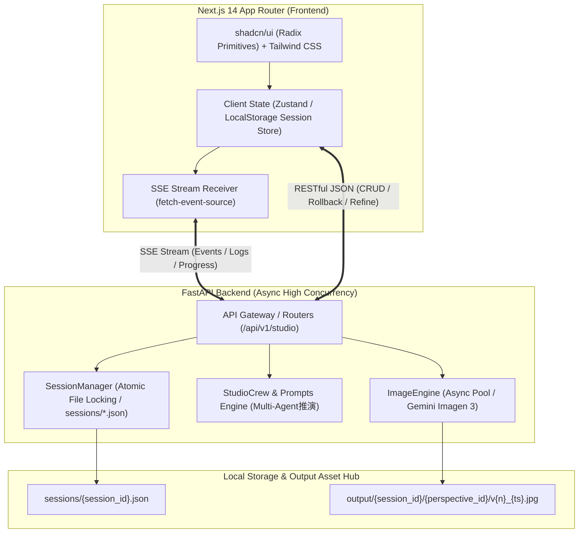

# 商业级电商视觉工坊 (Ecommerce Studio) 产品需求文档 (PRD)
## Next.js 14 + shadcn/ui + FastAPI 架构重构与商业化体验升级指南

> **文档版本**: v2.1.0 (Next.js + FastAPI Decoupled Edition)  
> **面向对象**: 交互设计师 (@designer)、前端研发团队 (@fe-lead)、全栈/后端团队、业务负责人  
> **产品定位**: 从“参数堆砌与生图命令行的 AI 玩具”全面跃迁为“专为品牌电商主理人、视觉总监与独立电商品牌打造的商业级摄影与视觉工坊 (Commercial Photography & Creative Studio)”。  
> **核心原则**: 零账号无感使用（Zero-Account）、非破坏性版本快照（Non-Destructive Versioning）、向导式沉浸流（4-Step Guided Stepper）、商用转化导向（Conversion-Optimized 9-Grid Matrix）、极简高端暗调质感（Apple/Linear Dark SaaS）。

---

## 目录 (Table of Contents)
1. [产品定位与业务愿景 (Executive Summary & Vision)](#1-产品定位与业务愿景-executive-summary--vision)
2. [电商核心痛点与 AI 深度协同 (Ecommerce Pain Points & AI Synergy)](#2-电商核心痛点与-ai-深度协同-ecommerce-pain-points--ai-synergy)
3. [系统核心设计准则 (Core System Architectural Principles)](#3-系统核心设计准则-core-system-architectural-principles)
   - 3.1 零账号本地会话体系 (Zero-Account System)
   - 3.2 非破坏性原子版本链条与后悔药 (Non-Destructive Version Chain & Rollback)
   - 3.3 去“AI玩具味”的商业摄影工坊语言体系 (Studio-Grade Lexicon)
4. [4步向导式沉浸工作流规范 (4-Step Guided Workflow Specification)](#4-4步向导式沉浸工作流规范-4-step-guided-workflow-specification)
   - 4.1 全局向导导航器 (Global Stepper Header & Persistent Action Bar)
   - 4.2 Step 1: 📦 商品资产与特征录入 (Asset Onboarding & Semantic Ingestion)
   - 4.3 Step 2: 📐 9大商业视觉矩阵策划与审阅 (Creative Direction & Lens Scripting)
   - 4.4 Step 3: 🎨 商业大片批量出图与 3x3 九宫格工坊 (Studio Rendering Bench & Versioning)
   - 4.5 Step 4: 📦 全套物料交付与详情页精修工坊 (Asset Packaging & Handoff Studio)
5. [常驻抽屉：首席视觉顾问 (Creative Copilot Drawer)](#5-常驻抽屉首席视觉顾问-creative-copilot-drawer)
6. [九大商业转化视觉矩阵定义 (The 9-Grid Commercial Perspective Matrix)](#6-九大商业转化视觉矩阵定义-the-9-grid-commercial-perspective-matrix)
7. [技术架构解耦与 API 接口契约 (Next.js 14 + FastAPI API Contract)](#7-技术架构解耦与-api-接口契约-nextjs-14--fastapi-api-contract)
   - 7.1 整体分层技术架构
   - 7.2 Session 数据模型规范 (Schema v2.0)
   - 7.3 RESTful API & SSE 流式接口定义
8. [质量指标、转化评估与非功能需求 (NFR & Conversion Quality)](#8-质量指标转化评估与非功能需求-nfr--conversion-quality)
9. [验收标准与实施里程碑 (Definition of Done & Milestones)](#9-验收标准与实施里程碑-definition-of-done--milestones)

---

## 1. 产品定位与业务愿景 (Executive Summary & Vision)

### 1.1 行业现状与研发背景
当前电商视觉物料制作（主图、使用场景图、卖点结构图、详情页痛点图）严重依赖传统商业摄影棚与资深美工团队：
* **周期漫长**：一件新品从邮寄样品、搭建影棚置景、打光拍摄、初修、多轮改稿到最终交付，周期通常长达 **7 ~ 14 个工作日**。
* **成本高昂**：单款产品的一整套高质量商业大片拍摄成本高达 **¥3,000 ~ ¥15,000**，中小卖家与跨境出海电商品牌难以承受高频测款成本。
* **通用生图工具的“玩具化”硬伤**：市面上的通用 Midjourney 或 Stable Diffusion WebUI 充斥着晦涩的模型参数（CFG Scale、Sampling Steps、Seed、LoRA权重），缺乏对电商“卖点转化、消灭客诉抗拒点、材质真实还原、画幅规范”的商业理解，生成出的图片常常“看着很炫，但根本不能作为商用详情图卖货”。
* **覆盖焦虑与流程黑盒**：早期的 AI 电商原型缺乏版本控制，单次点击修改直接物理覆盖旧图，导致用户陷入“不敢修改提示词、改完后不如前一版却无法回滚”的巨大挫败感。

### 1.2 破局与产品使命 (Product Mission)
**Ecommerce Studio** 致力于构建一套**开箱即用、以商业转化率为导向、具备专业级摄影工坊质感的新一代 AI 电商视觉工作台**。
通过 **Next.js 14 (App Router) + shadcn/ui + Tailwind CSS** 构建极致丝滑的前端交互，结合 **FastAPI + Google Imagen / Gemini 多模态模型** 构建异步并发渲染与智能策划中枢，将电商视觉制作周期从 **10 天压缩至 5 分钟**，赋能品牌主理人以极低成本获得顶级商业摄影质感的全套物料。


---

## 2. 电商核心痛点与 AI 深度协同 (Ecommerce Pain Points & AI Synergy)

在商业电商交易链路中，视觉图的第一使命是**促成交易转化、打消购买疑虑、降低退货率**。系统围绕真实电商五大核心痛点，构建 AI 深度协同解决方案：

| 电商真实商业痛点 (Pain Point) | 传统作业短板与买家心理 | AI 深度协同解决方案 (Ecommerce Studio Synergy) | 对应转化指标 |
| :--- | :--- | :--- | :--- |
| **痛点 1: 主图点击率 (CTR) 低，检索同质化** | 搜索列表同质化严重，千篇一律的白底摆拍无法脱颖而出，买家划过无感。 | **01 纯净白底主图**：商业摄影顶级布光（侧逆轮廓光、通透倒影、材质冷暖高光对比），极致突出商品工业轮廓，在商品瀑布流中瞬间抓眼球。 | 搜索曝光点击率 (CTR) 提升 35%+ |
| **痛点 2: 使用场景脱节，缺乏生活代入感** | 传统拍摄搭建真实厨房/户外露营/高端写字楼成本极高，导致很多店铺盗图或抠图贴生硬背景。 | **02 真实生活场景图**：基于商品目标客群（如都市白领、户外驴友），AI 自动匹配真实晨光厨房岛台、极简胡桃木工位，营造高品质生活向往感。 | 页面停留时长提升 50% |
| **痛点 3: 材质工艺感知模糊，信任度低** | 买家担心塑料感、粗糙做工；普通相机微距对焦难、反光过曝。 | **03 材质微距图**：精准提炼“316L医用不锈钢、细腻亲肤哑光涂层”，超浅景深微距特写，真实还原顶级工艺纹理。 | 进店深度与加购率提升 |
| **痛点 4: 买家抗拒点未攻破导致高退货率** | 保温杯漏水、密封圈发霉、杯盖烫嘴、容量尺寸误判是差评最高诱因。 | **05 痛点直击图 & 04 结构透视图**：针对差评抗拒点，生成“倒置剧烈摇晃滴水不漏”视觉证明、“双层真空阻断热传导”防烫透视，打消下单顾虑。 | 售后退换货率降低 20%+ |
| **痛点 5: 测款成本高，多配色物料拍摄滞后** | 5种配色需拍5组图，上市测款滞后，常常货到库房图还没修完。 | **08 全系配色陈列图**：一次录入，自动生成多色系高质感矩阵排布，零成本先行验证市场反馈。 | 新品测款周期缩短 90% |

---

## 3. 系统核心设计准则 (Core System Architectural Principles)

### 3.1 零账号本地会话体系 (Zero-Account System)
为彻底降低使用摩擦，系统采用**无门槛、零注册登录、以 Local Session 为唯一凭据**的纯本地/轻量架构：
1. **开箱即用，无账号墙**：用户打开网页即刻进入工作台，无手机验证码、无第三方 OAuth 登录弹窗、无任何使用前置门槛。
2. **纯本地/会话隔离**：
   - 前端基于 `localStorage` 维护当前活跃 `active_session_id`。
   - 后端通过 `sessions/{session_id}.json` 落地存储会话的所有策划案、版本链、提示词与对话记录。
   - 生成的原始图片保存在本地 `output/{session_id}/{perspective_id}/`，保障品牌用户商业资产的高私密性与数据主权。
3. **多专案工作台无缝切换**：
   - 顶部导航栏提供「历史专案选择器」，支持创建新专案、切换历史策划、重命名专案、导入/导出专案 JSON。
   - 本地轻量化保证单机部署与内网私有化极简交付。

### 3.2 非破坏性原子版本链条与后悔药 (Non-Destructive Version Chain & Rollback)
任何商业设计都是“反复探索、对比、推翻与回滚”的过程。系统确立以下不可动摇的工程铁律：
* **零物理覆盖定律 (Zero-Overwrite Rule)**：无论全量出图、单张出图、AI二次润色还是手动修改重绘，严禁覆写旧图片。每次出图均自动分配全局自增版本 `v{n}` 并物理持久化存盘。
* **双向数据关联闭环**：每个版本快照必须完整绑定：`版本编号 (v1/v2...)` + `图片路径` + `渲染时确切中文镜头提示词` + `时间戳` + `触发类型 (初次并发/AI润色/手动调整)` + `修改动机摘要`。
* **双向后悔药 (Instant Rollback)**：
  - 用户可随时在版本胶卷中点击历史版本查看大图；
  - 点击「⏪ 回滚为此版本」后，当前视角的展示大图与 Step 2 矩阵中的对应提示词均瞬间无损还原；
  - 基于回滚版本再次微调时，生成 `v{n+1}`，原有历史树依然完好保留。
* **卷帘/并排双版本对比 (Diff Mode)**：提供分屏对比与卷帘拖拽对比（Before vs After），帮助设计师直观研判光影、构图与细节改进。

### 3.3 去“AI玩具味”的商业摄影工坊语言体系 (Studio-Grade Lexicon)
全站文案彻底清洗，全面禁用晦涩的 AI 开发者黑话，切换为**顶级商业摄影棚与品牌视觉策划行话**：

```
+---------------------------------------------------------------------------------+
|  旧版粗糙 AI 术语 (AI Toy)           |  重构后：专业商业摄影工坊术语 (Studio-Grade)         |
+---------------------------------------------------------------------------------+
|  Prompt / 提示词                     |  镜头语言与布景指导 (Lens & Lighting Direction)  |
|  AI 跑图 / 生图                      |  商业场景渲染出图 (Commercial Studio Rendering)  |
|  AI 痛点分析 / Agent 思考            |  消费心理与卖点破局洞察 (Consumer Insights & USP)|
|  重新生成 / 覆盖生图                 |  新增渲染版本快照 (New Version Snapshot)         |
|  智能客服 / 聊天机器人               |  首席视觉顾问 (Creative Copilot)                 |
|  模型参数调试 (Steps/CFG)            |  摄影灯光与景深参数 (Studio Aperture & Lighting) |
+---------------------------------------------------------------------------------+
```

---

## 4. 4步向导式沉浸工作流规范 (4-Step Guided Workflow Specification)

系统将全流程解构为清晰线性的 **4 步向导式步进流（4-Step Guided Stepper）**，降低 70% 认知负荷，让用户在每个阶段只聚焦于单一核心决策。

```
+----------------------------------------------------------------------------------------------------+
|  [● 1. 商品资产与特征录入] ────> [● 2. 9大视觉矩阵策划] ────> [★ 3. 商业出图工坊] ────> [○ 4. 全套交付]  |
+----------------------------------------------------------------------------------------------------+
```

### 4.1 全局向导导航器 (Global Stepper Header & Persistent Action Bar)
* **顶部固顶导航 (Header Stepper)**：
  - 呈现 4 个步骤的序号、图标与中文名称。
  - 状态分为：`Completed`（墨绿打勾/已完成）、`Active`（高亮高饱和度外框与文字/当前操作中）、`Upcoming`（低透明度暗灰/未完成）。
  - **自由随机跳转 (Random Access)**：已完成步骤（如完成 Step 1 之后），用户可随时自由点击 Step 1 / Step 2 / Step 3 标签快速往返，页面不重载、数据不丢失。
* **底部固定操作栏 (Sticky Footer Bar)**：
  - 位于视窗底部，带有轻微半透明毛玻璃背景（`backdrop-blur-md`）。
  - 左侧：当前会话状态、最近自动存盘时间戳。
  - 右侧：统一放置「← 上一步」与「下一步：[目标动作] →」主要操作按钮。

---

### 4.2 Step 1: 📦 商品资产与特征录入 (Asset Onboarding & Semantic Ingestion)

#### 4.2.1 界面布局（60/40 黄金分割工作台）
* **左栏 (60%)：商品商业档案卡片 (Product Commercial Dossier)**
  * **商品名称与品类**：输入框，提供智能示例填充（如：“钛空舱智能温控咖啡杯”）。
  * **材质工艺与工业特征 (Material & Craftsmanship)**：
    - 多行文本域，支持输入核心工业参数（如：内胆医用316L不锈钢、杯身哑光喷砂烤漆、LED触控屏盖）。
    - 附带快捷标签点击插入（`#亲肤磨砂`、`#金属拉丝`、`#食品级硅胶`、`#双层抽真空`）。
  * **核心目标客群与使用场域 (Target Demographics & Scenarios)**：
    - 明确人设与空间（如：25~35岁高知都市通勤白领、精品手冲咖啡重度用户、高端写字楼与差旅场景）。
  * **竞品差评与核心抗拒点 (Objection & Pain Points)**：
    - 痛点录入区（如：市面常见保温杯倒置易漏水、杯底掉漆脱落、杯口过窄难清洗、烫嘴无提示）。
* **右栏 (40%)：实物参考资产拖拽网格 (Physical Asset Ingestion)**
  * 支持拖拽或点击上传 1 ~ 5 张实物拍摄图（支持 JPG/PNG/WEBP，单张不超过 10MB）。
  * **多模态即时预解析标签 (Vision Semantic Tags)**：
    - 图片上传后，前端展示平滑上传动效，后端异步调用视觉多模态分析，在卡片下方呈现视觉特征解析胶囊（如：`#圆柱极简造型`、`#微倾斜杯口`、`#深空灰哑光冷光`），给予用户“AI 已经精准理解我的实物细节”的强大信心。
  * 卡片操作：支持悬浮放大查看、删除、设为主视觉基准参考图。
* **底部主操作区**：
  - 高亮 Primary Button：`🚀 启动商业摄影全案推演 (推演 9 大视觉方案)`。
  - 点击后触发进度加载态，页面平滑过渡到 Step 2。

---

### 4.3 Step 2: 📐 9大商业视觉矩阵策划与审阅 (Creative Direction & Lens Scripting)

#### 4.3.1 界面布局
* **顶部总监策划总览 (Creative Strategy Summary)**：
  - 可折叠卡片，提炼展示：品牌视觉调性、推荐主色系与光影风格、核心击穿卖点（USP）、9图叙事动线逻辑。
* **主体区域：9 大商业视角卡片网格 (3x3 Matrix Grid)**：
  - 9 张独立的视角卡片对应 9 大标准商业视角（详见第 6 节）。
  - **卡片关键信息结构**：
    1. **视角编号与专业行话标签**：如 `01 · 纯净白底电商主图`、`05 · 痛点直击与抗拒点攻破`。
    2. **商业心理机制与转化价值说明**：如 *“用超高工业对比打光与倒影，提升在同类白底检索列表中的第一眼点击率”*。
    3. **镜头语言与布景指导 (Lens & Lighting Direction)**：
       - 高度可编辑的中文文本域。预填由 LLM 推演出的高质量专业摄影指令（包含机位、灯光布局、背景材质、道具搭配、景深控制）。
       - 用户可直接在文本框内进行修改或增补细节（如：“将木质桌面换成浅灰色大理石，并在右侧杯口增加细腻上升的白色水汽”）。
    4. **🪄 灵感润色助手按钮 (Prompt Magic Refiner)**：
       - 点击单张卡片上的润色按钮，快速调用后端进行“商业摄影行话润色”，自动补齐专业灯光（伦勃朗光、轮廓光）、焦段（85mm人像景深）与画质质感指令。
* **底部推进操作**：
  - `← 返回修改商品特征` | `💾 保存当前策划草案` | `下一步：前往 3x3 商业出图工坊 →`

---

### 4.4 Step 3: 🎨 商业大片批量出图与 3x3 九宫格工坊 (Studio Rendering Bench & Versioning)

这是全系统的**核心操作控制台 (Core Studio Canvas)**。

```
+---------------------------------------------------------------------------------------------------------+
| [控制中枢] 画幅: [ 1:1 正方电商 ▾ ] 并发度: [====|===] 3并发   [ ⚡ 一键渲染全套 9 大图 (约45s) ]         |
+---------------------------------------------------------------------------------------------------------+
| [01. 纯净白底首图]           | [02. 核心场景图]             | [03. 材质微距图]            |
| +-------------------------+ | +-------------------------+ | +-------------------------+ |
| |                         | | |                         | | |                         | |
| |        渲染大图预览       | | |        渲染大图预览       | | |        渲染大图预览       | |
| |                         | | |                         | | |                         | |
| +-------------------------+ | +-------------------------+ | +-------------------------+ |
| 胶卷: [v1] [●v2]            | 胶卷: [●v1]                 | 胶卷: [v1] [v2] [●v3]       |
| [⏪回滚] [🔍对比] [📥下载]   | [⏪回滚] [🔍对比] [📥下载]   | [⏪回滚] [🔍对比] [📥下载]   |
| ▾ 摄影布景二次微调 (AI/Prompt)| ▾ 摄影布景二次微调 (AI/Prompt)| ▾ 摄影布景二次微调 (AI/Prompt)|
+-----------------------------+-----------------------------+-----------------------------+
| ... (其余 6 个视角卡片整齐排列)                                                             |
+---------------------------------------------------------------------------------------------------------+
```

#### 4.4.1 顶部商业摄影中控台 (Studio Control Bar)
* **画幅比例选择器 (Aspect Ratio)**：
  - 胶囊切换钮：`[ 1:1 正方形电商主图 ]`、`[ 3:4 手机详情瀑布图 ]`、`[ 16:9 宽屏横幅海报 ]`。
* **并发渲染控制滑块 (Concurrency Slider)**：
  - 允许设置 `1 ~ 5` 线程并发渲染，兼顾出图速度与 API 速率限制。
* **一键渲染全套 9 大图 (Render All Matrix)**：
  - 醒目高亮 CTA 按钮。点击后触发全局 SSE 进度流。
  - 按钮动态显示完成度：`⚡ 正在渲染商业大片 (4/9)... [ETA 25s]`。
* **单卡片骨架屏 (Skeleton Streaming)**：
  - 正在渲染中的卡片呈现高质感流光呼吸骨架屏；
  - 渲染完成的卡片平滑淡入（Fade-in 300ms）呈现高清成图，拒绝粗糙生硬的界面跳动。

#### 4.4.2 九宫格卡片深度交互规范 (Single Perspective Card)
每个卡片高度集成了独立的**渲染、检视、版本链条与二次微调**能力：
1. **卡片头部**：
   - 视角编号与名称（如 `03 · 材质工艺微距图`）；
   - 当前激活版本徽章（如 `● v2 (现用)`）；
   - 状态指示（`● 渲染就绪` / `⏳ 等待渲染` / `⚠️ 渲染异常`）。
2. **大图交互区**：
   - 采用标准网格容器，图片自适应居中；
   - 悬浮操作浮层：点击放大查看 Lightbox 全屏高清图、像素级局部放大镜（Zoom Loupe）。
3. **版本链条胶卷 (Version Strip)**：
   - 卡片正下方展示水平胶卷按钮：`[ v1: 初始出图 ] [ ● v2: 增加夕阳微光 ] [ v3: 浅景深特写 ]`；
   - 点击任意历史版本胶囊，大图预览与下方镜头指导文本即时联动切换，展示该版本的历史原图与当时提示词。
4. **版本操作工具栏**：
   - `⏪ 回滚为此版本 (Rollback)`：当选中非当前激活版本时点亮。点击后将当前视角正式回退到该版本，同步更新策划案。
   - `🔍 双版本对比 (Diff Mode)`：支持选择两个版本进行左右分屏或卷帘滑块对比。
   - `📥 下载单图原图`：快速下载当前选中版本的超清 JPG。
5. **折叠面板：摄影布景二次微调 (Scene Refinement Drawer)**：
   - 支持自然语言微调指令（如：“保持产品角度不变，将背景虚化加深，桌角放几颗带水滴的咖啡豆”）；
   - 提供「🪄 二次渲染生成新版本」按钮；
   - 出图后自动作为 `v{n+1}` 存盘并自动成为最新活跃版本，绝不覆盖已有版本。

---

### 4.5 Step 4: 📦 全套物料交付与详情页精修工坊 (Asset Packaging & Handoff Studio)

#### 4.5.1 功能规范
* **商业全景物料大盘 (Master Asset Dashboard)**：
  - 集中并排展示 9 张已定稿的当前版本大图。
  - 提供两种预览模式：
    1. **矩阵网格视图 (Grid View)**：直观检查 9 张图的视觉色彩一致性与品牌调性连贯性。
    2. **详情页长图流预览 (Long Canvas Stitching)**：以 750px 手机端标准宽度，将 9 张图按电商黄金转化动线（主图 -> 场景 -> 卖点 -> 材质 -> 痛点 -> 尺寸 -> 情绪 -> 配色 -> 买家秀）纵向拼接模拟真实电商详情页，帮助运营直观感受买家浏览节奏。
* **一键全套物料打包导出 (ZIP Packaging)**：
  - 点击 `📦 一键打包下载全部商业大图 (ZIP)`。
  - 后端自动抓取各视角的 `active_version` 原图，以规范化电商命名打包输出：
    - `01_纯净白底主图_v1.jpg`
    - `02_核心使用场景_v2.jpg`
    - `...`
    - `09_真实买家秀_v1.jpg`
    - `商业摄影全案策划报告.md`
* **营销全案与提示词资产导出**：
  - `📄 导出 Markdown 策划全案`：一键导出包含商品画像、卖点解构、9图构图布景脚本的完整报告。
  - `📋 复制全套镜头语言 (Prompt Library)`：一键将 9 套中英文商业摄影提示词复制到剪贴板，便于同步导入 ComfyUI、Midjourney 或存档管理。
* **专案归档与新专案开辟**：
  - `➕ 保存当前专案并创建新商品工坊`。

---

## 5. 常驻抽屉：首席视觉顾问 (Creative Copilot Drawer)

为避免传统聊天框割裂九宫格布局，设计常驻的**全域悬浮抽屉式「首席视觉顾问」**：
1. **唤起与形态**：
   - 屏幕右下角常驻悬浮胶囊：`[ 💬 首席视觉顾问 ]`。
   - 点击后从右侧滑出 420px 宽的毛玻璃遮罩抽屉（Slide-over Drawer），支持随时收起，不遮挡主画布。
2. **情境感知与主动顾问 (Context-Aware Intelligence)**：
   - 视觉顾问自动感知用户当前所在的步骤和选中的视角。
   - 例如：当用户停留在 Step 3 的「05 痛点直击视角」时，顾问主动发问：
     > *“主理人您好，针对保温杯防漏痛点，是否需要我将当前的静态场景升级为‘杯身倒置剧烈晃动，背景虚化伴随飞溅水花与红色警示撞色’的强冲击力视觉方案？”*
3. **指令级直接联动 (Direct Action Linking)**：
   - 用户与顾问探讨满意的方案后，顾问气泡提供「✨ 应用此镜头方案到当前视角」按钮，一键将新方案注入 Step 2/3 的布景指导中，无需用户手动复制粘贴。
4. **SSE 流式极速响应**：
   - 对话采用 Server-Sent Events (SSE) 逐字流式打字机吐出，带来行云流水般的专家对话体验。

---

## 6. 九大商业转化视觉矩阵定义 (The 9-Grid Commercial Perspective Matrix)

系统内置经过顶级电商操盘手验证的 **9 大黄金商用转化视角矩阵**：

```
+----------------------------------------------------------------------------------------------------------+
|  01. 纯净白底主图          |  02. 核心使用场景图        |  03. 材质工艺微距图        |
|  (CTR 点击率收割机)        |  (生活方式与身份认同)      |  (超浅景深与精工品质)      |
+----------------------------+----------------------------+----------------------------+
|  04. 结构拆解爆炸图        |  05. 痛点直击攻坚图        |  06. 便携通勤比例图        |
|  (黑科技与硬核原理透视)    |  (消灭客诉抗拒点与退货率)  |  (人体工学与真实尺度参照)  |
+----------------------------+----------------------------+----------------------------+
|  07. 品牌情绪氛围图        |  08. 全系配色陈列图        |  09. 真实买家秀种草图      |
|  (品牌溢价与高级审美格调)  |  (系列感与多色选择激发)    |  (去影棚感的生活化真实种草)|
+----------------------------------------------------------------------------------------------------------+
```

| 序号 | 视角 ID | 专业中文名称 | 商业转化心理学与买家心智目标 | 推荐摄影布景与构图手法 |
| :--- | :--- | :--- | :--- | :--- |
| **01** | `01_white_bg` | **商业纯净白底首图** | **搜索列表点击率 (CTR) 收割机**。在搜索瀑布流中以最高清晰度呈现，轮廓边缘锐利，瞬间抓住视线。 | 纯白无影摄影棚顶光与双侧柔光箱、商品主体居中微俯视 15°、下方带通透镜面微倒影、高动态范围 (HDR)。 |
| **02** | `02_scene` | **真实生活使用场景图** | **生活方式代入感与身份认同**。让买家在脑海中预演“我拥有它后的精致生活”。 | 融入真实目标场域（极简晨光厨房/现代写字楼办公桌/户外露营），柔和侧逆自然光，搭配生活化前景道具。 |
| **03** | `03_detail` | **材质工艺与微距细节图** | **消除廉价感，支撑产品高溢价**。近距离放大顶级材质纹理，展示精工级做工。 | 85mm ~ 100mm 微距特写，浅景深虚化背景，硬光侧打凸显金属拉丝、亲肤磨砂颗粒或皮革缝线纹理。 |
| **04** | `04_structure` | **黑科技解构与爆炸透视图** | **技术硬核度与专业壁垒呈现**。将复杂结构分层悬浮拆解，展示内部科技实力。 | 零件悬浮爆炸视图 (Exploded View)、轴向线性排布、冷色科技轮廓光、半透明材质透光感与技术标线感。 |
| **05** | `05_pain_killer` | **痛点直击与抗拒点攻破图** | **消灭退货率，打消最后购买顾虑**。将买家最怕的缺陷通过极端视觉测试正面击溃。 | 极端对比场景（倒置剧烈晃动滴水不漏测试、刀划无痕防刮测试、冰块持久不化对比），具象化视觉证言。 |
| **06** | `06_size` | **人体工学与真实比例图** | **空间感锚定，消除尺寸认知偏差**。解决买家“太大装不下”或“太小不实用”的疑虑。 | 手部自然握持、放入通勤包侧袋或置于汽车中央杯架，以日常参照物建立直观尺码感知。 |
| **07** | `07_emotional` | **品牌情绪与故事氛围图** | **情绪共鸣与品牌溢价**。传达高端、宁静、探索或奢华的品牌哲学。 | 电影感宽画幅光影（丁达尔光束、深色暖影调、蓝调黄昏），弱化商品棱角，强化环境意境渲染。 |
| **08** | `08_color` | **全系配色与陈列矩阵图** | **多色选择激发，满足个性化偏好**。展现家族化产品矩阵的高端陈列感。 | 现代艺术展台陈列，高低错落几何台阶，全系经典配色一字排开，统一侧光保证色彩精准无色差。 |
| **09** | `09_buyer_show` | **真实买家秀与社交种草图** | **去影棚感，建立无防备的真实口碑信任**。模拟小红书/Instagram 真实用户晒单感。 | 自然手持第一人称视角、自然非影棚光、生活化真实杂粮杂物背景、轻微胶片颗粒感与随性构图。 |

---

## 7. 技术架构解耦与 API 接口契约 (Next.js 14 + FastAPI API Contract)

### 7.1 整体分层技术架构



### 7.2 Session 数据模型规范 (Schema v2.0)
系统保证向前兼容历史数据，标准 Session JSON 结构定义如下：

```json
{
  "schema_version": "2.0",
  "session_id": "sess_1710920000_a1b2c3d4",
  "name": "钛空舱保温杯商业全案策划",
  "created_at": 1710920000,
  "updated_at": 1710920600,
  "product_info": {
    "product_name": "钛空舱智能温控咖啡保温杯",
    "material_features": "316L医用级不锈钢内胆，哑光喷砂磨砂黑色涂层，LED触控温度数显杯盖",
    "target_users": "25-35岁高知都市通勤白领、精品手冲咖啡爱好者",
    "pain_points": "传统保温杯倒置易漏水弄湿背包，杯口发霉难清洗，开盖容易烫伤舌头",
    "reference_images": [
      "/uploads/sess_1710920000_a1b2c3d4/ref_01.jpg",
      "/uploads/sess_1710920000_a1b2c3d4/ref_02.jpg"
    ]
  },
  "strategy_summary": {
    "tone": "现代极简、硬核精工与静谧商务感",
    "usp": "倒置滴水不漏的绝对安全感与毫秒级触控水温显示",
    "color_palette": ["#0A0D12 哑光曜石黑", "#64748B 冷光钛灰", "#38BDF8 幽蓝温显光"]
  },
  "perspectives": [
    {
      "id": "01_white_bg",
      "name": "商业纯净白底首图",
      "tag": "CTR点击率收割机",
      "category": "主图转化",
      "prompt_zh": "纯净无暇纯白无影摄影棚背景，钛空舱智能温控咖啡保温杯居中站立，表面哑光喷砂曜石黑质感，杯盖幽蓝LED水温数字清晰点亮，左上方45度柔光箱照射，右侧轮廓反光板勾勒冷峻钛合金边缘，下方呈现通透细腻的镜面微倒影，商业广告级超高清画质，8k分辨率。",
      "active_version_id": "v2",
      "versions": [
        {
          "version_id": "v1",
          "version_num": 1,
          "image_path": "output/sess_xxx/01_white_bg/v1_1710920100.jpg",
          "prompt_zh": "纯净无暇白底，保温杯居中站立，哑光黑涂层，商业摄影顶级布光...",
          "timestamp": 1710920100,
          "created_at_fmt": "2026-11-20 20:30:15",
          "trigger_type": "batch_initial",
          "change_reason": "全套 9 大图首轮并发渲染出图",
          "aspect_ratio": "1:1"
        },
        {
          "version_id": "v2",
          "version_num": 2,
          "image_path": "output/sess_xxx/01_white_bg/v2_1710920400.jpg",
          "prompt_zh": "纯净无暇纯白无影摄影棚背景，钛空舱智能温控咖啡保温杯居中站立，表面哑光喷砂曜石黑质感，杯盖幽蓝LED水温数字清晰点亮，下方镜面倒影更加清晰通透...",
          "timestamp": 1710920400,
          "created_at_fmt": "2026-11-20 20:35:00",
          "trigger_type": "manual_edit",
          "change_reason": "手动调词：强化杯盖 LED 温度数字发光效果与镜面倒影通透度",
          "aspect_ratio": "1:1"
        }
      ]
    }
  ],
  "chat_history": [
    {
      "role": "assistant",
      "content": "主理人您好，我是您的首席视觉顾问。已完成保温杯的 9 大视觉全案策划，建议重点关注 05 号痛点攻坚视角。",
      "timestamp": 1710920120
    }
  ]
}
```

### 7.3 RESTful API & SSE 流式接口契约定义

所有端点基准路由前缀统一为：`/api/v1/studio`

| HTTP 方法 | 接口路径 | 功能说明 | 核心请求/响应参数 | 通信模式 |
| :--- | :--- | :--- | :--- | :--- |
| **GET** | `/sessions` | 获取本地所有历史策划专案列表 | 响应：`[{session_id, name, updated_at, image_count}]` | REST (JSON) |
| **POST** | `/sessions` | 创建全新策划专案 | 请求：`{name?: string}`，响应：`SessionData` | REST (JSON) |
| **GET** | `/sessions/{session_id}` | 获取单个专案全量元数据与版本树 | 响应：完整 `SessionData` (含 9 视角及 versions) | REST (JSON) |
| **POST** | `/sessions/{session_id}/assets/upload` | 上传商品参考图实物资产 | 请求：`multipart/form-data`，响应：`{url, vision_tags}` | REST (FormData) |
| **POST** | `/sessions/{session_id}/plan/generate` | 触发 9 大商业视角全案推演 | 请求：`{product_info}`，响应：推演进度与完整 9 图矩阵 | **SSE 流式 (EventStream)** |
| **PUT** | `/sessions/{session_id}/perspectives/{id}/prompt` | 编辑修改单个视角的布景指导 | 请求：`{prompt_zh: string}`，响应：`{success: true}` | REST (JSON) |
| **POST** | `/sessions/{session_id}/perspectives/{id}/refine-prompt` | 调用 AI 顾问润色单视角镜头布景 | 请求：`{instructions?: string}`，响应：`{refined_prompt: string}` | REST (JSON) |
| **POST** | `/sessions/{session_id}/render/batch` | 批量并发渲染 9 大图 | 请求：`{aspect_ratio, concurrency}`，响应：每张出图进度 | **SSE 流式 (EventStream)** |
| **POST** | `/sessions/{session_id}/perspectives/{id}/render-version` | 单视角出图或二次微调重绘 (产生新版本) | 请求：`{prompt_zh, change_reason, trigger_type}`，响应：`NewVersionSnapshot` | REST (JSON) |
| **POST** | `/sessions/{session_id}/perspectives/{id}/rollback` | 一键回滚至指定历史版本快照 | 请求：`{version_id: "v1"}`，响应：`{active_version_id, restored_prompt}` | REST (JSON) |
| **POST** | `/sessions/{session_id}/copilot/chat` | 首席视觉顾问对话与策略推荐 | 请求：`{message, context: {step, active_perspective_id}}` | **SSE 流式 (EventStream)** |
| **GET** | `/sessions/{session_id}/export/zip` | 一键打包下载全部定稿商业大片 ZIP | 响应：`application/zip` (规范命名附件下载) | File Stream |
| **GET** | `/sessions/{session_id}/export/markdown` | 导出营销策划报告 Markdown | 响应：`text/markdown` | File Stream |

---

## 8. 质量指标、转化评估与非功能需求 (NFR & Conversion Quality)

### 8.1 视觉商业转化质量评估矩阵 (Commercial Image Quality Rubric)
AI 生成的商业摄影必须满足以下 4 大刚性验收标准，严防“玩具图”流出：
1. **工业特征保真度 (Geometry & Feature Faithfulness $\ge 95\%$)**：
   - 商品关键轮廓、开关、接口、数显位置必须与实物参考图高度吻合，禁止出现形变、扭曲或凭空增减零件。
2. **材质物理光学真实感 (Physically Based Rendering Realism $\ge 90\%$)**：
   - 金属拉丝高光、玻璃透光率、橡胶磨砂吸光率符合物理规律，坚决杜绝“塑料油腻高光感”。
3. **商业构图合规度 (Compositional Compliance = 100%)**：
   - 01 视角严格纯净白底带倒影，边缘抠图无毛刺；
   - 04 视角零件悬浮无穿模穿插；
   - 所有图片均在选定画幅下保持主体比例和谐（主体面积占比 65% ~ 80%）。
4. **文字去畸变 (Zero-Artifact Typography)**：
   - 画面中涉及的屏幕数字（如 55℃）、刻度线清晰整洁，无 AI 幻觉乱码。

### 8.2 系统性能与稳定性指标 (NFR)
* **并发渲染性能**：3 线程并发下，全套 9 大图生成总体耗时控制在 **45 秒以内**。
* **回滚响应时延**：卡片切换历史版本与点击回滚，前端响应时延 **< 50ms**，界面零卡顿。
* **数据安全与零丢失**：所有操作均通过原子文件锁写入 `sessions/*.json`，即使服务意外崩溃或用户误关闭浏览器，已生成图片与提示词历史 100% 完好无损。
* **响应式适配**：优先保障主流台式机与笔记本（1920x1080、1440x900、1280x800）沉浸式宽屏操作体验，九宫格在 1200px 以上保持规整 3x3 排布。

---

## 9. 验收标准与实施里程碑 (Definition of Done & Milestones)

### 9.1 阶段验收标准 (Definition of Done)
1. [x] **架构解耦落地**：前端通过 Next.js 14 App Router + shadcn/ui 独立运行，后端由 FastAPI 纯异步提供 RESTful/SSE 服务，杜绝单体全页刷新。
2. [x] **后悔药验证闭环**：对九宫格内任意视角执行 3 次以上微调出图（v1 -> v2 -> v3），能够无损切换并一键回滚到任意历史版本，对应镜头语言提示词精准恢复。
3. [x] **双版本分屏对比**：支持在 UI 上任选两版进行左右分屏或卷帘滑动横向比对（Before vs After）。
4. [x] **4 步向导流畅推进**：Step 1 录入 $\rightarrow$ Step 2 矩阵审阅 $\rightarrow$ Step 3 批量并发出图 $\rightarrow$ Step 4 ZIP/详情页长图打包交付，全流程各阶段状态持久化。
5. [x] **首席视觉顾问抽屉感知**：抽屉在任意界面可随手唤起与收起，顾问能精准感知当前激活步骤与视角，支持 SSE 流式实时打字机对话与方案一键注入。
6. [x] **去 AI 味商业行话**：全站没有任何技术命令行黑话，文案严谨契合商业摄影棚与电商策划标准。

### 9.2 敏捷协作交付里程碑 (Swarm Handoff Roadmap)
* **Milestone 1 (Product / 本阶段已达成)**：`@pm` 完成全套产品需求规格书 `ecommerce_studio_docs/NEXTJS_FASTAPI_PRD.md`，交棒给 `@designer`。
* **Milestone 2 (UX / UI Design)**：`@designer` 基于 Next.js 14 + shadcn/ui + Radix + Tailwind CSS，输出完整交互流与 UI 设计规范 `ecommerce_studio_docs/NEXTJS_SHADCN_UI_SPEC.md`。
* **Milestone 3 (Architecture & Tech Spec)**：`@fe-lead` 制定前端技术架构、状态管理、组件层级、FastAPI 接口联调方案与分阶段落地代码计划 `ecommerce_studio_docs/FRONTEND_ARCHITECTURE_PLAN.md`。
* **Milestone 4 (Implementation & Verification)**：前后端工程师协同编码，完成分支合并与全功能测试验证。

---
*文档编制完成于 2026-11-20 | Lead Product Manager (@pm)*
