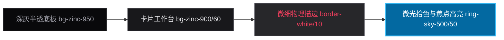
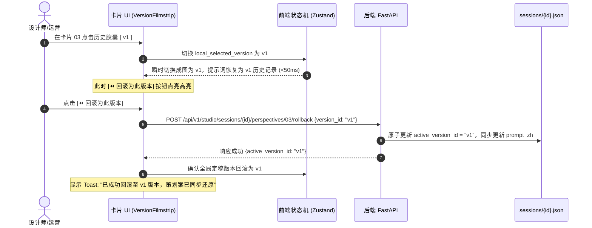
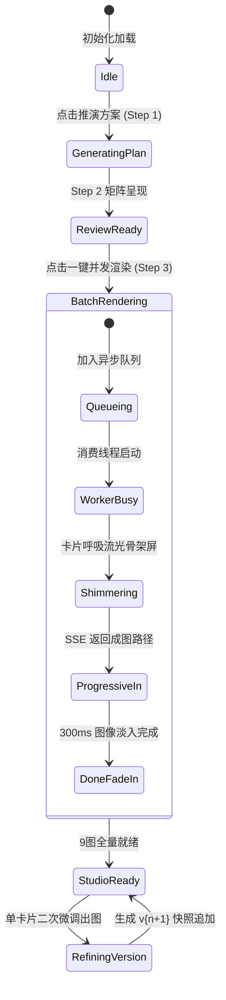

# 商业级电商视觉工坊 (Ecommerce Studio) UI/UX 交互与设计规范
## Next.js 14 + shadcn/ui + Tailwind CSS 前端交互与视觉规范全案

> **文档版本**: v2.1.0 (Next.js 14 App Router + shadcn/ui Edition)  
> **面向对象**: 前端研发团队 (@fe-lead)、全栈工程师、UI/UX 设计师 (@designer)、产品经理 (@pm)  
> **设计美学定位**: **Apple & Linear 风格现代专业级极简暗调 SaaS (Modern Pro Dark Studio)**  
> **设计核心法则**: 极致减熵（Low-Entropy UI）、非破坏性版本无感操作（Frictionless Rollback）、向导式沉浸流（4-Step Guided Stepper）、全景商业摄影工坊质感（Studio Benchwork）、无账号极速开箱（Zero-Account Local Session）。

---

## 目录 (Table of Contents)
1. [设计哲学与视觉设计语言体系 (Design Philosophy & Visual Language)](#1-设计哲学与视觉设计语言体系-design-philosophy--visual-language)
   - 1.1 设计哲学：从“AI生成器”到“商业暗房工坊”
   - 1.2 颜色系统与色彩代币 (Color Tokens)
   - 1.3 排版与字体规范 (Typography Scale)
   - 1.4 材质质感与毛玻璃层级 (Surfaces, Borders & Glassmorphism)
   - 1.5 动效与微交互原则 (Framer Motion & Micro-interactions)
2. [全局布局架构与导航系统 (Global Layout Architecture)](#2-全局布局架构与导航系统-global-layout-architecture)
   - 2.1 顶部工坊导航栏 (Studio Top Bar & Session Switcher)
   - 2.2 4步向导步进导航条 (Global Stepper Header)
   - 2.3 底部吸底持久动作栏 (Persistent Sticky Action Bar)
3. [分步交互规范 (Step-by-Step Interaction Specification)](#3-分步交互规范-step-by-step-interaction-specification)
   - 3.1 Step 1: 📦 商品资产与特征录入 (60/40 黄金分割工作台)
   - 3.2 Step 2: 📐 9大商业视觉矩阵策划与审阅 (3x3 脚本总控网格)
   - 3.3 Step 3: 🎨 商业大片批量出图与 3x3 九宫格工坊 (核心出图与版本链)
   - 3.4 Step 4: 📦 全套物料交付与详情页长图工坊 (Packaging & Handoff)
4. [核心独立组件级设计规范 (Atomic & Composite Component Specs)](#4-核心独立组件级设计规范-atomic--composite-component-specs)
   - 4.1 3x3 商业出图卡片 (StudioPerspectiveCard)
   - 4.2 版本胶卷与双向回滚控制器 (VersionFilmstrip & RollbackEngine)
   - 4.3 卷帘/并排双版本对比弹窗 (VersionDiffModal)
   - 4.4 750px 手机详情页模拟瀑布流 (MobileDetailPreviewSheet)
5. [常驻抽屉：首席视觉顾问 (Creative Copilot Drawer)](#5-常驻抽屉首席视觉顾问-creative-copilot-drawer)
   - 5.1 唤起机制与浮动胶囊 (Floating Trigger Pill)
   - 5.2 抽屉侧滑面板架构 (Slide-over Sheet Specification)
   - 5.3 上下文感知机制与一键注入动作 (Context-Aware Action Chips)
6. [状态流转、加载反馈与容错交互 (States, Feedback & Error Handling)](#6-状态流转加载反馈与容错交互-states-feedback--error-handling)
   - 6.1 流光骨架屏与 SSE 渐进渲染 (Shimmer Skeleton & Progressive Influx)
   - 6.2 异常中断与重试恢复机制 (Graceful Degradation)
7. [shadcn/ui 核心组件映射与 TypeScript 接口定义 (Component Mapping & TS Contracts)](#7-shadcnui-核心组件映射与-typescript-接口定义-component-mapping--ts-contracts)

---

## 1. 设计哲学与视觉设计语言体系 (Design Philosophy & Visual Language)

### 1.1 设计哲学：从“AI生成器”到“商业暗房工坊”
传统 AI 工具往往充斥着输入框、随机种子、生硬的覆盖按钮，让品牌电商运营产生不可控的“盲盒开奖感”。
在 **Ecommerce Studio Next.js 14** 中，我们将交互心智全面重构为**顶级商业摄影暗房与视觉总监调色台**：
* **严谨秩序感**：3x3 矩阵式物理对齐，无错位流式卡片，如同摄影棚中排布严谨的柔光箱与机位；
* **非破坏性探索安全感**：任何微调均为“新胶卷快照”，用户点击回滚只需一瞬（<50ms），给予设计师无限尝试的底气；
* **极简无光污染**：采用 Apple Pro Display XDR 与 Linear 经典冷黑背景，消除刺眼的高对比度纯黑，以多层深灰半透叠层营造空间纵深感。



---

### 1.2 颜色系统与色彩代币 (Color Tokens)

系统使用 Tailwind CSS 变量与 shadcn/ui 命名规范，全局采用 Dark Mode 优先设计体系：

| 色彩角色 | CSS 变量 / Tailwind 类名 | Hex 色值 | 交互场景与语义说明 |
| :--- | :--- | :--- | :--- |
| **画布底色 (Canvas Background)** | `bg-zinc-950` / `--background` | `#09090b` | 全局沉浸暗色视窗，提供顶级对比基底 |
| **工作台板 (Surface Elevated)** | `bg-zinc-900/70` / `--card` | `#18181b` (70% alpha) | 卡片主体背景，结合 `backdrop-blur-md` |
| **浮层面板 (Surface Overlay)** | `bg-zinc-800/90` / `--popover` | `#27272a` (90% alpha) | 弹窗、下拉菜单、抽屉面板、悬浮提示框 |
| **极细物理描边 (Subtle Border)** | `border-white/10` / `--border` | `rgba(255,255,255,0.08)` | 区分层级的精密线条，杜绝厚重感 |
| **强焦点描边 (Active Border)** | `border-sky-500/50` / `--ring` | `rgba(56,189,248,0.5)` | 激活选中的卡片、输入框焦点、活动版本胶囊 |
| **品牌主强调色 (Primary Accent)** | `text-sky-400` / `bg-sky-500` | `#0ea5e9` ~ `#38bdf8` | 主 CTA 按钮、高光图标、重要进度条指示 |
| **辅助强调色 (Secondary Brand)** | `text-indigo-400` / `bg-indigo-600` | `#6366f1` | 首席视觉顾问标识、灵感润色按钮、AI 洞察徽章 |
| **成功/定稿 (Success State)** | `text-emerald-400` / `bg-emerald-500/10` | `#10b981` | 步骤已完成打勾、渲染就绪就绪绿灯、已回滚提示 |
| **进行中/等待 (Warning/Progress)** | `text-amber-400` / `bg-amber-500/10` | `#f59e0b` | 渲染排队中、正在生成中动态呼吸光芒 |
| **破坏/移除 (Destructive)** | `text-rose-400` / `bg-rose-500/10` | `#f43f5e` | 删除参考图、清空专案、终止当前批量任务 |
| **一级标题文本 (Text Primary)** | `text-zinc-100` / `--foreground` | `#f4f4f5` | 界面大标题、卡片名称、版本核心文字 |
| **次级说明文本 (Text Muted)** | `text-zinc-400` / `--muted-foreground` | `#a1a1aa` | 摄影布景指导说明、商业心理学注解、时间戳 |
| **弱化辅助文本 (Text Subtle)** | `text-zinc-500` | `#71717a` | 键盘快捷键提示、占位符、非激活步骤序号 |

---

### 1.3 排版与字体规范 (Typography Scale)

* **字体栈 (Font Family)**: 
  - 西文与代码：`font-sans: 'Inter', -apple-system, BlinkMacSystemFont, 'SF Pro Display', sans-serif`
  - 中文字体：`'PingFang SC', 'Hiragino Sans GB', 'Microsoft YaHei', sans-serif`
  - 数字与版本标识：`font-mono: 'JetBrains Mono', 'SF Mono', monospace`
* **字阶定义**:
  - `Display / Page Title`: `text-2xl font-semibold tracking-tight text-zinc-100`
  - `Card Header / Section Title`: `text-lg font-medium text-zinc-100`
  - `Body Standard / Prompts`: `text-sm leading-relaxed text-zinc-200`
  - `Footnote / Tags / Meta`: `text-xs font-normal text-zinc-400`
  - `Mono Stamp / Version Number`: `text-[11px] font-mono tracking-wider uppercase`

---

### 1.4 材质质感与毛玻璃层级 (Surfaces, Borders & Glassmorphism)

为了实现如 macOS Sonoma 与 Linear 一般的高级感，界面分为 4 个清晰的 Z 轴物理景深层：

1. **Z-0 底板层 (Canvas Base)**: 
   - 类名：`bg-zinc-950 bg-[radial-gradient(ellipse_80%_80%_at_50%_-20%,rgba(120,119,198,0.12),rgba(255,255,255,0))]`
   - 提供若隐若现的顶部冷紫微光晕，消除死黑。
2. **Z-10 内容卡片层 (Working Surfaces)**:
   - 类名：`bg-zinc-900/60 backdrop-blur-md border border-white/[0.08] rounded-xl shadow-2xl shadow-black/40`
3. **Z-20 常驻交互条与导航 (Persistent Sticky Bars)**:
   - 类名：`bg-zinc-950/80 backdrop-blur-xl border-b border-white/[0.08]` (Header)
   - 类名：`bg-zinc-950/80 backdrop-blur-xl border-t border-white/[0.08]` (Sticky Action Bar)
4. **Z-50 抽屉与模态浮层 (Floating Copilot & Dialogs)**:
   - 类名：`bg-zinc-900/95 backdrop-blur-2xl border-l border-white/10 shadow-2xl` (Copilot Sheet)

---

### 1.5 动效与微交互原则 (Framer Motion & Micro-interactions)

* **自然物理衰减**：严禁突兀生硬的切换，所有状态流转使用 `cubic-bezier(0.16, 1, 0.3, 1)`（Apple 物理弹性缓动曲线）。
* **微交互时长基准**:
  - 悬浮 Hover 与颜色微变：`150ms ease-out`
  - 胶囊/选项卡激活滑动（Active Pill Transition）：`250ms spring(damping: 25, stiffness: 300)`
  - 骨架屏淡入成图（Image Fade-in）：`300ms ease-in-out`
  - 抽屉滑出与收起（Drawer Slide）：`350ms cubic-bezier(0.32, 0.72, 0, 1)`

---

## 2. 全局布局架构与导航系统 (Global Layout Architecture)

工作台采用现代专业 SaaS 的**固定视窗高度流体视口布局 (100vh Pro Layout)**：

```
+---------------------------------------------------------------------------------------------------------+
| [LOGO] Ecommerce Studio   [ 专案: 钛空舱保温杯 ▾ ]      [ ● 1 资产录入 ] ── [ ● 2 矩阵策划 ] ── [ ★ 3 出图工坊 ] ── [ ○ 4 物料交付 ]   [ ⚙ 设置 ] [ 🌙 ] |
+---------------------------------------------------------------------------------------------------------+
|                                                                                                         |
|                                       沉浸式工作区 (Main Scroll Canvas)                                  |
|                                 (根据当前 Step 动态渲染对应的沉浸式界面视图)                              |
|                                                                                                         |
+---------------------------------------------------------------------------------------------------------+
| [会话状态: 本地自动存盘 22:45:10]                                    [ ← 上一步 ]   [ 下一步：进入出图工坊 → ] |
+---------------------------------------------------------------------------------------------------------+
                                                                                  [ 💬 首席视觉顾问 (3) ] (悬浮胶囊)
```

---

### 2.1 顶部工坊导航栏 (Studio Top Bar & Session Switcher)

* **高度**: `h-14` (56px)，固顶，`z-40`。
* **左侧品牌与专案上下文**:
  - **Logo & Title**: `Sparkles` 图标（微光淡紫渐变） + `Ecommerce Studio` 文字（`font-semibold text-sm tracking-tight`） + `v2.1 Pro` 胶囊徽章。
  - **本地专案选择器 (Local Project Switcher)**:
    - 采用 shadcn `DropdownMenu` 组件。
    - 触发钮：展示当前专案名称（如 `钛空舱智能温控咖啡杯`） + `ChevronsUpDown` 图标。
    - 下拉内容项：
      * 快速切换历史策划专案（显示专案名、最近修改时间、成图数量统计 `9/9 图`）；
      * `+ 新建空白商业专案` (点击生成全新 `sess_{timestamp}` 会话)；
      * `重命名当前专案` (内联弹窗无刷新修改)；
      * `📥 导入专案配置 JSON` / `📤 导出当前专案 JSON` (实现 100% 数据主权可迁移)。
* **右侧全局辅助操作**:
  - `API Key 连通状态指示灯` (绿色微光圆点 + `Gemini Imagen Active`)；
  - `系统使用指南 (Quick Tour)` 图标按钮；
  - `GitHub 代码仓` 图标链接。

---

### 2.2 4步向导步进导航条 (Global Stepper Header)

位于顶部导航栏正中央，清晰呈现产品沉浸工作流：

```
[ ● 1. 资产与特征录入 ] ─── [ ● 2. 9大矩阵策划 ] ─── [ ★ 3. 商业出图工坊 ] ─── [ ○ 4. 全套交付 ]
```

* **状态与样式定义**:
  1. **Completed (已完成)**:
     - 徽标：墨绿色实心小圆圈内含白色微缩勾选图标（`Check`）。
     - 文字：`text-zinc-300 font-medium`。
     - 交互：**支持任意点击直接跳转 (Random Access)**。点击即可无损回到该阶段查看或补齐资料，不重载页面。
  2. **Active (当前进行中)**:
     - 徽标：高亮天蓝色外框光晕 `ring-2 ring-sky-500/50 bg-sky-500/20 text-sky-400 font-mono`。
     - 文字：`text-white font-semibold`。
     - 底部带有细腻的指示滑块（Framer Motion `layoutId="active-step-indicator"`）。
  3. **Upcoming (未到达)**:
     - 徽标：浅暗灰空心圆圈 `border border-zinc-700 text-zinc-600 font-mono`。
     - 文字：`text-zinc-500`。
     - 交互：未激活状态下禁用点击，带有 `cursor-not-allowed` 弱提示。
* **连线效果 (Stepper Connectors)**:
  - 步骤之间以 `w-8 h-[1px]` 的横线相连。当两侧均完成时，连接线呈现 `bg-sky-500/40`，未到达时呈现 `bg-zinc-800`。

---

### 2.3 底部吸底持久动作栏 (Persistent Sticky Action Bar)

* **高度**: `h-16` (64px)，固定吸附在视窗最底部，`z-30`。
* **左侧内容**:
  - 自动存盘指示器：`CloudCheck` 绿色微标 + `本地已实时存盘 (22:45:10)`。
  - 当前会话 ID 短码（如 `sess_...a1b2`，支持点击复制）。
* **右侧主交互区**:
  - `← 上一步 (Secondary Ghost Button)`：返回上一流程，当处于 Step 1 时禁用。
  - `下一步：[目标动作名称] → (Primary Accent Button)`：
    - Step 1: `下一步：推演 9 大视觉方案 →`
    - Step 2: `下一步：进入 3x3 出图工坊 →`
    - Step 3: `下一步：前往交付与长图工坊 →`
    - Step 4: `完成定稿并下载全套资产包 📦`

---

## 3. 分步交互规范 (Step-by-Step Interaction Specification)

### 3.1 Step 1: 📦 商品资产与特征录入 (60/40 黄金分割工作台)

```
+---------------------------------------------------------------------------------------------------------+
|                                  Step 1: 商品资产与商业特征深度录入                                         |
+-------------------------------------------------------+-------------------------------------------------+
| 左栏 (60%): 商品商业档案 (Commercial Dossier)          | 右栏 (40%): 实物参考资产网格 (Physical Ingestion)|
|                                                       |                                                 |
| 1. 商品名称与品类定位                                   | [ 拖拽实物参考图到此处，或点击上传 (1-5张) ]       |
|    [ 钛空舱智能温控咖啡保温杯                      ]    |                                                 |
|                                                       | +---------------------------------------------+ |
| 2. 材质工艺与工业特征 (Material & Craft)              | | [IMG 1]  主基准参考图  [🔍] [🗑️]            | |
|    [ 316L医用级不锈钢内胆，外壁曜石黑哑光喷砂烤漆... ]  | | 视觉解析标签: #圆柱极简 #哑光黑 #LED冷光数显  | |
|    快捷标签: [+ 亲肤磨砂] [+ 金属拉丝] [+ 食品级硅胶] | +---------------------------------------------+ |
|                                                       | | [IMG 2]  杯盖结构细节  [🔍] [🗑️]            | |
| 3. 核心目标客群与使用场域 (Target Demographics)        | | 视觉解析标签: #触控屏 #防漏密封胶圈           | |
|    [ 25-35岁高知都市通勤白领、精品手冲咖啡重度用户...]| +---------------------------------------------+ |
|                                                       |                                                 |
| 4. 竞品差评与核心抗拒点 (Pain Points to Crush)        | 提示: 上传高清实物多角度照片，AI 将精准锁定外形 |
|    [ 传统杯倒置易漏水弄湿电脑背包，开盖易烫伤舌头... ]| 几何特征与反光材质，出图高度保真。              |
+-------------------------------------------------------+-------------------------------------------------+
| [ 🚀 启动商业摄影全案推演 (自动策划 9 大商业视觉矩阵) ]                                                    |
+---------------------------------------------------------------------------------------------------------+
```

#### 3.1.1 详细交互说明
1. **左栏表单卡片 (Dossier Form)**:
   - 字段间距 `space-y-6`，每个输入框均配备聚焦微光高亮 `focus-visible:ring-1 focus-visible:ring-sky-500`。
   - **快捷标签点击注入 (Quick Tags Pill)**:
     - 点击标签（如 `[+ 316L不锈钢]`），平滑注入到多行文本框的光标位置，避免纯打字负担。
   - **智能预设模板 (Smart Presets)**:
     - 提供「轻奢水杯」、「高端护肤精华」、「户外降噪耳机」、「精品机械腕表」快速加载体验样例，方便快速演示与评测。
2. **右栏多模态资产区 (Multimodal Assets)**:
   - 上传采用 `react-dropzone` 逻辑，支持图片批量拖入。
   - 上传完成后立即调用视觉解析 API，在卡片底端展示动态微标签（Vision Semantic Tags）。
   - 用户可勾选「设为主视觉基准图（Primary Reference）」，以此张作为后续所有视角的核心轮廓锚定源。
3. **主推进动作**:
   - 点击「🚀 启动商业摄影全案推演」按钮，按钮进入 Loading 态，并呈现 SSE 流式思考指示器：“正在基于竞品抗拒点解构 9 大商业镜头语言...”，随后自动平滑滑入 Step 2。

---

### 3.2 Step 2: 📐 9大商业视觉矩阵策划与审阅 (3x3 脚本总控网格)

```
+---------------------------------------------------------------------------------------------------------+
| [总监策划总览] 调性: 现代极简冷峻精工 | 击穿卖点: 倒置不漏水与水温数显 | 推荐色板: [■ 曜石黑] [■ 钛金灰] [■ 幽蓝光] |
+---------------------------------------------------------------------------------------------------------+
| [01 · 纯净白底主图]           | [02 · 核心生活场景图]        | [03 · 材质工艺微距图]        |
| 标签: CTR点击率收割机         | 标签: 生活方式与身份认同     | 标签: 超浅景深精工细节       |
| 心理学: 列表曝光第一眼抓取     | 心理学: 唤醒拥有的美好想象   | 心理学: 消除塑料廉价感       |
| 镜头与布景指导: (可编辑文本域)| 镜头与布景指导:              | 镜头与布景指导:              |
| [纯白无影棚，45度柔光箱...]   | [晨光极简实木工位，手冲壶..] | [85mm微距特写，冷峻金属光..] |
| [🪄 灵感润色] [210字]         | [🪄 灵感润色] [180字]        | [🪄 灵感润色] [195字]        |
+-------------------------------+------------------------------+------------------------------+
| [04 · 结构拆解爆炸图]         | [05 · 痛点直击攻坚图]        | [06 · 便携通勤比例图]        |
| ...                           | 心理学: 打消倒置漏水退货疑虑 | ...                          |
+-------------------------------+------------------------------+------------------------------+
| [07 · 品牌情绪氛围图]         | [08 · 全系配色陈列图]        | [09 · 真实买家秀种草图]      |
| ...                           | ...                          | 心理学: 小红书真实种草感     |
+---------------------------------------------------------------------------------------------------------+
| [ ← 返回修改资产 ]          [ 💾 保存策划草案 ]          [ 下一步：进入 3x3 商业出图工坊 → ]              |
+---------------------------------------------------------------------------------------------------------+
```

#### 3.2.1 详细交互说明
1. **策略总览折叠卡片 (Creative Strategy Summary)**:
   - 默认展开，点击右上角 `ChevronUp/Down` 可折叠。
   - 提取商品的品牌视觉基调、核心击穿 USP、色板与构图动线指导。
2. **3x3 策划卡片网格**:
   - 严格对应 9 个固定商业视角（01 ~ 09）。
   - **镜头语言与布景指导 (Lens & Lighting Direction)**：
     - 使用可自动增高的 `Textarea`，展示推演出的完整构图、光位、焦段与道具描述。
     - 用户可直接在框内任意增删中文词汇。失去焦点（`onBlur`）自动静默存盘。
   - **🪄 灵感润色按钮 (Prompt Magic Refiner)**:
     - 悬浮在卡片右下角。点击后触发单卡片局部微调：
     - 前端展示转圈微动效 `Wand2 className="animate-spin text-indigo-400"`；
     - 自动调用后端 LLM 补齐商业摄影机位（如“85mm定焦”、“伦勃朗侧逆光”、“深浅对比景深”），润色结果实时打字机替换文本框内容，并伴有淡绿高亮闪烁一次提醒用户已优化。

---

### 3.3 Step 3: 🎨 商业大片批量出图与 3x3 九宫格工坊 (核心出图与版本链)

此界面为系统**最高频交互中心 (Master Studio Bench)**，必须承载高密度的图片检视、批量出图、单张微调与无损版本回滚。

```
+---------------------------------------------------------------------------------------------------------+
| [画幅]: [ ● 1:1 正方主图 ] [ 3:4 手机详情 ] [ 16:9 横版海报 ] | [并发]: [3 线程] | [ ⚡ 一键渲染全套 9 大图 ]  |
+---------------------------------------------------------------------------------------------------------+
| [01 · 纯净白底首图] [●v2]     | [02 · 核心生活场景图] [●v1]   | [03 · 材质工艺微距图] [●v3]  |
| +---------------------------+ | +---------------------------+ | +---------------------------+ |
| |                           | | |                           | | |                           | |
| |        渲染大图预览       | | |        渲染大图预览       | | |        渲染大图预览       | |
| |        (1:1 响应式居中)   | | |                           | | |                           | |
| |                           | | |                           | | |                           | |
| +---------------------------+ | +---------------------------+ | +---------------------------+ |
| 胶卷: [ v1:全量 ] [ ● v2:倒影 ]| 胶卷: [ ● v1:初始 ]           | 胶卷: [v1] [v2] [ ● v3:光泽 ] |
| [⏪ 回滚为此版] [🔍对比] [📥下载]| [⏪ 回滚为此版] [🔍对比] [📥下载]| [⏪ 回滚为此版] [🔍对比] [📥下载]|
| ▾ 摄影布景二次微调 (AI/Prompt)| ▾ 摄影布景二次微调 (AI/Prompt)| ▾ 摄影布景二次微调 (AI/Prompt)|
+-------------------------------+-------------------------------+-------------------------------+
| (04 ~ 06 第二排卡片)                                                                                    |
+---------------------------------------------------------------------------------------------------------+
| (07 ~ 09 第三排卡片)                                                                                    |
+---------------------------------------------------------------------------------------------------------+
```

#### 3.3.1 顶部商业摄影中控台 (Studio Control Bar)
* **画幅比例切换钮 (Aspect Ratio Selector)**:
  - 选项：`1:1` (正方形主图，默认)、`3:4` (小红书/手机详情图)、`16:9` (宽屏横幅)。
  - 切换时以平滑过渡更新 3x3 网格容器的高宽比（`aspect-square` / `aspect-[3/4]` / `aspect-video`）。
* **并发控制滑块 (Concurrency Slider)**:
  - 范围 `1 ~ 5` 线程，默认 `3`。
  - 附带 Tooltip 提示：“平衡出图效率与 API 速率上限，推荐 3 线程”。
* **一键渲染全套 9 大图 (Render All Matrix CTA)**:
  - 醒目高亮按钮：`bg-gradient-to-r from-sky-500 to-indigo-600 hover:from-sky-400 hover:to-indigo-500 text-white font-semibold shadow-lg shadow-sky-500/20`。
  - **运行中状态**:
    - 呈现全局进度条与耗时预估：`⚡ 正在并发渲染商业大片 (4/9)... [剩余约 20s]`；
    - 按钮旁出现取消按钮 `终止出图 (Stop)`。

---

### 3.4 Step 4: 📦 全套物料交付与详情页长图工坊 (Packaging & Handoff)

```
+---------------------------------------------------------------------------------------------------------+
| 预览模式切换: [ ● 3x3 商业矩阵网格视图 (Grid) ]   [ 📱 750px 手机详情页长图流预览 (Long Canvas) ]        |
+---------------------------------------------------------------------------------------------------------+
|                                                                                                         |
| (根据选中的模式展示 9 张高清水印已去除的终版成图，支持拖拽调整排序或按电商黄金转化动线拼接)             |
|                                                                                                         |
+---------------------------------------------------------------------------------------------------------+
| 交付动作枢纽 (Handoff Actions):                                                                         |
| [ 📦 一键打包下载全部商业大图 (ZIP) ]   [ 📄 导出 Markdown 策划全案 ]   [ 📋 复制 9 套中英文镜头提示词 ]|
+---------------------------------------------------------------------------------------------------------+
```

#### 3.4.1 详细交互说明
1. **750px 手机详情页模拟瀑布流 (Long Canvas Stitching)**:
   - 切换到长图模式后，主视图转为中央 **750px 宽度的仿真手机端详情页**：
   - 9 张图片自上而下无缝竖向拼接，呈现标准电商转化动线：
     `01 主图吸睛 -> 02 场景代入 -> 03 材质精工 -> 04 内部黑科技 -> 05 痛点直击 -> 06 尺寸比例 -> 07 品牌格调 -> 08 全配色 -> 09 买家实拍`；
   - 运营人员可直观评估滑屏时的视觉节奏感，支持点击任意单图跳转回 Step 3 针对性微调重绘。
2. **规范化 ZIP 资产包下载**:
   - 点击 `一键打包下载全部商业大图 (ZIP)` 后，浏览器发起 `/api/v1/studio/sessions/{id}/export/zip` 流式下载。
   - 解压后目录规范整齐：
     ```text
     ├── 01_商业纯净白底首图_v2.jpg
     ├── 02_真实生活使用场景_v1.jpg
     ├── 03_材质工艺微距细节_v3.jpg
     ├── ...
     ├── 09_真实买家秀种草_v1.jpg
     └── 商业摄影全案策划与镜头语言全案.md
     ```

---

## 4. 核心独立组件级设计规范 (Atomic & Composite Component Specs)

### 4.1 3x3 商业出图卡片 (StudioPerspectiveCard)

这是出图工坊的核心原子单元，承载了完整的生命周期：

```
+-------------------------------------------------------------+
| 03 · 材质工艺微距图            [● v3 (现用)]  [● 渲染就绪]   |
+-------------------------------------------------------------+
|                                                             |
|                                                             |
|                    高清图像展示区                           |
|               (鼠标悬浮触发遮罩操作栏)                      |
|                                                             |
|               [ 🔍 点击全屏放大查看 (Lightbox) ]            |
|                                                             |
+-------------------------------------------------------------+
| 版本胶卷: [ v1:初始 ] [ v2:加光 ] [ ● v3:金属纹理特写 ]       |
+-------------------------------------------------------------+
| [⏪ 回滚为此版本]     [ 🔍 双版本对比 ]      [ 📥 下载原图 ] |
+-------------------------------------------------------------+
| ▾ 摄影布景二次微调 (Scene Refinement)                        |
|   自然语言微调指令:                                          |
|   [ 保持微距景深，将金属表面的拉丝纹理反光强化，去除暗角... ]|
|   [ 🪄 渲染新版本快照 (生成 v4) ]                            |
+-------------------------------------------------------------+
```

#### 4.1.1 内部元素规范
* **卡片头部**:
  - 左侧：编号与中文视角名称（如 `03 · 材质工艺微距图`）；
  - 中间：当前选中的版本胶囊（若选中的是活跃版本，显示绿色微标 `● v3 (现用)`；若选中的是历史版本，显示黄色微标 `○ v1 (历史)`）；
  - 右侧：状态指示器（就绪绿点 / 渲染中旋转指示器 / 错误红点）。
* **大图展示容器 (Image Canvas Area)**:
  - 容器尺寸：自适应撑满，保持画幅比例（默认 1:1）；
  - 占位与加载：未出图时显示极简摄影暗房相机线框占位图；出图过程中展示流光骨架屏；出图完成后 300ms 淡入；
  - 悬浮浮层 (Hover Overlay)：鼠标进入图片区域时，从上方和下方优雅滑出微透黑遮罩（`bg-black/60`），中央提供「全屏查看 (ZoomIn)」与「局部放大镜 (Loupe)」图标。

---

### 4.2 版本胶卷与双向回滚控制器 (VersionFilmstrip & RollbackEngine)

非破坏性版本链是本系统最核心的杀手级功能。



#### 4.2.1 交互细则
1. **胶卷展示形式**:
   - 采用水平横向排列的胶囊按钮组（`flex items-center gap-1.5 overflow-x-auto py-1 scrollbar-none`）；
   - 每个胶囊文字格式：`v{n}: {修改原因摘要简写}`（如 `v1: 全套初始`、`v2: 强化倒影`）；
   - 当前正在查看的版本：外框高亮 `border-sky-500 bg-sky-500/20 text-sky-300`；
   - 真实激活的系统当前版本：左侧带有一个小圆绿点。
2. **后悔药回滚按钮 (Rollback Button)**:
   - 当选中的版本就是当前 `active_version` 时：按钮显示为灰置不可点击 `已是现用版本`；
   - 当选中的版本是历史版本（例如在当前 v3 下查看 v1 时）：按钮瞬间点亮为翡翠绿高亮 `⏪ 回滚为此版本`；
   - 点击回滚后，无需重新跑图，毫秒级将后端与前端的当前正式指针切回 `v1`，同时 Step 2 矩阵中该视角的镜头提示词无损还原为 v1 时的提示词！

---

### 4.3 卷帘/并排双版本对比弹窗 (VersionDiffModal)

用于辅助设计师精细研判两次修改的灯光与细节改动：

```
+---------------------------------------------------------------------------------------------------------+
| [对决模式]: [ ● 左右分屏对比 (Side-by-Side) ]   [ ↔ 卷帘拖拽对比 (Curtain Splitter) ]           [ ✕ 关闭 ]|
+---------------------------------------------------------------------------------------------------------+
|                                                                                                         |
|       左侧: 版本 A [ v1: 初始渲染 ▾ ]               右侧: 版本 B [ v2: 增加夕阳微光 ▾ ]                 |
|       +-----------------------------+              +-----------------------------+                      |
|       |                             |              |                             |                      |
|       |                             |      VS      |                             |                      |
|       |                             |              |                             |                      |
|       +-----------------------------+              +-----------------------------+                      |
|       提示词: 纯白背景，居中打光...                提示词: 增加侧向夕阳暖金微光...                      |
|                                                                                                         |
+---------------------------------------------------------------------------------------------------------+
|                                    [ ⏪ 采用左侧 A 版本 ]     [ ⏪ 采用右侧 B 版本 ]                     |
+---------------------------------------------------------------------------------------------------------+
```

* **左右分屏模式**:
  - 左右并排两张大图，支持鼠标在任一图片移动时，双图局部放大镜同步移动（Synchronized Zoom Loupe）；
* **卷帘滑动模式 (Curtain Splitter)**:
  - 单张大图叠放，中间一条可左右拖拽的白色手柄滑轨；
  - 拖动手柄向左滑动露出 B 版本，向右滑动露出 A 版本，以极高直观性比对打光强弱与材质反光变化。

---

### 4.4 750px 手机详情页模拟瀑布流 (MobileDetailPreviewSheet)

在 Step 4 中，针对电商运营对“整套图拼起来好看不好看”的刚性痛点，打造**高逼真度手机端长图画卷**：

* **视窗模拟**:
  - 居中呈现 750px 宽的仿 iPhone 15 Pro 钛合金边框外壳（带圆角和灵动岛装饰）；
  - 内部滚动条可使用滚轮自由向下漫游；
* **动线标注**:
  - 每一张图的右侧悬浮轻量标注气泡（如 `01 首图 · 抢占点击`、`05 痛点直击 · 防漏承诺`）；
  - 用户可点击右侧的快速锚点导航条（Mini Outline Navigator）瞬间跳至对应楼层。

---

## 5. 常驻抽屉：首席视觉顾问 (Creative Copilot Drawer)

为了彻底颠覆传统聊天机器人割裂九宫格布局的问题，设计常驻的**全域右侧滑出抽屉 (Slide-over Sheet)**：

```
+-----------------------------------------------------------------------------+
| [ Sparkles ] 首席视觉顾问 (Creative Copilot)                    [ ✕ 收起 ]  |
+-----------------------------------------------------------------------------+
| 上下文感知徽章: [ 当前对齐: Step 3 · 05 痛点直击图 ]                          |
+-----------------------------------------------------------------------------+
|                                                                             |
| [顾问 22:42]                                                                |
| 主理人您好！我注意到您正在调整 05 号痛点攻坚图。对于保温杯品类，退货率最高的 |
| 原因往往是“倒置滴水漏在包里”。                                              |
|                                                                             |
| 我为您推演了更具视觉冲击力的布景方案：                                      |
| ✦ 建议方案: 极端倒置剧烈晃动，背景虚化，杯盖结合处有细微防漏硅胶密封特写。   |
|                                                                             |
| +-------------------------------------------------------------------------+ |
| | [✨ 一键应用此镜头方案到 05 号视角]                                       | |
| +-------------------------------------------------------------------------+ |
|                                                                             |
| [用户 22:43]                                                                |
| 很好，请再帮我把色调调得更硬核冷感一点。                                    |
|                                                                             |
| [顾问 22:43 打字机实时吐字...]                                              |
| 已为您在镜头指令中补充深冷钛灰光效与冷蓝科技反光轮廓...                     |
|                                                                             |
+-----------------------------------------------------------------------------+
| 推荐问题: [ 帮我优化全案色系 ] [ 怎么提升 01 主图点击率 ] [ 检查 9 图连贯性 ]|
+-----------------------------------------------------------------------------+
| [ 输入您对视觉创意、镜头光影的调整要求... (Cmd+Enter 发送)            ] [ 发送 ] |
+-----------------------------------------------------------------------------+
```

### 5.1 交互细则
1. **悬浮唤起胶囊 (FAB)**:
   - 位于右下角 `bottom-20 right-6`，不遮挡底部操作栏；
   - 胶囊样式：`bg-zinc-900/90 text-zinc-100 border border-white/10 shadow-2xl backdrop-blur-md rounded-full px-4 py-2.5 flex items-center gap-2 hover:border-indigo-500/50 hover:shadow-indigo-500/10 transition-all`；
   - 带有未读建议数量红点微标（如 `(1)`）。
2. **上下文深度自动感知 (Context Engine)**:
   - 抽屉顶部实时读取用户当前所处步骤（Step 1~4）以及当前鼠标选中的九宫格视角（01~09）；
   - 发送对话时，自动隐式将当前的 `product_info` 与 `perspective.prompt_zh` 伴随请求发给 FastAPI，无需用户反复交代背景。
3. **指令级直接联动 (Direct Injection)**:
   - 顾问输出方案卡片中内嵌「✨ 一键应用此镜头方案到当前卡片」按钮；
   - 用户点击后，前端直接更新对应卡片的布景文本域，并弹窗提示 `已成功应用至 05 号视角`，省去繁琐的人工复制粘贴。

---

## 6. 状态流转、加载反馈与容错交互 (States, Feedback & Error Handling)

### 6.1 流光骨架屏与 SSE 渐进渲染 (Shimmer Skeleton & Progressive Influx)



* **流光呼吸动效 (Shimmer Effect)**:
  - 渲染中的单卡片呈现 `bg-gradient-to-r from-zinc-900 via-zinc-800 to-zinc-900 bg-[length:200%_100%] animate-shimmer`；
  - 卡片中心展示极简动态雷达圈或柔光箱图标，显示 `AI 摄影棚正在置景布光... (已耗时 12s)`。
* **单图就绪淡入**:
  - 某一张图片生成完毕时，仅该卡片发生淡入替换（`transition-opacity duration-300 opacity-100`），其余卡片互不影响，杜绝全网格重排抖动。

---

### 6.2 异常中断与重试恢复机制 (Graceful Degradation)

* **网络波动或 API 限制**:
  - 若某张视角渲染超时或触发速率限制，该卡片呈现暗红微边框（`border-rose-500/30 bg-rose-950/20`）；
  - 界面提供明确文案（如 `渲染超时：服务商速率排队`）与单卡片高亮重试按钮 `🔄 单独重新拍摄此张`；
  - 其余已成功的图片完好保存，不影响其他视角。

---

## 7. shadcn/ui 核心组件映射与 TypeScript 接口定义 (Component Mapping & TS Contracts)

### 7.1 shadcn/ui 组件库选型与映射清单

| UI 模块 / 需求 | 采用的 shadcn/ui (Radix) 组件 | 关键定制与 Tailwind 修饰 |
| :--- | :--- | :--- |
| **顶部专案选择** | `DropdownMenu`, `DropdownMenuContent`, `DropdownMenuItem` | `w-64 bg-zinc-900/95 border-white/10 backdrop-blur-xl` |
| **4步全局向导** | 自定义复合组件 `Stepper`, `Badge` | Radix 无障碍支持，Framer Motion 弹性滑块指示线 |
| **参考图上传** | 自定义 `FileUploadZone` + `Card` + `Badge` | 拖拽上传、Hover 操作遮罩、多模态语义胶囊标签 |
| **3x3 商业出图卡片** | `Card`, `CardHeader`, `CardContent`, `CardFooter` | `bg-zinc-900/60 border-white/10 rounded-xl overflow-hidden` |
| **画幅与并发控制** | `ToggleGroup`, `Slider`, `Tooltip` | 胶囊形单选组，暗黑质感微细滑轨 |
| **版本链条胶卷** | `ScrollArea` (水平横向模式), `Badge`, `Button` | 紧凑型胶囊按钮组，激活态带 `ring-1 ring-sky-500` |
| **二次微调面板** | `Accordion`, `AccordionItem`, `AccordionTrigger` | 内嵌暗灰圆角文本域，平滑折叠展开动效 |
| **双版本对比** | `Dialog`, `DialogContent`, `Tabs` | `max-w-5xl bg-zinc-950/95 border-white/10 backdrop-blur-2xl` |
| **全屏大图查看** | `Dialog` 或 Lightbox | 黑色半透背景 `bg-black/90`，支持滚轮缩放与原图比对 |
| **首席视觉顾问** | `Sheet`, `SheetTrigger`, `SheetContent` | 420px 宽，从右侧滑出 (`side="right"`)，毛玻璃质感 |
| **全局操作反馈** | `Sonner` (Toast) | 替代旧版原生 Toast，支持深色沉浸高质感微提示 |

---

### 7.2 前端核心数据模型与组件 Props 接口规范 (TypeScript)

#### 7.2.1 视角与版本数据契约 (Perspective & Version Models)
```typescript
/**
 * 单个版本的原子快照定义
 */
export interface PerspectiveVersion {
  version_id: string;          // 唯一版本标识，如 "v1", "v2"
  version_num: number;         // 整数版本号，如 1, 2
  image_path: string;          // 本地持久化存储相对路径
  image_url: string;           // 前端可直接访问的静态资产绝对/相对 URL
  prompt_zh: string;           // 该版本出图时绑定的完整中文商业摄影指令
  timestamp: number;           // 时间戳
  created_at_fmt: string;      // 友好显示时间，如 "2026-11-20 22:30:15"
  trigger_type: 'batch_initial' | 'manual_edit' | 'copilot_refine'; // 出图触发源
  change_reason: string;       // 修改动机与变更备忘，如 "强化金属边缘反光"
  aspect_ratio: '1:1' | '3:4' | '16:9';
}

/**
 * 9 大商业转化视角对象定义
 */
export interface Perspective {
  id: string;                  // 唯一视角 ID: "01_white_bg", "02_scene", ...
  name: string;                // 专业中文名称: "商业纯净白底首图"
  tag: string;                 // 商业心智标签: "CTR点击率收割机"
  category: '主图转化' | '场景生活' | '材质工艺' | '原理透视' | '痛点消灭' | '尺码参照' | '品牌格调' | '多色矩阵' | '买家社交';
  psychology_target: string;   // 消费者心理学与抗拒点攻克目标
  prompt_zh: string;           // 当前策划案中的布景指导文本（可自由编辑）
  active_version_id: string;   // 当前激活采用的版本 ID，如 "v2"
  versions: PerspectiveVersion[]; // 该视角下的所有历史非破坏性快照链条
  
  // 运行时客户端状态 (Transient UI States)
  render_status?: 'idle' | 'rendering' | 'success' | 'error';
  render_progress?: number;    // 0 ~ 100
  error_message?: string;
}

/**
 * 商品全局档案定义
 */
export interface ProductDossier {
  product_name: string;
  material_features: string;
  target_users: string;
  pain_points: string;
  reference_images: Array<{
    id: string;
    url: string;
    is_primary: boolean;
    vision_tags: string[];     // 多模态解析标签，如 ["#哑光黑", "#双层不锈钢"]
  }>;
}

/**
 * 全局专案会话模型 (StudioSession)
 */
export interface StudioSession {
  schema_version: '2.0';
  session_id: string;
  name: string;
  created_at: number;
  updated_at: number;
  product_info: ProductDossier;
  strategy_summary?: {
    tone: string;
    usp: string;
    color_palette: string[];
  };
  perspectives: Perspective[];
  chat_history: Array<{
    id: string;
    role: 'user' | 'assistant' | 'system';
    content: string;
    timestamp: number;
    action_chip?: {
      target_perspective_id: string;
      suggested_prompt: string;
      label: string;
    };
  }>;
}
```

#### 7.2.2 核心组件 Props 定义规范
```typescript
/**
 * 3x3 商业出图卡片组件属性
 */
export interface StudioPerspectiveCardProps {
  perspective: Perspective;
  aspectRatio: '1:1' | '3:4' | '16:9';
  onPromptChange: (perspectiveId: string, newPrompt: string) => void;
  onRenderVersion: (perspectiveId: string, customInstruction?: string) => Promise<void>;
  onRollback: (perspectiveId: string, targetVersionId: string) => Promise<void>;
  onOpenDiff: (perspectiveId: string, versionA: string, versionB: string) => void;
  onOpenLightbox: (imageUrl: string, title: string) => void;
}

/**
 * 版本胶卷组件属性
 */
export interface VersionFilmstripProps {
  versions: PerspectiveVersion[];
  activeVersionId: string;
  selectedVersionId: string;
  onSelectVersion: (versionId: string) => void;
  onRollback: (targetVersionId: string) => void;
}

/**
 * 首席视觉顾问抽屉组件属性
 */
export interface CreativeCopilotDrawerProps {
  isOpen: boolean;
  onClose: () => void;
  activeStep: number;
  activePerspectiveId?: string;
  onApplyPromptToPerspective: (perspectiveId: string, prompt: string) => void;
}
```

---

## 8. 设计落地交付与实施自查清单 (Designer Handoff Checklist)

在进入代码工程实现阶段（@fe-lead 阶段）前，UI 规范需全面对照以下清单闭环验证：

- [x] **色彩对比度与暗黑无障碍 (Dark Mode A11y)**：所有关键文字在 `bg-zinc-950` 背景下的对比度满足 WCAG AA 级标准（$\ge 4.5:1$）。
- [x] **去 AI 玩具化文案审查**：全站没有任何晦涩的“CFG / LoRA / Seed / 跑图 / 提示词”，一律统一为“摄影机位、布景指导、商业渲染、版本快照、首席顾问”。
- [x] **后悔药回滚全链路闭环**：回滚操作不仅更新大图显示，且必须将 Step 2 矩阵文本和后端持久化指针无损恢复，并保留更早或更新的快照分支。
- [x] **响应式 3x3 稳态布局**：在主流 1080p、2K 屏幕上九宫格整齐划一，每个卡片高度一致，胶卷与微调折叠面板操作不引起网格形变。
- [x] **SSE 流式渐进体验**：支持批量渲染时的多卡片异步解耦并发，进度条平滑递增，卡片骨架屏优雅淡入成图。
- [x] **常驻视觉顾问抽屉感知**：抽屉在任何步骤可随手呼出，准确读取当前上下文，支持流式交互与一键方案采纳注入。

---
*设计规范制定完成于 2026-11-20 | Lead UI/UX Interaction Designer (@designer)*
