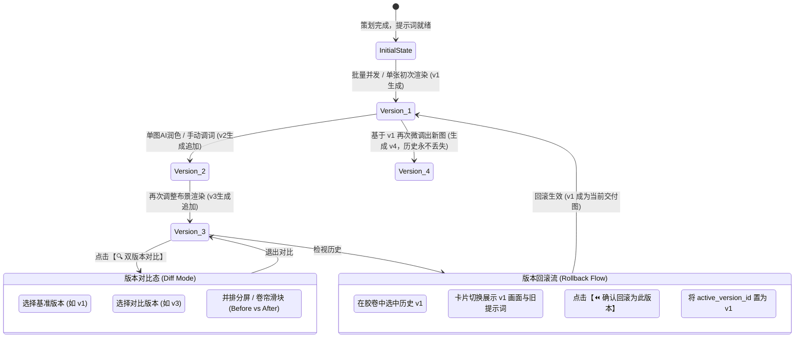
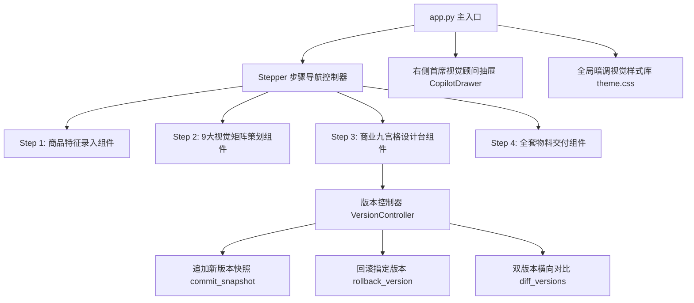

# 电商视觉工坊 (Ecommerce Studio) 产品与体验重构设计方案
## Modern PRD & UI/UX Design Specification (v2.0)

> **定位**：从“参数堆砌的廉价 AI 玩具”蜕变为“专为品牌电商主理人与视觉总监打造的商业级摄影与视觉工坊 (Commercial Photography & Creative Studio)”。  
> **核心关键词**：非破坏性版本链（Non-Destructive Versioning）、后悔药（Rollback）、向导式步进流（Guided Stepper）、去 AI 味（Commercial Studio Lexicon）、Apple/Linear 质感（Modern Clean SaaS）。

---

## 目录
1. [执行摘要与重构背景 (Executive Summary)](#1-执行摘要与重构背景)
2. [诉求一：生成版本链条 (Version Chain) 与回滚/对比体系设计](#2-诉求一生成版本链条-version-chain-与回滚对比体系设计)
   - 2.1 业务模型与痛点剖析
   - 2.2 数据模型升级规范 (Data Schema)
   - 2.3 原子存盘与非破坏性版本策略 (Atomic Snapshot Policy)
   - 2.4 九宫格卡片版本交互规范 (Card-level Versioning UI)
   - 2.5 版本对比与回滚流转状态机 (Rollback & Diff Flow)
3. [诉求二：4步引导式沉浸流 (Guided Workflow Stepper) 与现代 UX 重构](#3-诉求二4步引导式沉浸流-guided-workflow-stepper-与现代-ux-重构)
   - 3.1 线性心智模型与 4 步任务架构
   - 3.2 现代化顶部 Stepper 交互规范
   - 3.3 Step 1: 📦 商品资产与特征录入 (Asset Onboarding & Semantic Ingestion)
   - 3.4 Step 2: 📐 9大视觉矩阵策划与审阅 (Creative Direction & Lens Scripting)
   - 3.5 Step 3: 🎨 商业大片批量出图与九宫格工坊 (Studio Rendering & Perspective Matrix)
   - 3.6 Step 4: 📦 全套物料交付与精修工坊 (Asset Packaging & Handoff)
4. [现代高级审美视觉规范 (Modern Aesthetic Design System)](#4-现代高级审美视觉规范-modern-aesthetic-design-system)
   - 4.1 调色板与设计变量 (Design Tokens)
   - 4.2 卡片层级、圆角与阴影规范 (Depth & Borders)
   - 4.3 状态徽章与微交互 (Pills & Micro-interactions)
5. [去廉价“AI味”：商业摄影工坊语言体系与顾问抽屉](#5-去廉价ai味商业摄影工坊语言体系与顾问抽屉)
   - 5.1 术语重构对照表 (Lexicon Transformation)
   - 5.2 抽屉式“首席视觉顾问 (Creative Copilot Drawer)”交互
6. [落地实施与工程迁移方案 (Implementation & Migration)](#6-落地实施与工程迁移方案-implementation--migration)

---

## 1. 执行摘要与重构背景

### 1.1 现状诊断与体验断崖
在前期原型版本中，系统虽然跑通了“多模态读图 $\rightarrow$ 9大图策划 $\rightarrow$ 批量生图”的基础功能，但在实际商业场景中暴露了严重的体验断崖与心理抗拒：

```
[ 当前痛点全景图 ]
1. 覆盖焦虑 (Destructive Overwrite) ────> 每次微调直接抹去上一版，用户害怕尝试新 Prompt
2. 缺乏后悔药 (No Rollback / Diff)   ────> 微调变丑后无法还原，被迫重新跑全套流程
3. 视觉杂乱与信息轰炸 (Cognitive Overload) ─> 所有阶段堆砌在单个长页面，缺乏阶段性聚焦点
4. 廉价 AI 玩具味 (AI Toy Aesthetic)   ────> 术语黑话堆砌、高饱和度提示框，远离商业电商标准
```

### 1.2 重构核心目标 (North Star Metric)
* **创作安全感（Non-Destructive Safety）**：赋予用户 100% 的“后悔药”自由。任何一次出图与微调均自动进入快照历史，支持一键无缝回滚与横向对比。
* **沉浸式心智（Cognitive Focus）**：通过 4 步向导式步进流（Stepper），让用户在每个阶段只关注当前决策（录入 $\rightarrow$ 审阅 $\rightarrow$ 渲染 $\rightarrow$ 交付），降低 70% 的认知负荷。
* **专业级工坊质感（Studio-Grade Experience）**：以 Apple / Linear / Figma / Midjourney Web 的现代暗调 SaaS 质感，重塑视觉组件与电商摄影术语体系，营造尊贵、高效的商业摄影工坊氛围。

---

## 2. 诉求一：生成版本链条 (Version Chain) 与回滚/对比体系设计

### 2.1 业务模型与痛点剖析
在电商设计实际作业中，视觉设计师通常需要“先出 3 版不同光影，对比选优，再在选定版本上做细节微调”。  
当前系统的致命伤在于：`img_item["image_path"] = new_img_path` 采用了**破坏性覆盖写入**。一旦重新生成，上一版的物理文件虽然孤立存在于磁盘，但在 UI 与 Session 元数据中彻底断连，提示词被重写，旧图彻底丢失。

### 2.2 数据模型升级规范 (Data Schema)
将原先扁平的单个视角对象升级为具备**版本链条（Version Chain）**的非破坏性树状快照模型：

```json
{
  "perspective_id": "02_scene_kitchen",
  "perspective_name": "核心使用场景图",
  "perspective_desc": "极简北欧晨光厨房岛台，微距蒸汽上升特写，传达保温防烫与生活品质",
  "active_version_id": "v3",
  "versions": [
    {
      "version_id": "v1",
      "version_num": 1,
      "image_path": "output/sess_xxx/02_scene_kitchen/v1_1710920000.jpg",
      "prompt_zh": "极简北欧晨光厨房岛台，白色大理石台面，哑光黑色保温杯置于中央，杯口升起细腻温暖的白色水汽...",
      "timestamp": 1710920000,
      "created_at_fmt": "2026-11-20 20:30:15",
      "trigger_type": "batch_initial",
      "change_reason": "全套 9 大图首轮并发渲染出图",
      "aspect_ratio": "1:1",
      "model_params": {
        "provider": "gemini",
        "model": "imagen-3.0-generate-002"
      }
    },
    {
      "version_id": "v2",
      "version_num": 2,
      "image_path": "output/sess_xxx/02_scene_kitchen/v2_1710920300.jpg",
      "prompt_zh": "极简北欧晨光厨房岛台，台面增加一本翻开的商务手账本与新鲜切开的柠檬，光线调为夕阳暖金色...",
      "timestamp": 1710920300,
      "created_at_fmt": "2026-11-20 20:35:00",
      "trigger_type": "ai_refine",
      "change_reason": "AI顾问润色：桌面增加商务手账本与柠檬切片，光线转为夕阳暖光",
      "aspect_ratio": "1:1",
      "model_params": {
        "provider": "gemini",
        "model": "imagen-3.0-generate-002"
      }
    },
    {
      "version_id": "v3",
      "version_num": 3,
      "image_path": "output/sess_xxx/02_scene_kitchen/v3_1710920600.jpg",
      "prompt_zh": "高端商务办公晨间场景，阳光洒在胡桃木书桌上，哑光黑色保温杯杯身倒影清晰，极简奢华感...",
      "timestamp": 1710920600,
      "created_at_fmt": "2026-11-20 20:40:00",
      "trigger_type": "manual_edit",
      "change_reason": "手动修改布景：将厨房场景切换为胡桃木办公桌场景",
      "aspect_ratio": "1:1",
      "model_params": {
        "provider": "gemini",
        "model": "imagen-3.0-generate-002"
      }
    }
  ]
}
```

### 2.3 原子存盘与非破坏性版本策略 (Atomic Snapshot Policy)
1. **严格原子持久化**：
   * 每次渲染出图（无论是初次批量出图、单卡片点击出图、AI 二次微调出图、还是手动修改提示词出图），系统必须计算下一个版本编号（如 `v{len(versions) + 1}`）。
   * 将新图片物理保存到专属视角子路径：`output/{session_id}/{perspective_id}/v{num}_{timestamp}.jpg`。
   * 将【新图片路径】+【当前确切中文提示词】+【高精时间戳】+【修改原因】+【触发类型】组装为一个不可变的快照对象，追加（Append）到 `versions` 数组中。
   * 更新 `active_version_id = new_version_id`，并立即持久化写入 `sessions/{session_id}.json`。
2. **零覆写定律**：
   * 严禁直接改写或删除旧版本的快照。磁盘上的每一张历史渲染图与对应的提示词都具备永久引用地址。

### 2.4 九宫格卡片版本交互规范 (Card-level Versioning UI)
在九宫格的每个卡片中，重构顶部状态与操作条，提供极简、优雅的胶囊化版本控制器：

```
+-------------------------------------------------------------+
| [02. 核心使用场景图]               [● v3 现用] [历史 (3) ▾]  |
+-------------------------------------------------------------+
|                                                             |
|                                                             |
|                    [ 商业渲染大图预览区 ]                   |
|                                                             |
|                                                             |
+-------------------------------------------------------------+
| 历史版本胶卷: [ v1: 初始渲染 ] [ v2: 暖光夕阳 ] [ ● v3: 胡桃木书桌 ] |
+-------------------------------------------------------------+
| [ ⏪ 回滚为此版本 ]   [ 🔍 双版本对比 ]   [ 📥 下载本版原图 ] |
+-------------------------------------------------------------+
| ▾ 🪄 摄影师二次微调 (AI 自然语言重绘 / 镜头语言微调)          |
+-------------------------------------------------------------+
```

#### 关键交互组件：
* **版本状态指示徽章 (Active Version Pill)**：
  * 显示当前正在呈现场景的版本号，如 `v3 (最新)` 或 `v1 (已回滚)`。
* **版本快速切换胶卷 (Version Strip)**：
  * 卡片底部展示紧凑型水平胶囊按钮列表。点击任意历史版本胶囊（如 `v1`），主图预览立即平滑淡入切换为该版本的渲染图，同时下方的提示词预览与生成批注即时联动，无需刷新全页面。
* **一键回滚按钮 (Rollback Action Button)**：
  * 当用户在胶卷中选中某个非活跃历史版本时，操作条高亮展示 `⏪ 将视角回滚为此版本 (Rollback)`。
  * 用户点击后，弹出轻量确认 Toast，系统将 `active_version_id` 指向该版本，并将该版本的提示词同步重置到 Step 2 的矩阵配置中。
* **快照详情浮层 (Snapshot Popover)**：
  * 悬浮于版本胶囊上时，显示悬浮卡片：
    * **生成时间**：2026-11-20 20:35:00 (5分钟前)
    * **操作原因**：AI顾问润色：桌面增加商务手账本与柠檬切片
    * **提示词快照**：展示该版本出图时锁定的完整中文布景指令

### 2.5 版本对比与回滚流转状态机 (Rollback & Diff Flow)



> [!TIP]
> **非破坏性追加原则**：回滚操作并不删除 `v2` 和 `v3`，只是将“聚焦点指针”重新指向 `v1`。若用户基于 `v1` 再次重绘，系统将生成 `v4`。版本树持续增长，彻底打消设计师与运营的“试错焦虑”。

---

## 3. 诉求二：4步引导式沉浸流 (Guided Workflow Stepper) 与现代 UX 重构

### 3.1 线性心智模型与 4 步任务架构
原有的单页面设计将“商品录入、策划报告、9大视角提示词、并发配置、九宫格出图、智能对话”全部平铺在一个滚动条内，导致用户产生严重的视觉疲劳，不知当前处于什么阶段。  
重构方案采用**现代电商 SaaS 黄金标准向导流（4-Step Guided Stepper）**：

| 步骤阶段 | 步骤名称 | 核心用户任务 | 阶段交付物 (Milestone) |
| :--- | :--- | :--- | :--- |
| **Step 1** | **📦 商品资产与特征录入** | 录入商品核心信息、材质痛点，上传 1~5 张实物细节图 | 商品特征理解档案 & 多模态材质特征向量库 |
| **Step 2** | **📐 9大视觉矩阵策划与审阅** | 审阅商业摄影全案，逐视角微调镜头语言与中文布景指令 | 9套高转化商业摄影级中文布景矩阵 |
| **Step 3** | **🎨 商业大片批量出图与九宫格工坊** | 设置画幅比例与并发，批量出图，在 3x3 商业设计台检视、版本回滚、单图微调 | 3x3 商业摄影高清九宫格大片 & 完整版本链 |
| **Step 4** | **📦 全套物料交付与精修工坊** | 一键打包全套商业原图、导出策划案报告、全景物料审查与详情页拼图预览 | ZIP 交付包、Markdown 全案、全视角商用资产大盘 |

### 3.2 现代化顶部 Stepper 交互规范
页面顶部固定展示现代化 Stepper 进度导轨，具有以下特性：
* **清晰的状态反馈**：已完成步骤（`Completed`，带墨绿色/靛蓝圆点或勾号）、当前激活步骤（`Active`，加粗文字与高亮下划线外框）、未解锁/未来步骤（`Upcoming`，低对比度灰色）。
* **直接点击跳转（Random Access Navigation）**：只要前置依赖数据已就绪（如 Step 1 完成策划后），用户可随时自由点击 Step 1 / Step 2 / Step 3 / Step 4 标签在各步骤间来回切换，无需重跑流程。
* **底部固定推进栏（Persistent Footer Action Bar）**：每步底部配备统一的导航控制栏：`← 上一步`、`保存草稿`、`下一步：进入视觉矩阵策划 →`。

```
+----------------------------------------------------------------------------------------------------+
|  [● 1. 商品资产与特征录入] ────> [● 2. 9大视觉矩阵策划] ────> [★ 3. 商业出图工坊] ────> [○ 4. 全套交付]  |
+----------------------------------------------------------------------------------------------------+
```

### 3.3 Step 1: 📦 商品资产与特征录入 (Asset Onboarding & Semantic Ingestion)

#### 界面布局（两栏式工作台）：
* **左栏 (60%)：商品商业档案输入卡片**
  * `商品名称`（单行，自动带出示例或聚焦输入）
  * `材质工艺与工业特征`（多行，如：316L 医用级不锈钢内胆、外层哑光亲肤磨砂黑涂层、LED 触控镜面水温数显盖）
  * `核心目标客群与使用场域`（单行，如：25-38岁都市通勤白领、精品咖啡爱好者、高频差旅人群）
  * `竞品差评与核心抗拒点`（多行，如：传统保温杯密封圈易发霉漏水、杯盖烫嘴、外壳易掉漆划伤）
* **右栏 (40%)：实物参考资产拖拽网格**
  * 支持拖拽上传 1~5 张商品实拍照（白底图、细节微距图、结构拆解图）。
  * 上传后即时显示圆角缩略图卡片，支持悬浮放大预览、设为主特征参考图、单图删除。
  * **多模态特征预解析徽章**：上传图片后，系统后台静默调用 Vision LLM 提取视觉特征，卡片下方自动生成标签（如：`#哑光磨砂质感`、`#金属冷光边缘`、`#圆形触控数显`），直观反馈“AI 已看懂你的产品实物”。
* **底部主操作区**：
  * `🚀 启动商业摄影策划案推演 (生成 9 大视觉方案)`（高亮主按钮，点击后平滑过渡至 Step 2 并自动激活下一步）。

### 3.4 Step 2: 📐 9大视觉矩阵策划与审阅 (Creative Direction & Lens Scripting)

#### 界面布局：
* **顶部折叠看台 (Summary Card)**：
  * 展示《商品商业摄影策划案核心摘要》：包含品牌调性定位、色彩心理学指导、第一杀手级卖点（USP）、场景故事线。支持一键展开/收起。
* **主体区域：9 大商业视角卡片网格 (3x3 Matrix Grid)**：
  每个视角卡片独立承载该视角的商业转化目标与具体镜头布景指导：
  1. `01_white_bg` (电商搜索主图/纯净白底)
  2. `02_scene` (生活方式与核心使用场景)
  3. `03_detail` (微距材质工艺与核心部件)
  4. `04_structure` (黑科技解构与爆炸透视)
  5. `05_pain_killer` (痛点直击与抗拒点攻破)
  6. `06_size` (人体工学与便携比例)
  7. `07_emotional` (品牌情绪与故事氛围)
  8. `08_color` (全系配色陈列)
  9. `09_buyer_show` (真实买家秀与社交种草)
* **卡片内交互细节**：
  * **视角标签与转化心理**（如 `痛点直击图 · 心理暗示：滴水不漏的安全感`）
  * **中文布景与镜头指导文本域 (Lens & Lighting Direction)**：用户可直接就地编辑修改（直接编辑自然语言，支持添加“背景加一束清晨侧逆光”、“台面放几颗带水珠的蓝莓”）。
  * **🪄 灵感润色助手按钮**：一键调用后台专家模型，针对当前文本进行商业摄影级专业润色。
* **底部推进栏**：
  * `← 返回修改商品特征` | `确认策划，前往商业出图工坊 →`

### 3.5 Step 3: 🎨 商业大片批量出图与九宫格工坊 (Studio Rendering & Perspective Matrix)

这是全系统的**视觉聚焦点核心工作台**。从传统的简陋展示卡片升级为**专业商业摄影设计台 (Commercial Studio Canvas)**。

#### 顶部操作中控台 (Studio Control Bar)：
* **画幅比例选择器 (Aspect Ratio)**：胶囊切换钮 `[ 1:1 正方形电商图 ]` `[ 3:4 手机详情大图 ]` `[ 16:9 横幅海报 ]`。
* **渲染并发引擎控制**：并发度滑动条（1~5 线程并发）。
* **一键渲染全套 9 大图按钮**：带进度环与动态耗时预估的 Primary CTA。
* **实时渲染进度条**：并发执行时，顶部平滑展示全局进度条（`⚡ 正在渲染 (4/9): 【04. 黑科技解构】...`），未完成的卡片呈骨架屏（Skeleton Loading）呼吸态，已完成的卡片平滑淡入呈现。

#### 3x3 商业九宫格设计台：
* **主卡片视觉层次**：
  * **卡片头部**：视角序号与专业名称（如 `01 · 纯净白底主图`）、当前版本胶囊（如 `v2 (现用)`）、渲染状态指示（`● 渲染就绪`）。
  * **大图沉浸预览区**：
    * 采用固定宽高比容器，保证九宫格整齐划一；
    * 支持点击图片触发 Lightbox 全屏高清大图查看与像素级放大镜；
  * **卡片底部版本链条胶卷 (Version Strip)**：
    * 展示所有历史生成的版本胶囊；
    * 支持自由点击回看任意历史版本；
    * 检视历史版本时，显示 `⏪ 回滚为此版本` 与 `🔍 与当前版对比`；
  * **卡片底部折叠栏：🪄 二次 AI 场景重绘与修图**：
    * 输入框：“在当前画面基础上，将桌面换成深色大理石，水汽更加浓郁”；
    * 点击 `重绘本视角图` 后，生成新版本并自动追加到版本链末尾，不丢弃现有版本。

### 3.6 Step 4: 📦 全套物料交付与精修工坊 (Asset Packaging & Handoff)

进入最终交付收口阶段，为电商运营与设计师提供一站式导出中枢：
* **全景商业物料看板 (Master Assets Grid)**：
  * 集中展示 9 张当前激活版本的商业大图，支持一键切换“网格视图”或“电商详情页瀑布流长图预览（Long Canvas Stitching）”。
* **交付导出工具组**：
  * `📦 一键打包下载全部商业大图 (ZIP)`：自动以规范化命名前缀导出（`01_纯净白底主图_v1.jpg`, `02_核心场景图_v3.jpg`...）。
  * `📄 导出全案营销策划报告 (Markdown / PDF)`：包含痛点剖析、买家心理、9图排版顺序指导与完整提示词存档。
  * `📋 复制全套镜头语言提示词清单`：一键复制 9 套中英文提示词，便于设计师在本地 ComfyUI / Midjourney 中复用。
* **新方案开辟**：`➕ 保存当前专案并创建新商品工坊`。

---

## 4. 现代高级审美视觉规范 (Modern Aesthetic Design System)

彻底弃用高饱和度亮色、花哨渐变和粗糙默认组件，全面拥抱 **Clean Modern SaaS (Apple / Linear / Midjourney / Figma)** 的高级暗调商业质感。

```
+-------------------------------------------------------------------------------+
|  DESIGN SYSTEM PALETTE                                                        |
|  Canvas Base:       #0A0D12 (深邃玄黑背景，纯净沉浸)                              |
|  Surface Card:      #121721 (精致深青灰卡片，高对比托底)                           |
|  Surface Elevated:  #1A2130 (悬浮与弹窗背景)                                     |
|  Border Subdued:    rgba(255, 255, 255, 0.08) (1px 极细微透边界线)               |
|  Border Focused:    #6366F1 (线性靛蓝高光描边)                                   |
|  Accent Primary:    #4F46E5 -> #6366F1 (极克制的 Indigo 品牌操作色)             |
|  Success Emerald:   #10B981 (墨玉绿状态指示，柔和不刺眼)                          |
|  Text Primary:      #F8FAFC (98% 极高可读性冷白)                                |
|  Text Muted:        #94A3B8 (次要文字与布景注释灰)                                |
+-------------------------------------------------------------------------------+
```

### 4.1 调色板与设计变量 (Design Tokens)
```css
:root {
  /* 背景系统 */
  --studio-bg-canvas: #0a0d12;
  --studio-bg-surface: #121721;
  --studio-bg-card: #161d2b;
  --studio-bg-elevated: #1e283b;

  /* 边框与阴影 */
  --studio-border-subtle: rgba(255, 255, 255, 0.08);
  --studio-border-highlight: rgba(99, 102, 241, 0.4);
  --studio-card-radius: 12px;
  --studio-pill-radius: 9999px;
  --studio-shadow-card: 0 4px 20px -2px rgba(0, 0, 0, 0.5);
  --studio-shadow-hover: 0 8px 30px -4px rgba(0, 0, 0, 0.7);

  /* 主题动作色 */
  --studio-accent-primary: #6366f1;
  --studio-accent-primary-hover: #4f46e5;
  --studio-accent-success: #10b981;
  --studio-accent-warning: #f59e0b;

  /* 文字系统 */
  --studio-text-main: #f8fafc;
  --studio-text-secondary: #94a3b8;
  --studio-text-tertiary: #64748b;
}
```

### 4.2 卡片层级、圆角与阴影规范 (Depth & Borders)
1. **12px 黄金圆角律**：所有的商品卡片、九宫格卡片、文件上传框统一采用 `border-radius: 12px`，严禁使用 4px 生硬直角或过度圆滑的 24px 大圆角。
2. **1px 微透细边框 (Hairline Border)**：卡片使用 `1px solid rgba(255, 255, 255, 0.08)`，在深黑背景下呈现如高端硬件般精致的边缘切割感。
3. **沉浸式微阴影**：卡片在静止态具有柔和的暗部遮蔽；当鼠标悬浮（Hover）时，边框透出淡淡的 Indigo 呼吸高光（`rgba(99, 102, 241, 0.3)`），卡片微抬升 2px。

### 4.3 状态徽章与微交互 (Pills & Micro-interactions)
* **状态胶囊 (Pills)**：
  * `[ ● 渲染就绪 ]`：墨绿半透明底色 `rgba(16, 185, 129, 0.15)`，文字 `#10B981`，带发光小圆点。
  * `[ ⏳ 策划就绪 / 待渲染 ]`：柔和琥珀灰底色，文字 `#E2E8F0`。
  * `[ ⏪ v2 回滚版本 ]`：紫晶半透明底色 `rgba(99, 102, 241, 0.15)`，文字 `#818CF8`。
* **微动效原则**：
  * 按钮点击时具备快速缩放反馈（`scale(0.98)`）；
  * 图片加载过程使用流光骨架屏（Shimmer Skeleton），拒绝生硬白屏与粗糙旋转菊花。

---

## 5. 去廉价“AI味”：商业摄影工坊语言体系与顾问抽屉

### 5.1 术语重构对照表 (Lexicon Transformation)
用户购买的是“商业摄影大片与销售转化方案”，而不是“调试 AI 模型的 Prompt 命令行”。因此，全站文案进行全面去 AI 味清洗，切换为高端电商与商业摄影行话：

| 旧版粗糙“AI味”术语 | 重构后：专业商业摄影与电商工坊术语 | 心理学效应与商业感知 |
| :--- | :--- | :--- |
| 多智能体推演 / Agent思考 | **商业摄影策划方案 (Creative Direction)** | 专业、值得信赖的品牌总监策划案 |
| AI 痛点挖掘 | **消费心理与卖点破局洞察 (Consumer Insight & USP)** | 触达销售转化的商业战略高度 |
| 生图 / 跑模型 | **商业场景渲染出图 (Commercial Studio Rendering)** | 摆脱玩具感，体现商业级出图品质 |
| Prompt / 提示词 | **镜头语言与布景指导 (Lens & Lighting Direction)** | 赋予设计师掌控感，像指挥摄影棚布景一样自然 |
| 二次微调 / Refine Prompt | **摄影布景微调与精修 (Lighting & Scene Refinement)** | 贴近修图师与摄影总监的日常工作语言 |
| 聊天机器人 / 智能客服 | **首席视觉顾问 (Creative Copilot)** | 尊贵的高级顾问定位，随叫随到的专家智囊 |
| 覆盖生图 / 重新生成 | **新增渲染版本 (New Version Snapshot)** | 明确传达“不会丢失历史”的安全感 |
| 回滚 | **⏪ 回退为此版本 (Rollback to Snapshot)** | 明确的后悔药与回退确定性 |

### 5.2 抽屉式“首席视觉顾问 (Creative Copilot Drawer)”交互
* **问题反思**：原界面将大段对话框堆砌在主页下半部分，割裂了九宫格的视觉连续性，宛如一个突兀的网页聊天室。
* **重构设计**：
  * 在屏幕右侧设计常驻的悬浮胶囊按钮：`[ 💬 首席视觉顾问 ]`。
  * 点击后从右侧平滑滑出 420px 宽的毛玻璃遮罩抽屉（Slide-over Drawer）。
  * 视觉顾问自动感知用户当前处于哪一步（例如正在 Step 3 审阅“05_pain_killer 痛点直击图”），并主动提示：
    > *“您正在审阅痛点直击视角。是否需要我将保温杯倒置测试的冷光环境调成具有视觉冲击力的红蓝警示对比色？”*
  * 对话完成后，可一键收起抽屉，主画布始终保持纯净沉浸。

---

## 6. 落地实施与工程迁移方案 (Implementation & Migration)

### 6.1 会话数据兼容迁移适配器 (Migration Adapter)
为了保证老用户的 `sessions/*.json` 历史数据平滑过渡，在 `session_manager.py` 中引入自动迁移管道：

```python
def migrate_session_to_v2(session_data: Dict[str, Any]) -> Dict[str, Any]:
    """
    将 v1 扁平生成的 generated_images 结构平滑升级为 v2 版本链结构
    """
    gen_images = session_data.get("generated_images", [])
    prompts_matrix = session_data.get("prompts_matrix", [])
    
    # 检查是否已经是 v2 结构
    if gen_images and "versions" in gen_images[0]:
        return session_data

    migrated_images = []
    for item in gen_images:
        p_id = item.get("id", "")
        img_path = item.get("image_path")
        prompt = item.get("prompt", "")
        
        versions = []
        if img_path and os.path.exists(img_path):
            versions.append({
                "version_id": "v1",
                "version_num": 1,
                "image_path": img_path,
                "prompt_zh": prompt,
                "timestamp": session_data.get("updated_at", int(time.time())),
                "created_at_fmt": time.strftime("%Y-%m-%d %H:%M:%S", time.localtime(session_data.get("updated_at", time.time()))),
                "trigger_type": "initial_batch",
                "change_reason": "历史首轮渲染成果",
                "aspect_ratio": "1:1",
            })
            active_v = "v1"
        else:
            active_v = None

        migrated_images.append({
            "id": p_id,
            "name": item.get("name", ""),
            "desc": item.get("desc", ""),
            "active_version_id": active_v,
            "versions": versions,
            "status": "success" if versions else "pending",
            "error": item.get("error"),
        })

    session_data["generated_images"] = migrated_images
    session_data["schema_version"] = "2.0"
    return session_data
```

### 6.2 核心模块重构职责分工



### 6.3 验收标准清单 (Definition of Done)
1. **后悔药闭环**：对九宫格任意卡片执行 3 次不同微调，能够无损切换回任意前置版本，且提示词完全一致还原。
2. **步进流聚焦**：4 步向导式 Stepper 状态流转清晰，任何步骤刷新页面均能精准停留在当前步骤。
3. **视觉高级感**：暗调 12px 圆角、细微边框、状态胶囊全面落地，无任何彩虹渐变和生硬报错信息。
4. **专业摄影语言**：全站文案无“生图/多智能体/Prompt”等粗糙术语，全面转变为“商业场景渲染/镜头语言与布景指导”。

---
*本设计规格书作为 Ecommerce Studio 2.0 体验重构的基准指南，可直接交由前端与后端开发工程师进行代码重构实施。*
